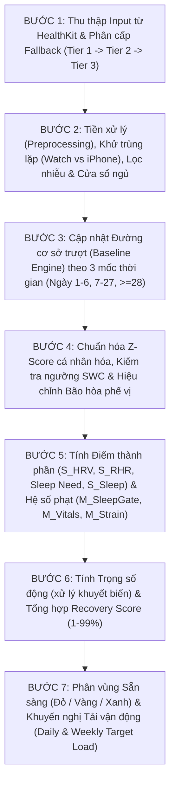

# Quy Trình Từng Bước Tính Toán Chỉ Số Recovery Score Từ Apple Watch (HealthKit) & Nền Tảng Khoa Học (Peer-Reviewed Papers + WHOOP Patents)

Tài liệu này được thiết kế chuyên biệt cho hệ sinh thái **Apple Watch & Apple HealthKit**, đối chiếu trực tiếp từ file [Thống kê chỉ số Apple Heath.xlsx](../Th%E1%BB%91ng%20k%C3%AA%20ch%E1%BB%89%20s%E1%BB%91%20Apple%20Heath.xlsx) kết hợp với hệ thống phương trình toán học từ các công trình bình duyệt công khai trong Mục II.5 (bao gồm tổng quan hệ thống 14 chỉ số sức khỏe thiết bị đeo của [Doherty et al., 2025](Recovery_Score_Papers/R23_Doherty2025_teb-2025-0001.pdf), bộ công trình tải tim mạch [Google Research Cardio Load — Phillips et al., 2025](Recovery_Score_Papers/_full-text-2508.11613v2.pdf) & [Phillips et al., 2026 MSSE #487](Recovery_Score_Papers/_conference-cardio-load-in-exercise-and-everyday-life-a-modified-trimp.pdf)) cùng với các cấu trúc thuật toán đặc thù từ bộ bằng sáng chế **WHOOP (`P01–P06`)**.

Cấu trúc tài liệu gồm **3 Phần lớn**:
- **PHẦN I (BƯỚC 1 $\to$ BƯỚC 7):** Quy trình kỹ thuật tính toán **Recovery Score** từng bước từ mã HealthKit, tiền xử lý, lọc nhiễu xác suất, đường cơ sở trượt, chuẩn hóa Z-Score, công thức thành phần và mục tiêu tải vận động. Tài liệu phân định rõ ràng từng thành phần: đâu là số liệu có chứng cứ từ **bài báo khoa học công khai**, đâu là cấu trúc/phương trình từ **bằng sáng chế WHOOP (`P01–P06`)** *(chưa có nguồn công khai tương đương thay thế)*, và đâu là tham số **`[Heuristic / Engineering Prior — cần tìm thêm nghiên cứu hoặc hiệu chỉnh thực nghiệm]`**.
- **PHẦN II (CƠ SỞ KHOA HỌC, PHƯƠNG PHÁP TÍNH TRỌNG SỐ & LỘ TRÌNH NGHIÊN CỨU BỔ SUNG):** Bảng đối chiếu minh bạch nguồn tham chiếu (Public Papers vs. Patents vs. Heuristics), tổng hợp bằng chứng sinh lý–thống kê ($w_{\text{HRV}} > w_{\text{RHR}} > w_{\text{Sleep}}$), nguyên lý chống phạt kép do đa cộng tuyến (*Multicollinearity & Double-Penalization Avoidance*), **6 phương pháp toán học xác định trọng số** (5 phương pháp trong code minh họa + 1 mô hình lý thuyết đề xuất), **6 hướng phát triển R&D**, và **Danh mục Tài liệu Tham khảo chuẩn APA/IEEE** *(kèm phân loại rõ mức độ khả dụng thực tế của file PDF)*.
- **PHẦN III (MÃ NGUỒN THAM CHIẾU PYTHON & MINH HỌA CƠ CHẾ TRÊN 10 KỊCH BẢN GIẢ LẬP):** Kết quả chạy thử các phương pháp trọng số trên dữ liệu giả lập (chưa hiệu chỉnh lâm sàng) và bảng minh họa 10 kịch bản Apple Watch.

---

# PHẦN I: QUY TRÌNH 7 BƯỚC TÍNH TOÁN RECOVERY SCORE TỪ APPLE WATCH (HEALTHKIT)

## Tổng Quan Luồng Xử Lý Dữ Liệu (Step-by-Step Pipeline)

---

## BƯỚC 1: Liệt Kê Các Biến Đầu Vào (Recovery Inputs), Mã HealthKit, Tính Khả Dụng & Nguồn Thay Thế (Fallback)

Dựa trên [Thống kê chỉ số Apple Heath.xlsx](../Th%E1%BB%91ng%20k%C3%AA%20ch%E1%BB%89%20s%E1%BB%91%20Apple%20Heath.xlsx) (`Sheet1` và `Quy tắc cho server`) và khung phân loại các biến sinh học đóng góp vào chỉ số phục hồi tổng hợp (*Composite Health Scores — CHS*) của **Doherty et al. (2025, Bảng 2, tr. 133)**, dưới đây là danh mục đầy đủ các biến cần thiết để tính **Recovery Score**, được chia thành **4 nhóm chức năng**, kèm theo điều kiện khả dụng và **phương án thay thế (Fallback)** khi thiết bị đời cũ không hỗ trợ, người dùng tắt tính năng hoặc từ chối cấp quyền.

### 1.1. Nhóm 1: Các Biến Cốt Lõi Của Hệ Thần Kinh Tự Chủ & Giấc Ngủ (Core Recovery Inputs)
*(Theo Doherty et al., 2025, tr. 132–133: Đây là nhóm biến xuất hiện phổ biến nhất trong các chỉ số CHS toàn ngành, dẫn đầu bởi $\text{HRV}$ [$86\%$], $\text{RHR}$ [$79\%$], Thời lượng ngủ [$71\%$] và Cấu trúc giấc ngủ [$57\%$]).*

| Biến đầu vào (Ký hiệu) | Tên chỉ số (Dòng trong Excel) | Mã HealthKit (`Identifier`) | Đơn vị chuẩn (Đơn vị gốc Excel) | Có Available trên Apple Watch không? (Điều kiện) | Khi nào bị thiếu / Bẫy dữ liệu (Từ Excel) | Nguồn thay thế / Công thức tính bù (Fallback) khi không có dữ liệu |
| :--- | :--- | :--- | :--- | :--- | :--- | :--- |
| **1. HRV ưu tiên 1: Chuỗi nhịp đập $\text{RR} \to \text{RMSSD}$** ($\text{RMSSD}_{\text{night}}$) | Chuỗi nhịp tim từng nhịp — Beat-to-Beat Measurements *(Dòng 52)* | `HKDataTypeIdentifierHeartbeatSeries` | $\text{ms}$ *(tính từ `timeSinceSeriesStart` đơn vị $\text{s} \times 1000$)* | **Có** (từ iOS 13.0). Tự động ghi khi đeo Watch lúc đo HRV nền hoặc đo ECG. | Bật chế độ tiết kiệm pin (Low Power Mode) trên Watch; không đeo lúc ngủ; user tắt quyền đọc `HeartbeatSeries`. | **Phương án 1B (iOS 27.0+ — thận trọng):** Đọc `HKQuantityTypeIdentifierHeartRateVariabilityRMSSD` *(Dòng 221, đơn vị `ms`; Excel ghi chú: `"Chưa rõ – Apple chưa công bố thiết bị nào ghi"`, `"Thu từ đồng hồ? = Chưa rõ"`)* nếu có mẫu. **Phương án 2 (Fallback chính):** Dùng `HKQuantityTypeIdentifierHeartRateVariabilitySDNN` *(Dòng 41)* ([GR03_OGrady2024](Recovery_Score_Papers/GR03_OGrady2024_Sensors_s24196220.pdf); [R25_Bonneval2025](Recovery_Score_Papers/R25_Bonneval2025_PMC12031371.pdf)). |
| **2. HRV dự phòng: $\text{SDNN}$** ($\text{SDNN}_{\text{night}}$) | HRV (SDNN) — Heart Rate Variability *(Dòng 41)* | `HKQuantityTypeIdentifierHeartRateVariabilitySDNN` | $\text{ms}$ | **Có** (từ iOS 11.0). Tự động ghi khi đeo Watch (WHOOP, Oura cũng ghi vào ô này). | Ban ngày các đời trước Series 12/Ultra 4 đo thưa (2–4 giờ/lần); sai số $\text{SDNN}$ rất lớn so với ECG/dây ngực: $\text{MAPE}=28.88\%$ trên Series 9/Ultra 2 ([GR03_OGrady2024](Recovery_Score_Papers/GR03_OGrady2024_Sensors_s24196220.pdf)) và $\text{MAPE}=31.31\%$ lúc nghỉ trên Series 6 ([R25_Bonneval2025](Recovery_Score_Papers/R25_Bonneval2025_PMC12031371.pdf)). | Nếu cả `HeartbeatSeries`, `RMSSD` và `SDNN` đều rỗng (do user tắt quyền HRV): chuyển sang **Chế độ Khuyết HRV (No-HRV Mode)** ở Bước 6 (tái phân bổ trọng số sang $\text{RHR}$ và $\text{Sleep}$). |
| **3. Nhịp tim ban đêm** ($\text{RHR}_{\text{night}}$) | Nhịp tim — Heart Rate *(Dòng 39)* | `HKQuantityTypeIdentifierHeartRate` | $\text{bpm}$ = `count/min` *(Excel ghi `count/s` $\to$ nhân $60$)* | **Có** (từ iOS 8.0). Tự động ghi khi đeo Watch ($1\text{–}5\text{ phút/lần}$ khi nghỉ, $1\text{–}5\text{ s/lần}$ khi tập). | Bật Low Power Mode trên Watch (ngừng tự đo kể cả khi ngủ); dữ liệu buổi tập cũ quá vài tháng bị Apple gộp lại. | **Fallback:** Nếu không có mẫu `HeartRate` trong lúc ngủ, đọc chỉ số `HKQuantityTypeIdentifierRestingHeartRate` *(Dòng 43)* ([R23_Doherty2025](Recovery_Score_Papers/R23_Doherty2025_teb-2025-0001.pdf), Bảng 3, tr. 135). |
| **4. Nhịp tim nghỉ tổng hợp của Apple** ($\text{RHR}_{\text{Apple}}$) | Nhịp tim nghỉ — Resting Heart Rate *(Dòng 43)* | `HKQuantityTypeIdentifierRestingHeartRate` | $\text{bpm}$ (`count/min`) | **Có** (từ iOS 11.0). Tự động ghi mỗi ngày 1 giá trị tổng hợp khi đeo Watch. | **Bẫy dữ liệu (Dòng 43 & Quy tắc Dòng 9):** Apple tự xóa số của hôm nay/hôm qua và thay bằng số mới chính xác hơn; có lẫn nhịp tim lúc ngồi yên ban ngày ([R23_Doherty2025](Recovery_Score_Papers/R23_Doherty2025_teb-2025-0001.pdf), Bảng 3). | Chỉ dùng làm **Fallback Tier 2** khi không tính được $\text{RHR}_{\text{night}}$ từ `HeartRate` trong cửa sổ ngủ. Nếu có `HeartbeatSeries` ban đêm thì tính $\text{RHR} = \frac{60000}{\overline{\text{RR}}}$. |
| **5. Giấc ngủ & Giai đoạn ngủ** ($\text{TST}, \text{TIB}, \text{SWS}, \text{REM}$) | Giấc ngủ + giai đoạn — Sleep *(Dòng 54)* | `HKCategoryTypeIdentifierSleepAnalysis` | Thời gian ($\text{phút}$ / $\text{giờ}$) + Enum giai đoạn (`asleepDeep`, `asleepREM`, `asleepCore`, `awake`, `inBed`) | **Có** (từ iOS 8.0; chia giai đoạn ngủ từ watchOS 9 / iOS 16.0). Cần bật theo dõi ngủ + chế độ **Sleep Focus**. | Nếu quên bật Sleep Focus hoặc dùng Watch đời cũ, chỉ có `inBed` / `asleepUnspecified` mà không có `Deep`/`REM`. Nhiều app cùng ghi gây chồng lấn thời gian. | **Fallback 1 (Có `inBed`/`asleepUnspecified`, thiếu Stages):** Tính $S_{\text{Sleep}}$ từ thời lượng ngủ + độ đều đặn giờ ngủ. **Fallback 2 (Không có bản ghi SleepAnalysis nhưng có đeo Watch ban đêm):** Ước tính cửa sổ ngủ từ `HeartRate` + `StepCount = 0` + `PhysicalEffort <= 1.05` `[Heuristic]` (xem Bước 2.2). |

---

### 1.2. Nhóm 2: Các Biến Dấu Hiệu Sinh Tồn Phụ / Cảnh Báo Ốm (Vitals & Illness Penalty Inputs)
*(Theo [Doherty et al., 2025](Recovery_Score_Papers/R23_Doherty2025_teb-2025-0001.pdf), Bảng 2 & Bảng 4, tr. 133, 137: Nhiệt độ da [$29\%$], Nhịp thở [$14\%$] và $\text{SpO}_2$ [$7\%$] được tích hợp làm chỉ báo nhạy cảm với bệnh lý/nhiễm trùng cấp tính).*

| Biến đầu vào (Ký hiệu) | Tên chỉ số (Dòng trong Excel) | Mã HealthKit (`Identifier`) | Đơn vị chuẩn (Đơn vị gốc Excel) | Có Available trên Apple Watch không? (Điều kiện) | Khi nào bị thiếu / Bẫy dữ liệu (Từ Excel) | Nguồn thay thế / Công thức tính bù (Fallback) khi không có dữ liệu |
| :--- | :--- | :--- | :--- | :--- | :--- | :--- |
| **6. Nhịp thở khi ngủ** ($\text{RespR}_{\text{night}}$) | Nhịp thở — Respiratory Rate *(Dòng 61)* | `HKQuantityTypeIdentifierRespiratoryRate` | $\text{breaths/min}$ (`count/min`) *(Excel ghi `count/s` $\to$ nhân $60$)* | **Có** (từ iOS 8.0). Tự động ghi khi đeo Watch lúc ngủ. | Thiếu khi không đeo Watch đi ngủ hoặc không bật Sleep Tracking. | **Fallback:** Đặt độ lệch phạt $E_{\text{RespR}}(t) = 0$ (vô hiệu hóa nhánh phạt nhịp thở trong $M_{\text{Vitals}}$, không báo lỗi). |
| **7. Nhiệt độ cổ tay khi ngủ** ($T_{\text{wrist}}$) | Nhiệt độ cổ tay khi ngủ — Wrist Temperature *(Dòng 63)* | `HKQuantityTypeIdentifierAppleSleepingWristTemperature` | $^\circ\text{C}$ (`degC`) | **Có giới hạn phần cứng** (từ iOS 16.0): Chỉ có trên **Watch Series 8+ / Ultra 1+**. **Không có trên Watch SE, Series 3–7**. | Cần bật **Sleep Focus** và đeo tối thiểu $\ge 4\text{ giờ/đêm}$. *(Lưu ý Dòng 63: App Health đợi 5 đêm mới hiện, nhưng app của mình đọc được ngay từ đêm 1)*. | **Fallback 1:** Đọc `HKQuantityTypeIdentifierBodyTemperature` *(Dòng 73, Watch=Không)* hoặc `BasalBodyTemperature` *(Dòng 143, Watch=Không; **Rủi ro pháp lý Excel: Rất cao — dữ liệu chu kỳ/sinh sản MHMDA & GDPR**, phải xin đồng ý riêng)* nếu có. **Fallback 2 (Watch SE / Series $\le 7$):** Đặt $E_{\text{Temp}}(t) = 0$ (theo [R05_Mason2022](Recovery_Score_Papers/R05_Mason2022_PMC8891385.pdf), mô hình vẫn đạt $\text{AUC}=0.770$ khi bỏ nhiệt độ so với $0.819$ khi có đủ cảm biến). |
| **8. Độ bão hòa Oxy máu** ($\text{SpO}_2$) | SpO2 — Blood Oxygen *(Dòng 59)* | `HKQuantityTypeIdentifierOxygenSaturation` | $\%$ ($0\text{–}100\%$) | **Có giới hạn phần cứng & quốc gia** (iOS 8.0): **Không có trên Watch SE**. Tại Việt Nam có đủ; tại Mỹ các máy Series 9/Ultra 2+ mã `LW/A` bị khóa đo trên Watch. | Bị tắt ở 18 vùng lãnh thổ (tab `Nước không có`); tắt khi bật Low Power Mode; vị trí đeo lỏng làm giảm giả tạo. | **Fallback 1:** Đọc thêm `HKQuantityTypeIdentifierAppleSleepingBreathingDisturbances` *(Dòng 55, đơn vị **`count`**, từ iOS 18.0+, Series 9+/Ultra 2+; **Rủi ro pháp lý Excel: Cao — Kết quả có tính chẩn đoán của Apple (thiết bị y tế đã được cấp phép), Rally chỉ được hiện lại đúng kết quả Apple, tự diễn giải/cảnh báo bệnh = SaMD**)* nếu có. **Fallback 2:** Đặt $E_{\text{SpO2}}(t) = 0$. |

---

### 1.3. Nhóm 3: Các Biến Vận Động & Tải Tập Luyện (Strain & Activity Inputs — Đầu vào cho `Sleep Need` & `Fatigue`)

| Biến đầu vào (Ký hiệu) | Tên chỉ số (Dòng trong Excel) | Mã HealthKit (`Identifier`) | Đơn vị chuẩn | Có Available trên Apple Watch không? (Điều kiện) | Khi nào bị thiếu / Bẫy dữ liệu (Từ Excel) | Nguồn thay thế / Công thức tính bù (Fallback) khi không có dữ liệu |
| :--- | :--- | :--- | :--- | :--- | :--- | :--- |
| **9. Bước chân** ($\text{Steps}$) | Số bước — Steps *(Dòng 30)* | `HKQuantityTypeIdentifierStepCount` | `count` | **Có** (từ iOS 8.0). Tự động ghi trên cả Watch và iPhone. | **Bẫy dữ liệu (Dòng 30):** iPhone + Watch cùng ghi $\to$ cộng thẳng bị gấp đôi. Người dùng xe lăn không có bước chân. | Dùng để lọc trạng thái nghỉ ($\text{Steps} = 0$ trong cửa sổ ngủ/nghỉ) và làm cổng kiểm tra chuyển động (*low-motion gating* theo [Phillips et al., 2025](Recovery_Score_Papers/_full-text-2508.11613v2.pdf), [2026](Recovery_Score_Papers/_conference-cardio-load-in-exercise-and-everyday-life-a-modified-trimp.pdf)). Nếu user dùng xe lăn (`HKCharacteristicTypeIdentifierWheelchairUse` Dòng 210, **Rủi ro pháp lý Excel: Cao**), thay bằng `HKQuantityTypeIdentifierPushCount` *(Dòng 26)*. |
| **10. Mức gắng sức chuyển hóa** ($\text{MET}_k$) | Mức gắng sức (MET) — Physical Effort *(Dòng 25)* | `HKQuantityTypeIdentifierPhysicalEffort` | $\text{kcal/(kg}\cdot\text{hr)}$ ($\text{METs}$) | **Có** (từ iOS 17.0, cần iPhone XS/XR trở lên). Tự động ghi khi đeo Watch. | Không có trên iPhone 8, 8 Plus, X (dừng ở iOS 16 — `Quy tắc cho server` Dòng 5). | **Công thức tính thay thế trên iOS 16:** Tính từ `ActiveEnergyBurned` *(Dòng 2)* và `BasalEnergyBurned` *(Dòng 6)* hoặc `BodyMass` *(Dòng 65)*: $\text{MET}_k = 1.0 + \frac{\text{ActiveCal}_k}{\text{Weight}_{\text{kg}} \times (\Delta t_k / 60)}$. |
| **11. Buổi tập & Điểm gắng sức** ($\text{Workouts}$, $\text{Effort}$) | Buổi tập *(Dòng 35)*, Điểm gắng sức tự chấm *(Dòng 33)* & Watch ước tính *(Dòng 21)* | `HKWorkoutTypeIdentifier`, `HKQuantityTypeIdentifierWorkoutEffortScore`, `EstimatedWorkoutEffortScore` | Thời lượng ($\text{min}$), Calo ($\text{kcal}$), Điểm `appleEffortScore` ($1\text{–}10$) | `Workouts` có từ iOS 8.0. Hai chỉ số `EffortScore` có từ **iOS 18.0** khi bật buổi tập. | Khi user tập nhưng không bấm bật Workout, hoặc bật chế độ 'ít đọc GPS và nhịp tim' khi tập *(Dòng 39)*. | **Ưu tiên 1:** Tính **Day Strain** từ chuỗi `HeartRate` liên tục 24h kết hợp cả buổi tập (*workout load*) và vận động thường ngày (*incidental load*). Theo [Phillips et al. (2025, Hình 3, tr. 4)](Recovery_Score_Papers/_full-text-2508.11613v2.pdf) minh họa phân rã tải trong ngày, và kết quả thực nghiệm [Phillips et al. (2026, MSSE #487)](Recovery_Score_Papers/_conference-cardio-load-in-exercise-and-everyday-life-a-modified-trimp.pdf) trên **$40,000$ người dùng Google Pixel Watch (6 tuần, $37.9\%$ nữ)**, các buổi tập có cấu trúc chiếm tỷ trọng trung bình $49.0\%$ (nam) và $41.0\%$ (nữ) tổng tải tim mạch cả ngày; phần còn lại đến từ vận động thường ngày. **Fallback khi thiếu HR lúc tập:** Dùng $\text{EffortScore} \times \text{Duration}$ (Foster et al., 2001) hoặc `AppleExerciseTime` *(Dòng 3)* + `ActiveEnergyBurned` *(Dòng 2)*. |
| **11b. Căng thẳng Tâm lý & Thiền / Chánh niệm** ($\text{PsychStrain}$) | Buổi thiền / chánh niệm *(Dòng 199)* & Tâm trạng *(Dòng 202 — iOS 18.0)* | `HKCategoryTypeIdentifierMindfulSession`, `HKDataTypeIdentifierStateOfMind` *(API `HKStateOfMind`)* | Thời lượng ($\text{min}$), Valence ($[-1, 1]$) | `MindfulSession` có từ iOS 10.0; `StateOfMind` có từ iOS 18.0 / watchOS 11 (**Rủi ro pháp lý Dòng 202: Rất cao — FTC BetterHelp / GDPR Điều 9**, cần đồng ý riêng, không chẩn đoán trầm cảm/lo âu). | Chỉ có dữ liệu khi user chủ động thực hiện phiên Breathe/Reflect hoặc tự ghi cảm xúc. | **Tự động phát hiện Stress Giao cảm ban ngày (Non-Metabolic HR Elevation):** Theo [Phillips et al. (2025, Mục 1.2, tr. 2)](Recovery_Score_Papers/_full-text-2508.11613v2.pdf), [2026](Recovery_Score_Papers/_conference-cardio-load-in-exercise-and-everyday-life-a-modified-trimp.pdf), Bằng sáng chế WHOOP [P02 (Cột 28)](Recovery_Score_Papers/P02_WHOOP_US9750415B2.pdf), Chida & Steptoe (2010), [Doherty et al. (2025, Bảng 4, tr. 137)](Recovery_Score_Papers/R23_Doherty2025_teb-2025-0001.pdf) và [Altini & Plews (2021)](Recovery_Score_Papers/R17_AltiniPlews2021_PMC8659706.pdf), khi $\text{HR}$ ban ngày tăng cao (ví dụ ngưỡng lọc kỹ thuật $> \mu_{\text{RHR}} + 15\text{ bpm}$ `[Heuristic]`) nhưng cảm biến quán tính không ghi nhận chuyển động ($\text{Steps} = 0$, $\text{MET} < 1.3$), cần tách nhịp tim stress tâm lý khỏi tải tập luyện cơ học và ghi nhận vào stress giao cảm. |

---

### 1.4. Nhóm 4: Các Biến Hồ Sơ Cá Nhân & Ngữ Cảnh Sinh Lý (Profile & Context Priors)

| Biến đầu vào (Ký hiệu) | Tên chỉ số (Dòng trong Excel) | Mã HealthKit (`Identifier`) | Đơn vị chuẩn | Mục đích trong công thức Recovery Score | Nguồn thay thế (Fallback) khi user không nhập hoặc từ chối quyền |
| :--- | :--- | :--- | :--- | :--- | :--- |
| **12. Ngày sinh $\to$ Tuổi** ($\text{Age}$) | Ngày sinh — Date of Birth *(Dòng 208)* | `HKCharacteristicTypeIdentifierDateOfBirth` | Năm tuổi ($\text{years}$) | Tính tiên nghiệm Cold-Start $\mu_{\text{prior}}(\text{LnRMSSD})$, $\text{Baseline}_{\text{sleep}}$ và ước tính $\text{HR}_{\max} = 208 - 0.7 \times \text{Age}$ (Tanaka et al., 2001). Theo [Phillips et al. (2026, MSSE #487)](Recovery_Score_Papers/_conference-cardio-load-in-exercise-and-everyday-life-a-modified-trimp.pdf), chuẩn hóa tải theo $\% \text{HRR}$ phụ thuộc tuổi giúp điểm tải tim mạch ổn định công bằng từ $30\text{–}75\text{ tuổi}$ ($\text{CV}\% < 4.5\%$). *(Chặn/xử lý COPPA nếu $<13$ tuổi theo Dòng 208)*. | Hỏi trong màn Onboarding của App; nếu không có, mặc định $\text{Age} = 30$. |
| **13. Giới tính sinh học** ($\text{Sex}$) | Giới tính sinh học — Sex *(Dòng 206)* | `HKCharacteristicTypeIdentifierBiologicalSex` | Enum (`male`, `female`, `other`) | Chọn tiên nghiệm $\text{RHR}_{\text{prior}}$ và hệ số mũ trọng số giới tính trong hàm TRIMP ($k=1.92$ cho nam, $k=1.67$ cho nữ theo [Morton et al., 1990](Recovery_Score_Papers/morton1990.pdf); [Phillips et al., 2025, Phương trình 1, tr. 2](Recovery_Score_Papers/_full-text-2508.11613v2.pdf); Rascon et al., 2020). | Nếu `notSet` hoặc `other`, dùng trung bình cộng hệ số nam & nữ ($k = 1.80$, $\mu_{\text{prior}}(\text{RHR}) = 64\text{ bpm}$ `[Heuristic]`). |
| **14. Thể lực tim mạch** ($\text{VO}_{2\max}$) | VO2max — Cardio Fitness *(Dòng 44)* | `HKQuantityTypeIdentifierVO2Max` | $\text{mL/(kg}\cdot\text{min)}$ | Tinh chỉnh tiên nghiệm $\text{RHR}_{\text{prior}}, \text{HRV}_{\text{prior}}$ và nhận diện vận động viên có bão hòa phế vị ([Plews et al., 2013](Recovery_Score_Papers/plews2013.pdf)). | *(Dòng 44: Người chỉ tập trong nhà sẽ không bao giờ có $\text{VO}_{2\max}$)*. Fallback: Ước tính mức độ thể lực từ phân vị $\text{RHR}_{\text{night}}$ sau 7 đêm đầu tiên. |

---

## BƯỚC 2: Quy Trình Tiền Xử Lý (Preprocessing), Chống Bẫy Dữ Liệu HealthKit & Tổng Hợp Theo Cửa Sổ Thời Gian Cho Từng Biến

### 2.1. Quy tắc Đồng bộ Hệ thống & Chống Bẫy Dữ liệu Chung (Từ Tab `Quy tắc cho server`)

1. **Thời điểm chốt dữ liệu (Sync & Lock Gate):**
   - Vì kho HealthKit bị mã hóa khi iPhone khóa màn hình (`Quy tắc cho server` Dòng 6) và dữ liệu từ Apple Watch sang iPhone có độ trễ (`Quy tắc cho server` Dòng 8), App chỉ thực hiện chốt **Recovery Score của ngày $t$** khi thỏa mãn đồng thời:
     - Người dùng đã mở khóa iPhone buổi sáng (`UIApplication.protectedDataDidBecomeAvailableNotification`).
     - Đã nhận được bản ghi kết thúc giấc ngủ chính của đêm $t$ (hoặc sau khi phát hiện người dùng đã đi lại $> 100\text{ bước}$ liên tục sau 05:00 sáng và đã đồng bộ mẫu `HeartRate` mới nhất từ Watch trong vòng $15\text{ phút}$ qua).
2. **Xử lý mẫu bị Apple xóa và ghi đè (`HKAnchoredObjectQuery` — `Quy tắc cho server` Dòng 9):**
   - Mọi bảng lưu trữ mẫu thô từ HealthKit trên Client/Server phải lưu khóa chính là `sample.uuid`.
   - Mỗi lần đọc bằng `HKAnchoredObjectQuery`, phải duyệt mảng `deletedObjects` trước để xóa các mẫu `RestingHeartRate`, `WalkingHeartRateAverage`, hoặc `Workouts` cũ đã bị Apple xóa/gộp, sau đó mới thêm `addedSamples` và tính lại nếu thuộc ngày hôm nay hoặc hôm qua.
3. **Khử trùng lặp Nguồn ghi (Source Deduplication — Chống gấp đôi dữ liệu ở Dòng 2, 19, 30, 54):**
   - Với các biến cộng dồn (`StepCount`, `ActiveEnergyBurned`, `BasalEnergyBurned`, `DistanceWalkingRunning`): **Tuyệt đối không** dùng `HKSampleQuery` rồi tự cộng tổng (`sum`). Bắt buộc dùng `HKStatisticsCollectionQuery` với tùy chọn `.cumulativeSum` để HealthKit tự động khử trùng lặp giữa Apple Watch và iPhone.
   - Với các biến mẫu rời rạc (`HeartRate`, `SleepAnalysis`, `HeartRateVariabilitySDNN`): Nếu trong cùng một khoảng thời gian $[t_1, t_2]$ có nhiều thiết bị cùng ghi, lọc theo thứ tự ưu tiên `sourceRevision`:
     $$\text{Priority 1: Apple Watch của chính user } (\texttt{productType.hasPrefix("Watch")}) \succ \text{Priority 2: Nhẫn/Vòng đeo chuyên dụng (WHOOP, Oura, Garmin)} \succ \text{Priority 3: iPhone}$$

---

### 2.2. Tiền xử lý Biến 1: Giấc ngủ (`HKCategoryTypeIdentifierSleepAnalysis`) & Xác định Khung giờ Ngủ Chính (Main Sleep Window)

1. **Bước 2.2.1 — Gom cụm Chu kỳ Ngủ Chính (Session Clustering):**
   - Lấy tất cả các đoạn mẫu `SleepAnalysis` có thời gian giao với khung từ **18:00 ngày $t-1$ đến 12:00 trưa ngày $t$**.
   - Loại bỏ các đoạn trùng lặp từ nguồn độ ưu tiên thấp hơn (ví dụ bỏ đoạn `inBed` do lịch báo thức iPhone tự tạo nếu đã có các đoạn `asleepCore`/`asleepDeep`/`asleepREM` từ Apple Watch).
   - Nếu khoảng cách giữa hai đoạn ngủ liên tiếp $\le 60\text{ phút}$ `[Engineering Heuristic]`, gộp chúng vào cùng một phiên ngủ (Sleep Session).
   - Phiên ngủ có tổng thời lượng dài nhất trong đêm (với điều kiện $\ge 180\text{ phút}$ tức $3\text{ giờ}$ theo tiêu chuẩn cửa sổ ngủ tối thiểu của [Doherty et al., 2025, Bảng 3, tr. 135](Recovery_Score_Papers/R23_Doherty2025_teb-2025-0001.pdf)) được định nghĩa là **Giấc ngủ chính (Main Nocturnal Sleep)** $[t_{\text{onset}},\, t_{\text{wake}}]$. Các phiên ngủ ngắn hơn ($\ge 15\text{ phút}$ và $< 180\text{ phút}$) diễn ra trong ngày được tính vào **Giấc ngủ ngắn ban ngày ($\text{Naps}$)**.

2. **Bước 2.2.2 — Tính các chỉ số thời lượng và cấu trúc giấc ngủ (Chia 3 Trường hợp):**
   - **Trường hợp A (Đầy đủ Giai đoạn Ngủ — watchOS 9+ / iOS 16+ có bật Sleep Focus):**
     - Thời gian nằm trên giường ($\text{TIB}$): $\text{TIB} = \sum \Delta t(\text{inBed} \cup \text{awake} \cup \text{asleepCore} \cup \text{asleepDeep} \cup \text{asleepREM})$ (giờ).
     - Thời gian ngủ thực tế ($\text{TST}$ / $\text{Actual Sleep}$):
       $$\text{TST}(t) = \Delta t(\text{asleepCore}) + \Delta t(\text{asleepDeep}) + \Delta t(\text{asleepREM}) \quad (\text{giờ})$$
     - Hiệu suất giấc ngủ ($\text{SE}$): $\text{SE}(t) = \frac{\text{TST}(t)}{\max(\text{TIB}(t),\, \text{TST}(t))} \times 100\%$.
     - Tỷ lệ ngủ phục hồi ($\text{Restorative}\%$ — gồm giấc ngủ sâu NREM3 và REM theo **Doherty et al., 2025, Bảng 2 & Bảng 4, tr. 133, 136**):
       $$\text{Restorative}\%(t) = \frac{\Delta t(\text{asleepDeep}) + \Delta t(\text{asleepREM})}{\text{TST}(t)} \times 100\%$$
     - **Chỉ số Phân mảnh Giấc ngủ & Số lần Thức giấc ($N_{\text{awake}}$, $\text{WASO}$ — Theo tiêu chuẩn đồng thuận của National Sleep Foundation trong [Ohayon et al., 2017](Recovery_Score_Papers/_Ohayon-et-al.2017_National-Sleep-Foundations-Sleep-Quality-Recommendations.pdf); [S16_Miller2022](Recovery_Score_Papers/S16_Miller2022_PMC9412437.pdf); và [Doherty et al., 2025, Bảng 4, tr. 136](Recovery_Score_Papers/R23_Doherty2025_teb-2025-0001.pdf)):**
       - Theo đồng thuận chuyên gia Delphi trên $277$ nghiên cứu của [Ohayon et al. (2017, *Sleep Health*, tr. 10–14)](Recovery_Score_Papers/_Ohayon-et-al.2017_National-Sleep-Foundations-Sleep-Quality-Recommendations.pdf), khái niệm *cơn thức giấc rõ rệt (awakening)* được định nghĩa là **đoạn thức kéo dài $\ge 5\text{ phút}$**:
         - **Ngưỡng tốt (Appropriate):** Hiệu suất ngủ $\text{SE} \ge 85\%$ (mọi lứa tuổi); số lần thức giấc ($\ge 5\text{ phút}$) $0\text{–}1\text{ lần/đêm}$ (người trưởng thành $18\text{–}64\text{ tuổi}$); tổng thời gian thức sau khi vào giấc $\text{WASO} \le 20\text{ phút}$; thời gian chờ ngủ $\le 30\text{ phút}$.
         - **Ngưỡng kém (Not Appropriate):** $\text{SE} \le 74\%$ ở người lớn $26\text{–}64\text{ tuổi}$ (hoặc $\le 64\%$ ở thanh niên $18\text{–}25\text{ tuổi}$); **$\ge 4$ lần thức giấc ($\ge 5\text{ phút}$)** ở mọi nhóm tuổi; **$\text{WASO} \ge 41\text{ phút}$** ($18\text{–}64\text{ tuổi}$, hoặc $\ge 51\text{ phút}$ trên toàn dải tuổi); thời gian chờ ngủ $> 45\text{ phút}$; và giấc ngủ ngắn ban ngày $> 100\text{ phút}$.
       - Trên `HKCategoryTypeIdentifierSleepAnalysis` của Apple Watch: tính tổng $\text{WASO}(t) = \sum \Delta t(\text{awake})$ (phút) và đếm số đoạn `HKCategoryValueSleepAnalysisAwake` nằm trong $[t_{\text{onset}},\, t_{\text{wake}}]$. *(Lưu ý hiệu chuẩn cảm biến đeo tay: chuẩn NSF tính đoạn thức $\ge 5\text{ phút}$; khi đọc dữ liệu HealthKit chia đoạn thô từng $30\text{ s–}1\text{ phút}$ từ Apple Watch, cấu hình bộ lọc $\ge 2\text{ phút}$ làm ngưỡng nhạy kỹ thuật `[Engineering Heuristic]` hoặc lọc chặt $\ge 5\text{ phút}$ theo đúng định nghĩa Ohayon 2017 tùy thiết lập triển khai).*
   - **Trường hợp B (Chỉ có Thời lượng ngủ, không có Giai đoạn — Watch đời cũ hoặc chỉ có `asleepUnspecified` / `inBed`):**
     - $\text{TST}(t) = \Delta t(\text{asleepUnspecified})$ (nếu chỉ có `inBed`, ước tính $\text{TST}(t) \approx 0.90 \times \Delta t(\text{inBed})$ `[Engineering Heuristic]`).
     - Đánh dấu cờ `has_sleep_stages = False`.
   - **Trường hợp C (Quên bật Sleep Focus / Không có bản ghi `SleepAnalysis` nhưng vẫn đeo Watch đi ngủ):** `[Engineering Heuristic Fallback]`
     - Quét khung giờ $21:00\text{ (ngày } t-1\text{)} \to 10:00\text{ (ngày } t\text{)}$ theo từng khối $5\text{ phút}$: một khối được coi là đang ngủ nếu đồng thời thỏa mãn:
       1. $\text{StepCount}_k = 0$.
       2. $0.5 \le \text{MET}_k \le 1.05$ *(trong đó chặn dưới $\text{MET} < 0.5$ để loại trạng thái không đeo máy theo [R05_Mason2022](Recovery_Score_Papers/R05_Mason2022_PMC8891385.pdf), còn trần $1.05\text{ METs}$ là `[Engineering Heuristic]` cho trạng thái nằm yên)*.
       3. $\text{HR}_k \le \text{Percentile}_{30}(\text{HR}_{24\text{h}})$ `[Engineering Heuristic]`.
     - Chuỗi liên tục dài nhất ($\ge 3\text{ giờ}$, cho phép ngắt quãng tối đa $15\text{ phút}$ `[Engineering Heuristic]`) tạo thành cửa sổ ngủ ước tính $[\hat{t}_{\text{onset}},\, \hat{t}_{\text{wake}}]$.

---

### 2.3. Tiền xử lý Biến 2: HRV (`HeartbeatSeries`, `RMSSD`, `SDNN`) Theo Cửa Sổ Ngủ

Theo [Doherty et al. (2025, tr. 139)](Recovery_Score_Papers/R23_Doherty2025_teb-2025-0001.pdf), mối liên hệ sinh lý giữa $\text{HRV}$ và hoạt động thần kinh phó giao cảm chỉ hợp lệ khi cơ thể ở trạng thái nghỉ tĩnh (trong giấc ngủ); các hoạt động ban ngày như nuốt nước bọt (**Yildiz & Doma, 2018**), nói chuyện, ho hoặc uống nước (**Kotani et al., 2007**) đều tạo ra nhiễu giả phá vỡ mối quan hệ này. Do đó, việc trích xuất $\text{HRV}$ bắt buộc khóa chặt trong cửa sổ ngủ $[t_{\text{onset}},\, t_{\text{wake}}]$ theo thứ tự ưu tiên phân cấp (**Tier 1A $\to$ Tier 1B $\to$ Tier 2**):

#### Trường hợp 1A (Ưu tiên cao nhất — Chuẩn $\text{rMSSD}$ theo [Doherty et al., 2025, Bảng 3, tr. 135](Recovery_Score_Papers/R23_Doherty2025_teb-2025-0001.pdf)): Có mẫu `HKDataTypeIdentifierHeartbeatSeries` trong khoảng $[t_{\text{onset}},\, t_{\text{wake}}]$
Sử dụng `HKHeartbeatSeriesQuery` để trích xuất chuỗi các tuple $\left(t_j,\, \text{precededByGap}_j\right)$ cho từng bản ghi Tachogram thứ $k$ trong đêm:
1. **Tính khoảng cách nhịp $\text{RR}_j$ ($\text{ms}$):**
   Với mọi $j \in \{1, \dots, N_k - 1\}$ mà $\text{precededByGap}_{j+1} = \text{False}$:
   $$\text{RR}_j = \left(t_{j+1} - t_j\right) \times 1000 \quad (\text{ms})$$
   *(Nếu $\text{precededByGap}_{j+1} = \text{True}$ hoặc $t_{j+1} - t_j > 2.0\text{ s}$, đánh dấu đây là điểm ngắt quãng và **không tính hiệu số bắc cầu qua Gap**, dựa trên phương pháp loại bỏ và nối chuỗi RR của Apple Watch trong [R24_Hernando2018](Recovery_Score_Papers/R24_Hernando2018_PMC6111985.pdf), bài báo ghi nhận Apple Watch có khoảng $10\%$ nhịp thiếu với các gap $3.3\text{–}10.4\text{ s}$ [trung bình $\sim 6\text{ s}$]).*
2. **Lọc nhịp ngoại lai & Bộ lọc Độ Tin Cậy Xác Suất Bayes (Artifact Filtering & Bayesian Beat Confidence Gate):**
   - **Bộ lọc miền thời gian** *(dựa trên khoảng sinh lý $30\text{–}200\text{ bpm}$ và bộ lọc trung vị trượt loại ngoại tâm thu của [Kiviniemi et al., 2007](Recovery_Score_Papers/kiviniemi2007.pdf) & [R02_Mishra2020](Recovery_Score_Papers/R02_Mishra2020_PMC9020268.pdf); ngưỡng số $12\text{ bpm}$ / $0.20$ / $7$ nhịp là `[Engineering Heuristic]`)*: Loại bỏ $\text{RR}_j \notin [300\text{ ms},\, 2000\text{ ms}]$. Tính trung vị cục bộ $m_j = \text{median}(\text{RR}_{j-3}, \dots, \text{RR}_{j+3})$ trên $7$ nhịp lân cận. Loại bỏ $\text{RR}_j$ nếu:
     $$\left|\frac{60000}{\text{RR}_j} - \frac{60000}{m_j}\right| > 12\text{ bpm} \quad \text{hoặc} \quad \frac{|\text{RR}_j - m_j|}{m_j} > 0.20$$
   - **Cổng Kiểm tra Hợp lệ Sinh lý SQI Tầng 1 ([Orphanidou et al., 2015](Recovery_Score_Papers/_Orphanidou%202015_Signal-Quality%20Indices%20for%20the%20Electrocardiogram%20and%20Photoplethysmogram.pdf)) & Bộ lọc Độ Tin Cậy Xác Suất Bayes từng nhịp ($C_j$ — Bằng sáng chế WHOOP [`P02` (`US 9,750,415 B2`, Cột 17–18, tr. 47)](Recovery_Score_Papers/P02_WHOOP_US9750415B2.pdf) & [`P04` (`US 2017/0188847 A1`, mục `[0125]–[0127]`)](Recovery_Score_Papers/P04_WHOOP_US20170188847A1.pdf)):**
     - **Kiểm tra khả thi theo từng cửa sổ $10\text{ s}$ (áp dụng trực tiếp trên chuỗi `HeartbeatSeries` theo [Orphanidou et al., 2015, Mục II.B, tr. 834](Recovery_Score_Papers/_Orphanidou%202015_Signal-Quality%20Indices%20for%20the%20Electrocardiogram%20and%20Photoplethysmogram.pdf)):** Chấp nhận cửa sổ $10\text{ s}$ khi thỏa mãn tuần tự 3 điều kiện: (1) nhịp tim ngoại suy nằm trong dải $[40,\, 180]\text{ bpm}$, (2) khoảng trống tối đa giữa hai nhịp liên tiếp $\le 3.0\text{ s}$, và (3) tỷ số $\frac{\max(\text{RR})}{\min(\text{RR})} < 2.2$. *(Lưu ý kỹ thuật: Bộ quy tắc khớp mẫu hình thái sóng PPG thích ứng $r \ge 0.86$ [độ nhạy $91\%$, độ đặc hiệu $95\%$] của Orphanidou et al. yêu cầu sóng PPG quang học thô — tín hiệu này không được Apple HealthKit phơi bày ra ngoài, nên tầng `HeartbeatSeries` chỉ áp dụng được 3 luật khoảng R-R kết hợp bộ lọc Bayes bên dưới).*
     - **Bộ lọc xác suất Bayes từng nhịp ($C_j$ — xuất phát từ Bằng sáng chế WHOOP `P02/P04`, không có trong Hernando 2018 hay Orphanidou 2015):**
       Trên không gian nhịp tim $\Theta = [20, 240]\text{ bpm}$, với nhịp tức thời $\hat{\gamma}_j = \frac{60000}{\text{RR}_j}$ và khoảng cách thời gian giữa hai đỉnh $\lambda_j = \frac{\text{RR}_j}{1000}\text{ (s)}$, phân phối tiên nghiệm tại nhịp $j$ mở rộng phương sai nhiễu quá trình tỷ lệ với $\lambda_j$:
     $$\pi_j(\theta) = \left(\eta_{j-1} * \mathcal{N}\left(0,\, \lambda_j \tilde{\sigma}^2\right)\right)(\theta), \qquad l_j(\theta) \propto p\cdot\mathcal{N}\left(\theta \mid \hat{\gamma}_j, \sigma_{\text{PPG}}^2\right) + (1 - p)\cdot\text{DiscUnif}(\Theta)$$
     $$\eta_j(\theta) = \frac{\pi_j(\theta)\,l_j(\theta)}{\sum_{\theta' \in \Theta} \pi_j(\theta')\,l_j(\theta')}, \qquad \hat{p}_j = \arg\max_{\theta \in \Theta} \eta_j(\theta), \qquad C_j = \sum_{\theta \in [\hat{p}_j - \epsilon_1,\, \hat{p}_j + \epsilon_1]} \eta_j(\theta)$$
     *(với $\tilde{\sigma} = 3.0\text{ bpm/s}^{1/2}$, $\sigma_{\text{PPG}} = 2.0\text{ bpm}$, $p = 0.85$, $\epsilon_1 = 5.0\text{ bpm}$, $C_{\text{thresh}} = 0.80$ — đây là bộ tham số `[Patent P02/P04 + Engineering Heuristic]`, cần hiệu chỉnh trên dữ liệu `HeartbeatSeries` thực tế của Apple Watch).*
3. **Kiểm tra độ phủ (Coverage Check — `[Engineering Heuristic]` lấy cảm hứng từ quản lý dữ liệu khuyết của [R03_Natarajan2020](Recovery_Score_Papers/R03_Natarajan2020_PMC7705652.pdf)):**
   - Gọi $T_{\text{series}, k} = (t_{N_k} - t_1) \times 1000$ là tổng thời lượng của bản ghi Tachogram thứ $k$ (trên Apple Watch thường dài $60\text{ s}$ đến $300\text{ s}$).
   - Chỉ giữ lại bản ghi $k$ nếu độ phủ nhịp hợp lệ đạt tối thiểu $70\%$ và đủ số cặp nhịp `[Engineering Heuristic]`:
     $$q_k = \frac{\sum_{j \text{ valid}} \text{RR}_j}{T_{\text{series}, k}} \ge 0.70 \quad \text{và số cặp nhịp liên tiếp hợp lệ } |\mathcal{V}_k| \ge 25$$
4. **Tính $\text{RMSSD}_k$ cho từng bản ghi hợp lệ (không tính hiệu số bắc cầu qua Gap — [R24_Hernando2018](Recovery_Score_Papers/R24_Hernando2018_PMC6111985.pdf)):**
   $$\text{RMSSD}_k = \sqrt{\frac{1}{|\mathcal{V}_k|} \sum_{(j, j+1) \in \mathcal{V}_k} \left(\text{RR}_{j+1} - \text{RR}_j\right)^2} \quad (\text{ms})$$

#### Trường hợp 1B (Trên iOS 27.0+ — thận trọng khả dụng): Có mẫu `HKQuantityTypeIdentifierHeartRateVariabilityRMSSD`
- Nếu không có `HeartbeatSeries` nhưng có các mẫu `HeartRateVariabilityRMSSD` *(Dòng 221 — Excel ghi chú: `"Chưa rõ – Apple chưa công bố thiết bị nào ghi"`, `"Thu từ đồng hồ? = Chưa rõ"`)* trong khoảng $[t_{\text{onset}},\, t_{\text{wake}}]$, lọc các mẫu nằm trong khoảng hợp lệ $[5\text{ ms},\, 250\text{ ms}]$ và gán $q_k = 1.0$.

#### Trường hợp 2 (Fallback khi thiếu cả `HeartbeatSeries` và `RMSSD`): Dùng `HKQuantityTypeIdentifierHeartRateVariabilitySDNN`
- Lấy tất cả các mẫu `HeartRateVariabilitySDNN` *(Dòng 41, đơn vị `ms`)* trong khoảng $[t_{\text{onset}},\, t_{\text{wake}}]$ (loại bỏ các mẫu $< 5\text{ ms}$ hoặc $> 300\text{ ms}$ `[Engineering Heuristic]`).
- **Quy tắc quan trọng:** Không trộn lẫn trực tiếp giá trị tuyệt đối của $\text{SDNN}$ vào đường cơ sở của $\text{RMSSD}$ (vì $\text{SDNN}$ phản ánh tổng biến thiên cả giao cảm–phó giao cảm và trên người trưởng thành khỏe mạnh $\text{SDNN}$ trung bình cao hơn $\text{RMSSD}$ theo [Nunan et al., 2010](Recovery_Score_Papers/nunan2010.pdf); đồng thời `SDNN` của Apple Watch có $\text{MAPE} = 28.88\%$ ở Series 9/Ultra 2 theo [GR03_OGrady2024](Recovery_Score_Papers/GR03_OGrady2024_Sensors_s24196220.pdf) và $31.31\%$ lúc nghỉ ở Series 6 theo [R25_Bonneval2025](Recovery_Score_Papers/R25_Bonneval2025_PMC12031371.pdf)). Thay vào đó, duy trì song song đường cơ sở riêng $\text{LnSDNN}_k = \ln(\text{SDNN}_k)$ khi fallback sang Tier 2.

#### Bước tổng hợp HRV cả đêm ($\text{HRV}_{\text{night}}$) và Biến đổi Logarit ($\text{LnHRV}(t)$):
- Theo khảo sát giao thức lấy mẫu $\text{HRV}$ của [Doherty et al. (2025, Bảng 3, tr. 135 & tr. 138)](Recovery_Score_Papers/R23_Doherty2025_teb-2025-0001.pdf) và nghiên cứu độ tin cậy qua đêm của [Nuuttila et al. (2024)](Recovery_Score_Papers/GR01_Nuuttila2024_SportsMedOpen_s40798-024-00779-5.pdf), tính trung bình có trọng số chất lượng trên toàn bộ các mẫu hợp lệ trong giấc ngủ chính $[t_{\text{onset}},\, t_{\text{wake}}]$:
  $$\text{HRV}_{\text{night}}(t) = \frac{\sum_{k=1}^K \omega_k \cdot q_k \cdot \text{HRV}_k}{\sum_{k=1}^K \omega_k \cdot q_k}$$
  trong đó hỗ trợ 2 chế độ cấu hình:
  - **Chế độ Mặc định khuyến nghị — Entire Sleep (`SleepFull` — theo Oura / Garmin / [Nuuttila et al., 2024](Recovery_Score_Papers/GR01_Nuuttila2024_SportsMedOpen_s40798-024-00779-5.pdf)):** $\omega_k = 1.0$ cho mọi giai đoạn ngủ `asleepCore`, `asleepDeep`, `asleepREM` (loại bỏ `awake`/chuyển động). Theo [Nuuttila et al. (2024, Bảng 1 & tr. 9)](Recovery_Score_Papers/GR01_Nuuttila2024_SportsMedOpen_s40798-024-00779-5.pdf), `SleepFull` có hệ số biến thiên qua các ngày thấp hơn đáng kể so với đo đứng/nằm buổi sáng (`CV = 4.2 ± 1.7%` cho $\text{LnRMSSD}$, `4.15 ± 0.31`; `CV = 6.0 ± 2.1%` cho HR; không có chỉ số `ICC = 0.94` hay `3.2%` trong bài báo), đồng thời tránh được sai số phân loại giai đoạn ngủ từ thiết bị đeo ([Doherty et al., 2025, tr. 138](Recovery_Score_Papers/R23_Doherty2025_teb-2025-0001.pdf)).
  - **Chế độ Tùy chọn — Deep Sleep Weighted (`SWS-Weighted` — theo Bằng sáng chế WHOOP [`P02` (Cột 28 & Claims 9–17, tr. 65)](Recovery_Score_Papers/P02_WHOOP_US9750415B2.pdf), Brandenberger et al., 2005, và [Doherty et al., 2025, Bảng 3, tr. 135](Recovery_Score_Papers/R23_Doherty2025_teb-2025-0001.pdf)):** Ưu tiên giai đoạn ngủ sóng chậm cuối đêm (WHOOP SWS-weighted); bộ trọng số $\omega_k = 2.0$ (`asleepDeep`), $\omega_k = 1.0$ (`asleepCore`), $\omega_k = 0.25$ (`asleepREM`) là `[Engineering Heuristic]`.
- **Biến đổi Logarit tự nhiên ([Buchheit, 2014](Recovery_Score_Papers/R15_Buchheit2014_PMC3936188.pdf); [Plews et al., 2013](Recovery_Score_Papers/plews2013.pdf)):**
  $$\text{LnHRV}(t) = \ln\left(\text{HRV}_{\text{night}}(t)\right)$$
- **Tính độ tin cậy dữ liệu HRV trong đêm $Q_{\text{HRV}}(t) \in [0.5, 1.0]$ `[Engineering Heuristic]`:**
  $$Q_{\text{HRV}}(t) = \min\left(1.0,\; 0.50 + 0.10 \times K_{\text{valid}}\right)$$
  *(Nếu cả đêm chỉ có $1$ mẫu HRV, $Q_{\text{HRV}} = 0.60$; nếu có $\ge 5$ mẫu hợp lệ trong đêm, $Q_{\text{HRV}} = 1.0$).*

---

### 2.4. Tiền xử lý Biến 3: Nhịp Tim Nghỉ Ban Đêm ($\text{RHR}_{\text{night}}$) & Giới Hạn Phương Sai Nhiễu Theo Trạng Thái Vận Động

1. **Chuyển đổi đơn vị từ HealthKit (Chống bẫy đơn vị Dòng 39):**
   - Trong file Excel Dòng 39, `HKQuantityTypeIdentifierHeartRate` có đơn vị gốc là `count/s`. Nếu lấy giá trị theo `count/s`, bắt buộc quy đổi:
     $$\text{HR}_m\text{ (bpm)} = 60 \times \text{HR}_m\text{ (count/s)}$$
2. **Lọc mẫu trong cửa sổ ngủ $[t_{\text{onset}},\, t_{\text{wake}}]$ & Phân bổ Giới hạn Sai số Đo theo Trạng thái Vận động (Theo [R01_Alavi2022](Recovery_Score_Papers/R01_Alavi2022_PMC8799466.pdf); [R03_Natarajan2020](Recovery_Score_Papers/R03_Natarajan2020_PMC7705652.pdf); [Nelson & Allen, 2019](Recovery_Score_Papers/_mhealth-2019-3-e10828.pdf); Mühlen et al., 2021; [GR03_OGrady2024](Recovery_Score_Papers/GR03_OGrady2024_Sensors_s24196220.pdf); [Doherty et al., 2025, Bảng 3, tr. 135](Recovery_Score_Papers/R23_Doherty2025_teb-2025-0001.pdf); và Bằng sáng chế [`P04`](Recovery_Score_Papers/P04_WHOOP_US20170188847A1.pdf)):**
   - Theo [Doherty et al. (2025, Bảng 3 Footnote, tr. 135)](Recovery_Score_Papers/R23_Doherty2025_teb-2025-0001.pdf): *"For most composite health scores (CHSs), RHR is calculated using data from sleep or wakeful inactivity, filtered to exclude periods of movement or physiological stress."* Đồng thời, kiểm định 24 giờ liên tục Apple Watch so với ECG lưu động của [Nelson & Allen (2019, *JMIR mHealth uHealth*, Bảng 1–2, tr. 7–8)](Recovery_Score_Papers/_mhealth-2019-3-e10828.pdf) *(nghiên cứu đơn cá thể $N=1$, $1,437\text{ điểm}$)* chứng minh trạng thái **Ngủ** cho sai số thấp nhất ($\text{MAPE} = 3.12\%$, $\text{MAE} = 1.96\text{ bpm}$, sai số trung bình $-0.95 \pm 2.78\text{ bpm}$, $\text{CCC} = 0.791$), trong khi trạng thái **Ngồi yên ban ngày** tăng sai số lên $\text{MAPE} = 7.21\%$ ($\text{CCC} = 0.453$) và **Sinh hoạt thường ngày (ADL)** vọt lên $\text{MAPE} = 13.70\%$ ($\text{CCC} = 0.460$, vượt ngưỡng $> 10\%$). Vì vậy, bắt buộc khóa $\text{RHR}_{\text{night}}$ vào cửa sổ ngủ: chỉ giữ các mẫu $\text{HR}_m \in [30,\, 160]\text{ bpm}$ ghi trong giai đoạn ngủ (`asleepCore`, `asleepDeep`, `asleepREM` hoặc `asleepUnspecified`, loại bỏ `awake` và mọi phút có $\text{StepCount} > 0$).
   - **Phân tầng sai số kỹ thuật ($\sigma_{\text{err}}$) theo trạng thái chuyển động `[Nelson & Allen 2019 / O'Grady 2024 + Patent P04 / Heuristic]`:** *(Lưu ý đính chính: [GR03_OGrady2024](Recovery_Score_Papers/GR03_OGrady2024_Sensors_s24196220.pdf) báo cáo Apple Watch RHR tổng thể đạt $\text{MAPE} = 5.91\%, \text{MAE} = 3.73\text{ bpm}$ so với Polar H10; [Nelson & Allen, 2019](Recovery_Score_Papers/_mhealth-2019-3-e10828.pdf) ghi nhận độ lệch chuẩn sai số khi ngủ $2.78\text{ bpm}$ và 24h là $\text{MAPE} = 5.86\%, \text{CCC} = 0.955$; Mühlen et al., 2021 [INTERLIVE Network] chỉ cung cấp checklist kiểm định và các bin minh họa $[\pm 20, \pm 15, \pm 10, \pm 5, \pm 2\text{ bpm}]$; còn độ lệch chuẩn $5\text{ bpm}$ của PPG xuất hiện trong Bằng sáng chế [`P04` (tr. 41)](Recovery_Score_Papers/P04_WHOOP_US20170188847A1.pdf))*
     - *Trạng thái Ngủ / Nghỉ tĩnh ($\text{Steps} = 0, \text{MET} \le 1.05$):* Chu kỳ lấy mẫu PPG nền (mỗi $1\text{–}5\text{ phút}$ trên Apple Watch), sai số thực nghiệm lúc ngủ $\text{MAPE} = 3.12\%$, $\text{SD}_{\text{err}} = 2.78\text{ bpm}$ ([Nelson & Allen, 2019](Recovery_Score_Papers/_mhealth-2019-3-e10828.pdf)); phân bổ chặn trên gộp $\sigma_{\text{err,rest}} \le 5.0\text{ bpm}$ `[Patent P04 / Heuristic]`.
     - *Trạng thái Đi lại / Sinh hoạt nhẹ ($\text{MET} \in (1.05, 3.0]$):* Nhiễu chuyển động cổ tay tăng mạnh (ADL $\text{MAPE} = 13.70\%$ theo [Nelson & Allen, 2019](Recovery_Score_Papers/_mhealth-2019-3-e10828.pdf)), ngưỡng tham chiếu $\sigma_{\text{err,walk}} \le 6.0\text{ bpm}$ `[Heuristic]`, loại trừ hoàn toàn khỏi tính $\text{RHR}_{\text{night}}$.
     - *Trạng thái Tập luyện ($\text{Workout}$ / $\text{MET} > 3.0$):* Lấy mẫu PPG liên tục ($1\text{–}5\text{ s/lần}$ trên Apple Watch; chạy bộ có $\text{MAPE} = 3.01\%, \text{CCC} = 0.864$ trong [Nelson & Allen, 2019](Recovery_Score_Papers/_mhealth-2019-3-e10828.pdf)), dùng để tích phân $\text{Strain}$ ở Bước 5.2 ($\sigma_{\text{err,ex}} \le 5.0\text{ bpm}$ `[Heuristic]`).
   - **Tính $\text{RHR}_{\text{night}}(t)$:** Lấy trung vị của các mẫu hợp lệ trong đêm:
     $$\text{RHR}_{\text{night}}(t) = \text{median}_{m \in \text{Sleep}}\left(\text{HR}_m\right)$$
3. **Fallback khi thiếu mẫu `HeartRate` ban đêm:**
   - Sử dụng giá trị mới nhất của `HKQuantityTypeIdentifierRestingHeartRate` *(Dòng 43)* trong ngày.

---

### 2.5. Tiền xử lý Biến 4: Nhịp Thở (`RespiratoryRate`), Nhiệt Độ Cổ Tay (`AppleSleepingWristTemperature`) & `SpO2`

1. **Nhịp thở ban đêm ($\text{RespR}_{\text{night}}$ — Dòng 61):**
   - **Quy đổi đơn vị:** Nếu dữ liệu thô ở đơn vị `count/s` *(Dòng 61)*, nhân $60$ để chuyển sang $\text{breaths/min}$ (`brpm`).
   - Lọc các mẫu hợp lệ trong khoảng $[8.0,\, 35.0]\text{ brpm}$ `[Engineering Heuristic]` nằm trong cửa sổ ngủ $[t_{\text{onset}},\, t_{\text{wake}}]$.
   - Lấy trung vị ban đêm ([R03_Natarajan2020](Recovery_Score_Papers/R03_Natarajan2020_PMC7705652.pdf)):
     $$\text{RespR}_{\text{night}}(t) = \text{median}_{m \in \text{Sleep}}\left(\text{RespR}_m\right)$$
2. **Nhiệt độ cổ tay khi ngủ ($T_{\text{wrist}}$ — Dòng 63):**
   - Lấy mẫu `HKQuantityTypeIdentifierAppleSleepingWristTemperature` (đơn vị $^\circ\text{C}$, lọc khoảng hợp lệ $[32.0^\circ\text{C},\, 41.0^\circ\text{C}]$ `[Engineering Heuristic]`).
   - Nếu Apple Watch chỉ xuất 1 mẫu tổng hợp cho cả đêm ngủ thì dùng trực tiếp giá trị đó làm $T_{\text{night}}(t)$. Nếu có chuỗi nhiều mẫu trong đêm (thiết bị đeo thứ ba ghi liên tục theo phút), loại bỏ **90 phút đầu và 30 phút cuối giấc ngủ** để tránh nhiễu chuyển trạng thái thức–ngủ rồi làm mượt LOESS theo quy trình chuẩn hóa nhiệt độ cổ tay của [Shilaih et al. (2018, *Bioscience Reports*)](Recovery_Score_Papers/_Shilaih_2018_Modern_fertility_awareness_methods_wrist_wearables.pdf) (dùng phân vị thứ 99 tương đồng với phân vị 50–90) hoặc **phân vị thứ 75 ban đêm ($T_{\text{per75,sleep}}$)** theo [R05_Mason2022](Recovery_Score_Papers/R05_Mason2022_PMC8891385.pdf).
3. **Độ bão hòa Oxy máu ($\text{SpO}_2$ — Dòng 59):**
   - Nếu giá trị trả về dưới dạng phân số $[0, 1]$ (ví dụ $0.975$), nhân $100$ để đưa về thang phần trăm $[0, 100\%]$.
   - Lọc khoảng hợp lệ $[80.0\%,\, 100.0\%]$ `[Engineering Heuristic]` trong cửa sổ ngủ và lấy trung vị: $\text{SpO}_{2,\text{night}}(t) = \text{median}_{m \in \text{Sleep}}(\text{SpO}_{2,m})$.

---

## BƯỚC 3: Xây Dựng Đường Cơ Sở Trượt (Rolling Baseline) Theo Các Mốc Thời Gian & Xử Lý Giới Hạn Lịch Sử (iOS 27)

Theo `Quy tắc cho server` (Dòng 4): *"Từ iOS 27, user được chọn chỉ cho app đọc từ một mốc ngày gần đây... Ảnh hưởng trực tiếp tới nền HRV cần 4 tuần (28 ngày), nợ ngủ cần 14 đêm"*. Quy trình thiết lập đường cơ sở cá nhân hóa theo **3 mốc thời gian (Ngày 1–6 $\to$ Ngày 7–27 $\to$ $\ge 28$ ngày)** dưới đây được chuẩn hóa dựa trên:
- [Phillips et al. (2025, Mục 3.4: *Target load during onboarding, wear requirements and missing data*, tr. 9)](Recovery_Score_Papers/_full-text-2508.11613v2.pdf): Xác lập lộ trình hội tụ 3 giai đoạn trên thiết bị đeo: trong tuần đầu tiên ($< 7\text{ ngày}$), hệ thống sử dụng giá trị chuẩn ban đầu (*initial baseline/minimum target*); ước lượng cá nhân hóa đầu tiên xuất hiện sau khi thu thập đủ **7 ngày dữ liệu**, tiếp tục tinh chỉnh trong các tuần kế tiếp ($7\text{–}27\text{ ngày}$), và đạt ước lượng cá nhân hóa tối ưu sau **4 tuần (28 ngày)**.
- [Doherty et al. (2025, Bảng 4, tr. 136–137)](Recovery_Score_Papers/R23_Doherty2025_teb-2025-0001.pdf): Tổng hợp khung thời gian đường cơ sở động của các hệ thống CHS thương mại, kết hợp xu hướng ngắn hạn **7 ngày** với đường cơ sở động **28 ngày (1 tháng)** (như Fitbit Daily Readiness, Polar Nightly Recharge).
- [Alavi et al. (2022)](Recovery_Score_Papers/R01_Alavi2022_PMC8799466.pdf) và [Plews et al. (2014)](Recovery_Score_Papers/plews2014.pdf): Đánh giá độ ổn định của trung vị trượt ban đêm (`RHR` qua đêm) và yêu cầu tuân thủ tối thiểu theo tuần để theo dõi thay đổi đường cơ sở cá nhân.

### 3.1. Bảng Tiên Nghiệm Nhân Khẩu Học ($\mu_{\text{prior}}, \sigma_{\text{prior}}$) Khi $n = 0$
Dựa trên xu hướng dịch tễ học quần thể từ [Nunan et al. (2010)](Recovery_Score_Papers/nunan2010.pdf) ($N=21,438$: trung bình `RMSSD` $42 \pm 15\text{ ms}$, `LnRMSSD` $3.49 \pm 0.26$, `LnSDNN` $3.82 \pm 0.23$; nữ giới có giá trị thấp hơn nam giới) và [Altini & Plews (2021)](Recovery_Score_Papers/R17_AltiniPlews2021_PMC8659706.pdf) ($N=28,175$: `HRV` tương quan nghịch với tuổi $r = -0.35$ và thuận với vận động $r = 0.21$; `RHR` tương quan với giới tính $d = 0.63$ và vận động $r = 0.30$):
> *(Lưu ý minh bạch: Nunan 2010 và Altini & Plews 2021 **không công bố** các phương trình hồi quy tuyến tính đóng hay các độ lệch chuẩn cố định dưới đây; bộ phương trình dưới đây là **`[Engineering Prior — cần tìm nghiên cứu chuẩn hóa Apple Watch hoặc hiệu chỉnh trên dữ liệu người dùng thật]`** được xây dựng theo đúng chiều sinh lý từ hai nghiên cứu trên).*
- **Với $\text{LnHRV}$ `[Engineering Prior]`:**
  - Nếu dùng $\text{RMSSD}$: $\mu_{\text{prior}}(\text{LnRMSSD}) = 4.20 - 0.015 \times \text{Age} - 0.08 \times \mathbb{I}(\text{Sex}=\text{Female})$; $\sigma_{\text{prior}}(\text{LnRMSSD}) = 0.18$.
  - Nếu dùng $\text{SDNN}$ (Fallback): $\mu_{\text{prior}}(\text{LnSDNN}) = 4.38 - 0.014 \times \text{Age} - 0.08 \times \mathbb{I}(\text{Sex}=\text{Female})$; $\sigma_{\text{prior}}(\text{LnSDNN}) = 0.20$.
- **Với $\text{RHR}_{\text{night}}$ `[Engineering Prior]`:**
  - $\mu_{\text{prior}}(\text{RHR}) = 61.0 + 3.5 \times \mathbb{I}(\text{Sex}=\text{Female}) - 0.25 \times \max(0,\, \text{VO}_{2\max} - 40)$; $\sigma_{\text{prior}}(\text{RHR}) = 2.2\text{ bpm}$.
- **Với các sinh hiệu phụ `[Engineering Prior]`:**
  - $\mu_{\text{prior}}(\text{RespR}) = 15.0\text{ brpm}$, $\sigma_{\text{prior}}(\text{RespR}) = 0.50\text{ brpm}$.
  - $\mu_{\text{prior}}(T_{\text{night}}) = 36.20^\circ\text{C}$, $\sigma_{\text{prior}}(T_{\text{night}}) = 0.20^\circ\text{C}$.
  - $\mu_{\text{prior}}(\text{SpO}_2) = 97.5\%$, $\sigma_{\text{prior}}(\text{SpO}_2) = 0.8\%$.

---

### 3.2. Công thức Tính Đường Cơ Sở $\mu_x(t)$ và Độ Lệch Chuẩn $\sigma_x(t)$ Theo 3 Mốc Thời Gian

Gọi $\mathcal{H}_x(t) = \{x(\tau_1), x(\tau_2), \dots, x(\tau_n)\}$ là tập các giá trị hợp lệ của biến $x$ trong tối đa **$W_L = 28\text{ ngày}$** gần nhất trước ngày $t$ (tức $\tau_i \in [t - 28,\, t - 1]$). Gọi $\bar{x}_n$ và $s_n$ là trung bình mẫu và độ lệch chuẩn mẫu của $\mathcal{H}_x(t)$.

#### Mốc 1: Giai đoạn Khởi tạo Lạnh — Cold-Start ($0 \le n < 7\text{ đêm}$)
Khi người dùng mới cài app (hoặc trên iOS 27 chỉ cấp quyền đọc vài ngày gần đây — giai đoạn trước mốc 7 ngày theo [Phillips et al., 2025, Mục 3.4, tr. 9](Recovery_Score_Papers/_full-text-2508.11613v2.pdf)), áp dụng **Co rút Thực nghiệm Bayes (Empirical Bayes Shrinkage)** với hằng số quán tính tiên nghiệm $\kappa_0 = 4$ **`[Engineering Prior]`**:
$$\mu_x(t) = \frac{n \cdot \bar{x}_n + \kappa_0 \cdot \mu_{\text{prior}}}{n + \kappa_0}, \qquad \sigma_x(t) = \frac{n \cdot s_n + \kappa_0 \cdot \sigma_{\text{prior}}}{n + \kappa_0}$$
*(Đặc biệt cho Nhiệt độ cổ tay $T_{\text{night}}$ `[Engineering Rule]`: vì cảm biến nhiệt độ cổ tay có độ lệch tuyệt đối tùy thuộc vị trí đeo/lệch chuẩn nền, trong $3\text{ đêm}$ đầu tiên [$n < 3$], đặt $\mu_{\text{Temp}}(t) = \bar{T}_n$ để không phạt nhầm độ lệch tĩnh so với $36.2^\circ\text{C}$).*

#### Mốc 2: Giai đoạn Hội tụ — Expanding Personal Window ($7 \le n < 28\text{ đêm}$)
Theo [Phillips et al. (2025, Mục 3.4, tr. 9)](Recovery_Score_Papers/_full-text-2508.11613v2.pdf), từ ngày thứ $7$ trở đi, ước lượng cá nhân hóa đầu tiên bắt đầu hình thành và tiếp tục được tinh chỉnh cho tới mốc 4 tuần. Khi đó, bỏ hoàn toàn tiên nghiệm quần thể ($\kappa_0 = 0$) và dùng trung bình / độ lệch chuẩn trên toàn bộ $n$ đêm hiện có:
$$\mu_x(t) = \bar{x}_n, \qquad \sigma_x(t) = \max\left(s_n,\, \sigma_{\min, x}\right)$$

#### Mốc 3: Giai đoạn Ổn định — Full 28-Day EWMA / Rolling Window ($n \ge 28\text{ đêm}$, hoặc $\ge 14\text{ đêm}$ hợp lệ trong 28 ngày qua)
Sau 4 tuần ($28\text{ ngày}$), hệ thống đạt ước lượng cá nhân hóa ổn định ([Phillips et al., 2025, Mục 3.4, tr. 9](Recovery_Score_Papers/_full-text-2508.11613v2.pdf); [Doherty et al., 2025, Bảng 4](Recovery_Score_Papers/R23_Doherty2025_teb-2025-0001.pdf)). Sử dụng **Trung bình trượt trọng số mũ (EWMA)** kế thừa cấu trúc từ **Williams et al. (2017)** với cửa sổ $W_L = 28\text{ ngày}$ (hệ số làm mượt chuẩn $\alpha_L = \frac{2}{W_L + 1} = \frac{2}{29} \approx 0.069$ cho trung bình và biến thể EWMA phương sai bên dưới là `[Engineering Choice]` — *lưu ý: Mishra 2020 dùng cửa sổ cuộn 28 ngày và Natarajan 2020 dùng Z-score cửa sổ trượt chuẩn, không dùng EWMA $2/29$*):
$$\mu_x(t+1) = (1 - \alpha_L)\,\mu_x(t) + \alpha_L\,x(t)$$
$$\sigma_x^2(t+1) = (1 - \alpha_L)\,\sigma_x^2(t) + \alpha_L\,\left(x(t) - \mu_x(t)\right)^2$$

> [!IMPORTANT]
> **Quy tắc Tuân thủ Tối thiểu & Xử lý Đứt quãng Dữ liệu ([Plews et al., 2014](Recovery_Score_Papers/plews2014.pdf); [Phillips et al., 2025, Mục 3.2 & 3.4, tr. 7–10](Recovery_Score_Papers/_full-text-2508.11613v2.pdf)):**
> - Nếu người dùng bỏ đeo đồng hồ $1\text{–}3\text{ đêm}$: giữ nguyên $\mu_x(t)$ và $\sigma_x(t)$ từ đêm gần nhất có dữ liệu (theo [Phillips et al., 2025, tr. 9](Recovery_Score_Papers/_full-text-2508.11613v2.pdf), việc thiếu dữ liệu 1 ngày không làm lệch nghiêm trọng đường cơ sở nhờ quán tính của dữ liệu 3 tuần trước đó).
> - Để hiển thị chỉ số xu hướng tuần (`7-Day HRV Trend` / `HRV Balance`), yêu cầu tối thiểu **$\ge 3\text{ đêm hợp lệ trong 7 ngày qua}$** ([Plews et al., 2014](Recovery_Score_Papers/plews2014.pdf)).
> - Nếu người dùng ngừng đeo liên tục **$> 14\text{ ngày}$** `[Engineering Heuristic — khớp cửa sổ 14 ngày iOS 27]`: hạ trọng số lịch sử cũ về lại chế độ tái hiệu chỉnh (Re-calibration với $\kappa_0 = 2$ lấy $\mu_x$ cũ làm prior).

---

## BƯỚC 4: Chuẩn Hóa (Normalization), Kiểm Tra Ngưỡng SWC & Hiệu Chỉnh Bão Hòa Phế Vị

### 4.1. Pha trộn Ngắn hạn (Acute Blending: Đêm nay vs. Trung bình 3 đêm & Tỷ số $\text{MA}_3 / \text{MA}_7$)
Theo [Doherty et al. (2025, tr. 134 & Bảng 4, tr. 136–137)](Recovery_Score_Papers/R23_Doherty2025_teb-2025-0001.pdf), các thuật toán Readiness/Recovery hiện đại ưu tiên phản ứng sinh lý tức thời của đêm vừa qua (*prioritize recent sleep and immediate physiological responses*), đồng thời Bằng sáng chế WHOOP [`P02` (`US 9,750,415 B2`, Cột 28, tr. 52)](Recovery_Score_Papers/P02_WHOOP_US9750415B2.pdf) cùng các nghiên cứu [Plews et al. (2012, 2013)](Recovery_Score_Papers/plews2013.pdf), [Kiviniemi et al. (2007)](Recovery_Score_Papers/kiviniemi2007.pdf) và [Bellenger et al. (2016)](Recovery_Score_Papers/bellenger2016.pdf) sử dụng so sánh **trung bình trượt 3 ngày ($\text{MA}_3$) với trung bình trượt 7 ngày ($\text{MA}_7$)** để phát hiện sớm trạng thái quá tải tích lũy:
1. **Pha trộn Đêm nay và Trung bình trượt 3 ngày ($\text{MA}_3$) `[Heuristic Prior: \lambda_{\text{acute}} = 0.85]`:**
   Để giảm nhiễu ngẫu nhiên của một đêm đơn lẻ nhưng vẫn giữ độ nhạy cao với đáp ứng sinh lý cấp tính, giá trị hiệu dụng $\tilde{x}(t)$ của $\text{LnHRV}$ và $\text{RHR}$ được tính bằng tổ hợp lồi giữa đêm nay ($85\%$) và trung bình trượt $3\text{ ngày}$ gần nhất ($\text{MA}_3$, $15\%$):
   $$\tilde{x}_{\text{LnHRV}}(t) = \lambda_{\text{acute}}\,\text{LnHRV}(t) + (1 - \lambda_{\text{acute}})\,\text{MA}_3(\text{LnHRV}, t), \qquad \lambda_{\text{acute}} = 0.85$$
   $$\tilde{x}_{\text{RHR}}(t) = \lambda_{\text{acute}}\,\text{RHR}_{\text{night}}(t) + (1 - \lambda_{\text{acute}})\,\text{MA}_3(\text{RHR}_{\text{night}}, t), \qquad \lambda_{\text{acute}} = 0.85$$
2. **Chỉ số Cân bằng Xu hướng Ngắn hạn 3 ngày so với 7 ngày ($\Delta \text{MA}_{3,7}$ — Theo Bằng sáng chế WHOOP [`P02` (Cột 28, tr. 52)](Recovery_Score_Papers/P02_WHOOP_US9750415B2.pdf), Plews et al., 2012, [2013](Recovery_Score_Papers/plews2013.pdf), và [Doherty et al., 2025, Bảng 4, tr. 136](Recovery_Score_Papers/R23_Doherty2025_teb-2025-0001.pdf)):**
   Để phát hiện sớm trạng thái quá tải tích lũy (Non-Functional Overreaching — NFOR) khi trung bình 3 ngày suy giảm liên tục so với trung bình 7 ngày:
   $$\Delta \text{MA}_{3,7}(\text{LnHRV}, t) = \text{MA}_3(\text{LnHRV}, t) - \text{MA}_7(\text{LnHRV}, t)$$
   $$\Delta \text{MA}_{3,7}(\text{RHR}, t) = \text{MA}_7(\text{RHR}_{\text{night}}, t) - \text{MA}_3(\text{RHR}_{\text{night}}, t)$$
   *(Nếu cả $\Delta \text{MA}_{3,7}(\text{LnHRV}, t) < -0.5\,\sigma_{\text{LnHRV}}(t)$ và $\Delta \text{MA}_{3,7}(\text{RHR}, t) < -0.5\,\sigma_{\text{RHR}}(t)$ `[Heuristic Prior]`, kích hoạt cờ cảnh báo mệt mỏi tích lũy đa ngày).*

---

### 4.2. Công thức Chuẩn hóa Z-Score Có Chặn Dưới Phương Sai ($\sigma_{\min}$)

Để tránh hiện tượng chia cho số gần $0$ khi độ lệch chuẩn cá nhân quá hẹp trong giai đoạn tập ổn định ([Plews et al., 2014](Recovery_Score_Papers/plews2014.pdf) từng ghi nhận hiện tượng suy giảm biến thiên ngày sang ngày ở giai đoạn quá tải với $\text{CV} \approx 1.3\%$) và để chuẩn hóa trên miền logarit/tuyến tính ([R03_Natarajan2020](Recovery_Score_Papers/R03_Natarajan2020_PMC7705652.pdf), [R05_Mason2022](Recovery_Score_Papers/R05_Mason2022_PMC8891385.pdf)), áp dụng các ngưỡng chặn dưới kỹ thuật $\sigma_{\min}$ **`[Engineering Safeguard Priors — các nghiên cứu gốc không công bố các hằng số 0.05 / 1.20 / 0.10 / 0.40 / 0.15 này, cần hiệu chỉnh thực nghiệm]`**:

1. **Z-Score của $\text{LnHRV}$ (Thuận chiều: HRV cao hơn baseline $\implies Z_{\text{HRV}} > 0$):**
   $$Z_{\text{HRV}}(t) = \frac{\tilde{x}_{\text{LnHRV}}(t) - \mu_{\text{LnHRV}}(t)}{\max\left(\sigma_{\text{LnHRV}}(t),\, \sigma_{\min,\text{HRV}}\right)}, \qquad \sigma_{\min,\text{HRV}} = 0.05\text{ ln-units}$$
2. **Z-Score của $\text{RHR}$ (Ngược chiều: RHR thấp hơn baseline $\implies Z_{\text{RHR}} > 0$):**
   $$Z_{\text{RHR}}(t) = -\frac{\tilde{x}_{\text{RHR}}(t) - \mu_{\text{RHR}}(t)}{\max\left(\sigma_{\text{RHR}}(t),\, \sigma_{\min,\text{RHR}}\right)}, \qquad \sigma_{\min,\text{RHR}} = 1.20\text{ bpm}$$
3. **Z-Score của Tỷ số Bão hòa Phế vị $\rho_{\text{sat}}(t) = \frac{\text{LnHRV}(t)}{60000 / \text{RHR}_{\text{night}}(t)} \times 10^3$ (Cơ chế từ [Buchheit, 2014](Recovery_Score_Papers/R15_Buchheit2014_PMC3936188.pdf) & [Plews et al., 2013](Recovery_Score_Papers/plews2013.pdf); chặn $0.10$ là `[Engineering Safeguard Prior]`):**
   $$Z_{\rho_{\text{sat}}}(t) = \frac{\rho_{\text{sat}}(t) - \mu_{\rho_{\text{sat}}}(t)}{\max\left(\sigma_{\rho_{\text{sat}}}(t),\, 0.10\right)}$$
4. **Z-Score của Nhịp thở $\text{RespR}$ và Nhiệt độ cổ tay $T_{\text{night}}$ (Dùng cho Hệ số phạt sinh hiệu; các sàn $0.40, 0.15$ là `[Engineering Safeguard Priors]`):**
   $$Z_{\text{RespR}}(t) = \frac{\text{RespR}_{\text{night}}(t) - \mu_{\text{RespR}}(t)}{\max\left(\sigma_{\text{RespR}}(t),\, 0.40\text{ brpm}\right)}, \qquad Z_{\text{Temp}}(t) = \frac{T_{\text{night}}(t) - \mu_{\text{Temp}}(t)}{\max\left(\sigma_{\text{Temp}}(t),\, 0.15^\circ\text{C}\right)}$$

---

### 4.3. Hiệu chỉnh Bão hòa Phế vị (Parasympathetic Saturation Correction)

Dựa trên cơ chế sinh lý học bão hòa phế vị (*parasympathetic saturation*) trong [Buchheit (2014)](Recovery_Score_Papers/R15_Buchheit2014_PMC3936188.pdf) và [Plews et al. (2013)](Recovery_Score_Papers/plews2013.pdf), thiết lập quy tắc quyết định kỹ thuật **`[Engineering Rule — ngưỡng 60 bpm, +0.5, -0.5 và hệ số 0.50 cần kiểm định thực nghiệm]`** cho **2 trường hợp** khi $\text{HRV}$ giảm ($Z_{\text{HRV}}(t) < 0$):
- **Trường hợp 1 (Mệt mỏi Giao cảm / Stress thật sự — Sympathetic Stress):** $\text{HRV}$ giảm ($Z_{\text{HRV}} < 0$) đi kèm $\text{RHR}$ tăng hoặc không giảm ($Z_{\text{RHR}} < +0.5$). Giữ nguyên $Z_{\text{HRV}}^{\text{adj}}(t) = Z_{\text{HRV}}(t)$.
- **Trường hợp 2 (Bão hòa Phế vị ở người có nền tảng thể lực cao — Vagal Saturation):** Khi người dùng có nhịp tim nghỉ thấp ($\text{RHR}_{\text{night}}(t) \le 60\text{ bpm}$, tức khoảng $\text{RR} \ge 1000\text{ ms}$), nếu $\text{HRV}$ giảm ($Z_{\text{HRV}}(t) < 0$) nhưng $\text{RHR}$ lại giảm sâu tốt hơn đường cơ sở vượt ngưỡng $\text{SWC}$ ($Z_{\text{RHR}}(t) \ge +0.5$) và tỷ số $\rho_{\text{sat}}$ giảm ($Z_{\rho_{\text{sat}}}(t) < -0.5$), thì sự sụt giảm $\text{HRV}$ được diễn giải là bão hòa thụ thể acetylcholine chứ không phải mệt mỏi:
  $$Z_{\text{HRV}}^{\text{adj}}(t) = \max\left(Z_{\text{HRV}}(t),\; 0.50 \times Z_{\text{RHR}}(t)\right)$$

---

## BƯỚC 5: Công Thức Toán Học Cụ Thể Tính Từng Biến Thành Phần (Sub-Scores) & Hệ Số Phạt

### 5.1. Công thức Điểm Thành phần HRV ($S_{\text{HRV}}$) và RHR ($S_{\text{RHR}}$) $\in [0, 100]$

Theo [Doherty et al. (2025, tr. 134 & Bảng 4, tr. 136–137)](Recovery_Score_Papers/R23_Doherty2025_teb-2025-0001.pdf) và Bằng sáng chế WHOOP [`P02` (Hình 13, Cột 29–30)](Recovery_Score_Papers/P02_WHOOP_US9750415B2.pdf), điểm phục hồi chuẩn hóa về thang $[0, 100]$ với ranh giới 3 vùng tại **$33\%$** và **$67\%$** (*Red: $1\text{–}33\%$, Yellow: $34\text{–}66\%$, Green: $67\text{–}99\%$*; Fitbit tương ứng: *Low $1\text{–}29$, Moderate $30\text{–}64$, High $65\text{–}100$*). Kết hợp ngưỡng $\text{SWC} = \pm 0.5\text{ SD}$ ([Buchheit, 2014](Recovery_Score_Papers/R15_Buchheit2014_PMC3936188.pdf)) và ngưỡng giảm tải $-1.0\text{ SD}$ ([Kiviniemi et al., 2007](Recovery_Score_Papers/kiviniemi2007.pdf)):
*(Lưu ý nguồn gốc: Bằng sáng chế [`P01` (`[0130]–[0136]`)](Recovery_Score_Papers/P01_WHOOP_US20240252121A1.pdf) và [`P02` (Cột 25–26)](Recovery_Score_Papers/P02_WHOOP_US9750415B2.pdf) sử dụng đường cong chữ S `arctan`; hàm Logistic Sigmoid dưới đây là dạng **`[Engineering Heuristic]`** hiệu chuẩn sao cho $Z=0$ chạm biên Xanh $67\%$ và $Z=-1.0$ chạm biên Đỏ $33\%$)*:

$$S_{\text{HRV}}(t) = \frac{100}{1 + \exp\left(-k_{\text{HRV}} \cdot \left(Z_{\text{HRV}}^{\text{adj}}(t) - Z_{0,\text{HRV}}\right)\right)}$$

$$S_{\text{RHR}}(t) = \frac{100}{1 + \exp\left(-k_{\text{RHR}} \cdot \left(Z_{\text{RHR}}(t) - Z_{0,\text{RHR}}\right)\right)}$$

- **Tham số chuẩn `[Engineering Heuristic]`:** $k_{\text{HRV}} = k_{\text{RHR}} = 1.40$ (độ dốc), $Z_{0,\text{HRV}} = Z_{0,\text{RHR}} = -0.50$ (điểm uốn tại $-\text{SWC}$).
- **Ý nghĩa tại các mốc chuẩn (khớp thang phân vùng [Doherty et al., 2025, Bảng 4](Recovery_Score_Papers/R23_Doherty2025_teb-2025-0001.pdf)):**
  - Tại $Z = 0.0$ (đúng đường cơ sở 28 ngày): $S = \frac{100}{1 + e^{-0.70}} = 66.8\text{ điểm}$ (chạm ngưỡng bắt đầu vùng Xanh $67\%$).
  - Tại $Z = +0.5$ (vượt $+\text{SWC}$): $S = 80.2\text{ điểm}$ (Xanh).
  - Tại $Z = -0.5$ (chạm biên $-\text{SWC}$): $S = 50.0\text{ điểm}$ (giữa vùng Vàng $34\text{–}66\%$).
  - Tại $Z = -1.0$ (dưới $1\text{ SD}$ theo [Kiviniemi et al., 2007](Recovery_Score_Papers/kiviniemi2007.pdf)): $S = 33.2\text{ điểm}$ (chạm ngưỡng vùng Đỏ $33\%$).

---

### 5.2. Công thức Tính Tải Vận Động Ngày Hôm Trước ($\text{Strain}_{t-1} \in [0, 21]$ & $\text{Cardio Load}$)
*(Dùng làm đầu vào cho phương trình `Sleep Need` của đêm $t$, `Residual Strain` của Bước 5.5 và `Weekly Target Load` của Bước 7.1)*

Chia thành **2 trường hợp** tùy theo độ đầy đủ của dữ liệu nhịp tim ngày hôm trước $t-1$:

#### Trường hợp A (Đầy đủ chuỗi `HeartRate` trong ngày — Theo [Phillips et al., 2025](Recovery_Score_Papers/_full-text-2508.11613v2.pdf); [Phillips et al., 2026](Recovery_Score_Papers/_conference-cardio-load-in-exercise-and-everyday-life-a-modified-trimp.pdf); [Morton et al., 1990](Recovery_Score_Papers/morton1990.pdf); Bằng sáng chế WHOOP [`P02`](Recovery_Score_Papers/P02_WHOOP_US9750415B2.pdf) & [`P04`](Recovery_Score_Papers/P04_WHOOP_US20170188847A1.pdf); và [Doherty et al., 2025](Recovery_Score_Papers/R23_Doherty2025_teb-2025-0001.pdf)):
1. **Tính tỷ lệ Dự trữ Nhịp tim ($\text{HRR}$) và Lọc chuyển động (Low-Motion Gating):**
   Với mỗi mẫu nhịp tim $H_m$ (khoảng thời gian $\Delta t_m$), tính phân số dự trữ nhịp tim $v_m$ (**Karvonen et al., 1957**; [Phillips et al., 2025, Phương trình 2, tr. 2](Recovery_Score_Papers/_full-text-2508.11613v2.pdf)):
   $$v_m = \frac{\% \text{HRR}_m}{100} = \text{clip}_{[0, 1]}\left(\frac{H_m - \mu_{\text{RHR}}(t-1)}{\text{HR}_{\max} - \mu_{\text{RHR}}(t-1)}\right), \qquad \text{HR}_{\max} = 208 - 0.7 \times \text{Age}$$
   - **Cổng kiểm tra chuyển động (*Low-motion gating* — [Phillips et al., 2025, tr. 2](Recovery_Score_Papers/_full-text-2508.11613v2.pdf); [2026, MSSE #487](Recovery_Score_Papers/_conference-cardio-load-in-exercise-and-everyday-life-a-modified-trimp.pdf); Chida & Steptoe, 2010):** Nếu mẫu $m$ không nằm trong một buổi tập đã ghi nhận (`HKWorkout`) và cảm biến quán tính không có chuyển động vật lý ($\text{StepCount}_m = 0$ và $\text{MET}_m < 1.3$ `[Heuristic threshold]`), loại khỏi tải vận động cơ học ($g_{\text{motion}}(m) = 0$, ngược lại $g_{\text{motion}}(m) = 1$).
2. **Hai phương án tính Tải Tim Mạch:**
   - **Phương án A1 — Mô hình Modified Banister TRIMP liên tục (Chuẩn Google Cardio Load theo [Phillips et al., 2025, Phương trình 1, tr. 2](Recovery_Score_Papers/_full-text-2508.11613v2.pdf)):**
     Áp dụng ngưỡng chặn dưới **$30\%\text{ HRR}$** ($v_m \ge 0.30$ — tham khảo Blair & Connelly, 1996) và giảm trọng số vùng chuyển tiếp **$30\%\text{–}40\%\text{ HRR}$** trước vùng MVPA ($\ge 40\%\text{ HRR}$ — Piercy & Troiano, 2018; Chastin et al., 2019). *(Lưu ý: Phillips et al., 2025 **chỉ mô tả định tính** việc giảm trọng số vùng $30\%\text{–}40\%\text{ HRR}$, **không công bố hằng số số học**; do đó giá trị $\psi(v_m) = 0.65$ dưới đây là **`[Uncalibrated Heuristic Placeholder — cần hiệu chỉnh]`**)*:
     $$\text{CL}_m = \begin{cases} 0 & \text{nếu } v_m < 0.30 \text{ hoặc } g_{\text{motion}}(m) = 0 \\ \psi(v_m) \cdot 0.64 \cdot v_m \cdot e^{k \cdot v_m} \cdot \Delta t_m\text{ (min)} & \text{nếu } v_m \ge 0.30 \text{ và } g_{\text{motion}}(m) = 1 \end{cases}$$
     trong đó $k = 1.92$ (nam) hoặc $k = 1.67$ (nữ) ([Morton et al., 1990](Recovery_Score_Papers/morton1990.pdf); Rascon et al., 2020), và $\psi(v_m) = 0.65$ `[Heuristic]` khi $0.30 \le v_m < 0.40$, $\psi(v_m) = 1.0$ khi $v_m \ge 0.40$. Tổng tải trong ngày là $\text{CL}_{\text{daily}}(t-1) = \sum_m \text{CL}_m$.
   - **Phương án A2 — Mô hình Trọng số Năng lượng Từng khúc WHOOP & Hiệu chỉnh HIIT (Kế thừa trực tiếp từ Bằng sáng chế WHOOP [`P02` (Cột 25–26, tr. 51)](Recovery_Score_Papers/P02_WHOOP_US9750415B2.pdf) & [`P04` (`[0144]–[0148]`, tr. 42–43)](Recovery_Score_Papers/P04_WHOOP_US20170188847A1.pdf); kết hợp lý thuyết HIIT/sRPE từ Gibala et al., 2012; MacInnis & Gibala, 2017; Foster et al., 2001):**
     Trọng số từng khúc $w_0(v_m) \in \{0, 1, 18, 42\}$ phản ánh tỷ số tạo ATP hiếu khí/yếm khí ($36/2 = 18$) xuất phát từ bằng sáng chế WHOOP *(không có trong Lucia et al., 2003 — bài báo của Lucia chỉ dùng 3 vùng trọng số $1, 2, 3$)*:
     $$w_0(v_m) = \begin{cases} 0 & \text{nếu } v_m \le 0.15 \text{ hoặc } g_{\text{motion}}(m) = 0 \\ 1 & \text{nếu } 0.15 < v_m \le 0.65 \text{ (vùng hiếu khí dưới ngưỡng AT)} \\ 18 & \text{nếu } 0.65 < v_m \le 0.82 \text{ (vùng yếm khí từ AT đến CPT)} \\ 42 & \text{nếu } 0.82 < v_m \le 1.00 \text{ (vùng công suất đỉnh trên CPT)} \end{cases}$$
     Cơ chế nhân trọng số động theo đạo hàm cường độ (*path-dependent HIIT weighting*) lấy từ [`P02` (Cột 26)](Recovery_Score_Papers/P02_WHOOP_US9750415B2.pdf) & [`P04` (tr. 43)](Recovery_Score_Papers/P04_WHOOP_US20170188847A1.pdf), kết hợp hiệu chỉnh `WorkoutEffortScore` (Dòng 21, 33 theo Foster et al., 2001); các tham số số học $\eta_{\text{HIIT}} = 1.5$, trần $0.35$, và biên độ $\beta_{\text{RPE}} \in [0.85, 1.25]$ là **`[Engineering Heuristic]`**:
     $$w_{\text{dyn}}(v_m) = w_0(v_m) \times \beta_{\text{RPE}} \times \left(1 + \eta_{\text{HIIT}} \cdot \mathbb{I}(v_m > 0.65) \cdot \min\left(0.35,\; \frac{|\Delta v_m|}{\Delta t_m \text{ (min)}}\right)\right), \qquad \eta_{\text{HIIT}} = 1.5$$
3. **Ánh xạ nén phi tuyến sang thang đo Strain $[0, 21]$ (Kế thừa trực tiếp Bằng sáng chế WHOOP [`P02` (Cột 25–26, tr. 51)](Recovery_Score_Papers/P02_WHOOP_US9750415B2.pdf), [`P04` (tr. 42)](Recovery_Score_Papers/P04_WHOOP_US20170188847A1.pdf), [`P06` (tr. 43, 53)](Recovery_Score_Papers/P06_WHOOP_US10182726.pdf); kết hợp thang điểm của Borg, 1982 & [Doherty et al., 2025, tr. 134 & Bảng 4, tr. 137](Recovery_Score_Papers/R23_Doherty2025_teb-2025-0001.pdf)):**
   Theo [Doherty et al. (2025, tr. 134, 137)](Recovery_Score_Papers/R23_Doherty2025_teb-2025-0001.pdf), thang Strain nén phi tuyến trên $[0, 21]$ (*Light: $0\text{–}9$, Moderate: $10\text{–}13$, High: $14\text{–}17$, All out: $18\text{–}21$*), còn phương trình tích phân `42 x 24` + `arctan` lấy trực tiếp từ Bằng sáng chế [`P02`](Recovery_Score_Papers/P02_WHOOP_US9750415B2.pdf) / [`P04`](Recovery_Score_Papers/P04_WHOOP_US20170188847A1.pdf):
   $$N_T = \frac{\sum_m w_{\text{dyn}}(v_m)\,\Delta t_m\text{ (hr)}}{42 \times 24\text{ hr}} \in [0, 1], \qquad \text{Strain}_{t-1} = 21 \times \frac{\arctan\left(15 \cdot (N_T - 0.08)\right) - \arctan(-1.2)}{\arctan(13.8) - \arctan(-1.2)}$$
   *(Nếu quy đổi trực tiếp từ Google Cardio Load $\text{CL}_{\text{daily}}$ sang thang $[0, 21]$, hàm nén sau là **`[Heuristic Calibration]`** — **chưa có** trong Phillips 2025/2026: $\text{Strain}_{t-1} = 21 \times \left(1 - \exp\left(-\frac{\text{CL}_{\text{daily}}(t-1)}{95.0}\right)\right)^{0.65}$).*

#### Trường hợp B (Fallback khi thiếu `HeartRate` lúc tập — dùng `ActiveEnergyBurned`, `AppleExerciseTime`, `WorkoutEffortScore` từ Excel Dòng 2, 3, 21, 33; công thức tổng hợp là `[Engineering Heuristic]` lấy ý tưởng sRPE của Foster et al., 2001):
$$\text{Load}_{\text{cal}} = \frac{\text{ActiveEnergyBurned}_{t-1}}{\max\left(1200,\, \text{BasalEnergyBurned}_{t-1}\right)} + \frac{\text{AppleExerciseTime}_{t-1}}{90\text{ min}} + \sum_{w \in \text{Workouts}} \frac{D_w \times \text{EffortScore}_w}{600}$$
$$\text{Strain}_{t-1} = 21 \times \left(1 - \exp\left(-1.15 \times \text{Load}_{\text{cal}}\right)\right) \in [0, 21]$$

---

### 5.3. Công thức Tính Nhu Cầu Ngủ Động ($\text{Sleep Need}$) và Điểm Giấc Ngủ ($S_{\text{Sleep}}$)

#### Bước 5.3.1 — Tính Nhu Cầu Ngủ Động ($\text{Sleep Need}(t)$, đơn vị: giờ)
Cấu trúc phương trình $\text{Sleep Need}$ dưới đây kế thừa trực tiếp từ **Bằng sáng chế WHOOP [`P01` (`US 2024/0252121 A1`, mục `[0149]–[0153]` & Claim 8, tr. 23)](Recovery_Score_Papers/P01_WHOOP_US20240252121A1.pdf), [`P02` (`US 9,750,415 B2`, Cột 29–30, tr. 53)](Recovery_Score_Papers/P02_WHOOP_US9750415B2.pdf) và [`P06` (`tr. 45`)](Recovery_Score_Papers/P06_WHOOP_US10182726.pdf)**, trên nền tảng sinh lý học **Mô hình 2 Quá trình Điều hòa Giấc ngủ (Process S & Process C)** của **Borbély (1982)** & **Borbély et al. (2016)**, đồng thuận thời lượng ngủ người lớn của **National Sleep Foundation ([Hirshkowitz et al., 2015 — tóm tắt NSF](Recovery_Score_Papers/_Hirshkowitz%20%282015%29.pdf))**, thí nghiệm định lượng nợ ngủ tích lũy của [Van Dongen et al. (2003)](Recovery_Score_Papers/_VanDongen2003CumulativeCost.pdf), đồng thuận giấc ngủ vận động viên của **Walsh et al. (2021)** & **Fullagar et al. (2015)**, tác động mất ngủ cấp tính của [Craven et al. (2022)](Recovery_Score_Papers/GR06_Craven2022_SportsMed_s40279-022-01706-y.pdf) & [Zhang et al. (2025)](Recovery_Score_Papers/GR07_Zhang2025_FrontNeurol_fneur.2025.1556784.pdf), và tổng hợp của [Doherty et al. (2025, Bảng 4, tr. 136–137)](Recovery_Score_Papers/R23_Doherty2025_teb-2025-0001.pdf):
$$\text{Sleep Need}(t) = \text{Baseline}_{\text{sleep}} + f_1\left(\text{Strain}_{t-1}\right) + f_2\left(\text{Debt}_{t-1}\right) - \text{Naps}(t)$$
trong đó:
- **Nhu cầu ngủ cơ sở ($\text{Baseline}_{\text{sleep}}$):** Mặc định $7.75\text{ giờ}$ `[Engineering Heuristic]` (nằm trong khuyến nghị $7\text{–}9\text{ giờ}$ cho thanh niên $18\text{–}25$ và người trưởng thành $26\text{–}64$ theo [Hirshkowitz et al., 2015 — bản tóm tắt NSF trích dẫn *Sleep Health* 2015;1(1):40–43](Recovery_Score_Papers/_Hirshkowitz%20%282015%29.pdf); đáng chú ý, mô hình thực nghiệm 14 ngày của [Van Dongen et al., 2003, *SLEEP*, tr. 122–123](Recovery_Score_Papers/_VanDongen2003CumulativeCost.pdf) chỉ ra ngưỡng thức tối đa không tích lũy suy giảm nhận thức trung bình là $\xi = 15.84 \pm 0.73\text{ giờ}$, tương ứng nhu cầu ngủ trung bình để triệt tiêu nợ nhận thức là $24 - \xi = \mathbf{8.16 \pm 0.73\text{ giờ}}$ với độ lệch cá thể $\text{SD} = 3.58\text{ giờ}$).
- **Lượng ngủ cộng thêm do tải vận động ngày hôm trước $f_1(\text{Strain}_{t-1})$ (Trực tiếp từ Bằng sáng chế WHOOP [`P01` (Claim 8, tr. 23 & `[0149]–[0153]`)](Recovery_Score_Papers/P01_WHOOP_US20240252121A1.pdf)):**
  $$f_1\left(\text{Strain}_{t-1}\right) = \frac{1.7}{1 + \exp\left(\frac{17.0 - \text{Strain}_{t-1}}{3.5}\right)} \quad (\text{giờ})$$
- **Nợ ngủ tích lũy cần trả trong đêm nay $f_2(\text{Debt}_{t-1})$ (Cấu trúc từ Bằng sáng chế WHOOP [`P01`/`P02`](Recovery_Score_Papers/P02_WHOOP_US9750415B2.pdf); luận cứ sinh lý từ [Van Dongen et al., 2003](Recovery_Score_Papers/_VanDongen2003CumulativeCost.pdf) — tham số $(0.75)^{m-1}$, tỷ lệ $0.30$ và trần $D_{\max} = 2.0\text{ giờ}$ vẫn là `[Engineering Heuristic Priors]` khớp cửa sổ 14 ngày của iOS 27 `Quy tắc cho server` Dòng 4):**
  *(Cơ sở từ [Van Dongen et al., 2003, tr. 122–124](Recovery_Score_Papers/_VanDongen2003CumulativeCost.pdf): Thời lượng thức dư tích lũy $\Sigma_t = (24 - \xi)t - \text{CTST}_t$ giải thích $83.0\%$ phương sai sai sót chú ý theo hàm lũy thừa $t^\theta$ [$\theta = 0.67 \pm 0.05$] ngay cả khi giấc ngủ sóng chậm SWS/SWA vẫn bảo toàn, chứng minh không có cơ chế tự bù thích nghi ở mức 4–6h/đêm).*
  $$\text{Debt}_{\text{raw}}(t-1) = \sum_{m=1}^{\min(14, n)} (0.75)^{m-1} \max\left(0,\; \text{Sleep Need}(t-m) - \text{TST}(t-m) - \text{Naps}(t-m)\right)$$
  $$f_2\left(\text{Debt}_{t-1}\right) = \min\left(2.0\text{ giờ},\; 0.30 \times \text{Debt}_{\text{raw}}(t-1)\right)$$
- **Giấc ngủ ngắn ban ngày ($\text{Naps}(t)$):** Tổng thời lượng ngủ trưa/ngủ ngắn trong ngày hôm trước (cấu trúc khấu trừ từ [`P01` Claim 8](Recovery_Score_Papers/P01_WHOOP_US20240252121A1.pdf); trần khấu trừ $1.5\text{ giờ}$ là `[Engineering Heuristic]` — tham khảo cảnh báo ngủ trưa $> 100\text{ phút}$ là kém chất lượng theo [Ohayon et al., 2017](Recovery_Score_Papers/_Ohayon-et-al.2017_National-Sleep-Foundations-Sleep-Quality-Recommendations.pdf)).

#### Bước 5.3.2 — Tính Điểm Giấc Ngủ Thành Phần $S_{\text{Sleep}}(t) \in [0, 100]$ (Chia 2 Trường hợp)
1. **Điểm Thời lượng đạt Nhu cầu ngủ ($S_{\text{SleepPerf}}$ — Bằng sáng chế WHOOP [`P02` (Cột 29–30)](Recovery_Score_Papers/P02_WHOOP_US9750415B2.pdf) & [Doherty et al., 2025, Bảng 4](Recovery_Score_Papers/R23_Doherty2025_teb-2025-0001.pdf)):**
   $$S_{\text{SleepPerf}}(t) = \min\left(100.0,\; \frac{\text{TST}(t)}{\text{Sleep Need}(t)} \times 100.0\right)$$
2. **Tổng hợp Điểm Giấc ngủ $S_{\text{Sleep}}(t)$ (`[Engineering Composite]` dựa trên các mốc đơn biến của [Ohayon et al., 2017](Recovery_Score_Papers/_Ohayon-et-al.2017_National-Sleep-Foundations-Sleep-Quality-Recommendations.pdf); [S16_Miller2022](Recovery_Score_Papers/S16_Miller2022_PMC9412437.pdf); và [Doherty et al., 2025, Bảng 4](Recovery_Score_Papers/R23_Doherty2025_teb-2025-0001.pdf)):**
   - **Trường hợp 1 (Có đầy đủ Giai đoạn ngủ `Deep`/`REM` từ Apple Watch):** Theo [Ohayon et al. (2017, Bảng 2–4)](Recovery_Score_Papers/_Ohayon-et-al.2017_National-Sleep-Foundations-Sleep-Quality-Recommendations.pdf), vùng **tốt** của người trưởng thành nằm tại $\text{SE} \ge 85\%$ (kém khi $\le 74\%$, riêng thanh niên $18\text{–}25$ là $\le 64\%$), Deep N3 $16\%\text{–}20\%$ (kém $\le 5\%$), REM $21\%\text{–}30\%$ (vậy vùng gộp phục hồi $\text{Deep}+\text{REM}$ lý tưởng tương ứng $\sim 37\%\text{–}50\%$), và số lần thức giấc ($\ge 5\text{ phút}$) $\ge 4$ là kém ($0\text{–}1$ là tốt). **Tuy nhiên**, chính Ohayon et al. (2017, tr. 16) nêu rõ *"Developing and testing composite measures for sleep quality"* vẫn là hướng nghiên cứu mở; vì vậy trọng số gộp $(0.50, 0.25, 0.25)$, biên chuẩn hóa tuyến tính $[65\%\text{–}92\%]$, $[20\%\text{–}45\%]$ và độ dốc phạt $1.5$ trong $P_{\text{awake}}$ giữ nguyên là **`[Engineering Heuristic Priors]`**:
     $$S_{\text{Sleep}}(t) = \text{clip}_{[0, 100]}\left(0.50\,S_{\text{SleepPerf}}(t) + 0.25\,S_{\text{Efficiency}}(t) + 0.25\,S_{\text{Stages}}(t) - P_{\text{awake}}(t)\right)$$
     $$S_{\text{Efficiency}}(t) = \text{clip}_{[0, 100]}\left(100 \times \frac{\text{SE}(t) - 65\%}{92\% - 65\%}\right), \qquad S_{\text{Stages}}(t) = \text{clip}_{[0, 100]}\left(100 \times \frac{\text{Restorative}\%(t) - 20\%}{45\% - 20\%}\right)$$
     $$P_{\text{awake}}(t) = \min\left(10.0,\; 1.5 \times \max\left(0,\; N_{\text{awake}}(t) - 4\right)\right)$$
     *(Ghi chú ngưỡng cắt: Trong công thức triển khai hiện tại, `max(0, N_awake - 4)` mới bắt đầu trừ điểm từ $N_{\text{awake}} \ge 5$, còn nếu áp dụng đúng định nghĩa Ohayon 2017 coi $\ge 4$ cơn thức $\ge 5\text{ phút}$ là kém thì có thể đổi sang `max(0, N_awake - 3)` ở bản hiệu chỉnh sau).*
   - **Trường hợp 2 (Fallback khi chỉ có Thời lượng ngủ, thiếu Stages `Deep`/`REM` — trọng số $(0.80, 0.20)$ là `[Heuristic Prior]`):**
     $$S_{\text{Sleep}}(t) = 0.80\,S_{\text{SleepPerf}}(t) + 0.20\,S_{\text{Efficiency}}(t)$$
3. **Cổng Kìm hãm khi Thiếu ngủ Cực đoan ($M_{\text{SleepGate}}(t) \in [0.55, 1.0]$ — `[Engineering Safety Gate]` dựa trên bằng chứng suy giảm khách quan vs. chủ quan của [Van Dongen et al., 2003](Recovery_Score_Papers/_VanDongen2003CumulativeCost.pdf); Fullagar et al., 2015; [Craven et al., 2022](Recovery_Score_Papers/GR06_Craven2022_SportsMed_s40279-022-01706-y.pdf)):**
   Theo [Van Dongen et al. (2003, Hình 4, tr. 122)](Recovery_Score_Papers/_VanDongen2003CumulativeCost.pdf), cảm nhận buồn ngủ chủ quan bão hòa sớm ($\theta = 0.16\text{–}0.24$) trong khi suy giảm hiệu suất thần kinh–hành vi tiếp tục xấu đi tuyến tính/lũy thừa ($\theta = 0.67$), đồng thời $\text{HRV}$ ngắn hạn có thể chưa tụt ngay trong đêm thiếu ngủ cấp. Do đó cổng an toàn $M_{\text{SleepGate}}$ ngăn báo Xanh giả tạo khi ngủ $2\text{–}3\text{ giờ}$; riêng số mũ $0.30$ và sàn $0.55$ là **`[Heuristic Prior]`**:
   $$M_{\text{SleepGate}}(t) = \text{clip}_{[0.55, 1.0]}\left(\left(\frac{\text{TST}(t)}{\text{Sleep Need}(t)}\right)^{0.30}\right)$$

---

### 5.4. Công thức Hệ Số Phạt Sinh Hiệu & Cảnh Báo Sức Khỏe ($M_{\text{Vitals}}(t) \in [0.35, 1.0]$)

Dựa trên cơ chế phát hiện sớm nhiễm trùng/stress từ [R01_Alavi2022](Recovery_Score_Papers/R01_Alavi2022_PMC8799466.pdf) (NightSignal), [R03_Natarajan2020](Recovery_Score_Papers/R03_Natarajan2020_PMC7705652.pdf), [R04_Quer2021](Recovery_Score_Papers/R04_Quer2021_s41591-020-1123-x.pdf), [R05_Mason2022](Recovery_Score_Papers/R05_Mason2022_PMC8891385.pdf) (TemPredict), và cơ chế tích hợp $\text{RespR}, \text{SpO}_2$, nhiệt độ da trong [Doherty et al. (2025, tr. 134 & Bảng 4, tr. 137)](Recovery_Score_Papers/R23_Doherty2025_teb-2025-0001.pdf):

1. **Độ lệch vượt ngưỡng Nhịp thở ban đêm ($E_{\text{RespR}}$) `[Heuristic threshold 1.50 SD]`:**
   $$E_{\text{RespR}}(t) = \begin{cases} \max\left(0,\; Z_{\text{RespR}}(t) - 1.50\right) & \text{nếu có } \text{RespR}_{\text{night}}(t) \\ 0 & \text{nếu thiếu dữ liệu} \end{cases}$$
2. **Độ lệch vượt ngưỡng Nhiệt độ cổ tay khi ngủ ($E_{\text{Temp}}$) `[Heuristic threshold 1.50 SD; Biên độ bù pha hoàng thể +0.33°C đã chứng minh thực nghiệm từ Shilaih et al., 2018]`:**
   *(Cảnh báo Chu kỳ Kinh nguyệt & Pháp lý Dòng 152: Nghiên cứu trên $N=136$ phụ nữ [$437$ chu kỳ] đeo thiết bị đo nhiệt độ cổ tay khi ngủ của [Shilaih et al. (2018, *Bioscience Reports*, tr. 1, 7–9)](Recovery_Score_Papers/_Shilaih_2018_Modern_fertility_awareness_methods_wrist_wearables.pdf) chứng minh nhiệt độ da cổ tay pha hoàng thể sớm cao hơn cửa sổ dễ thụ thai trung bình **`+0.33°C`** [pha kinh nguyệt `35.32 ± 0.71°C`, dễ thụ thai `35.23 ± 0.67°C`, hoàng thể sớm `36.04 ± 0.69°C`, hoàng thể muộn `35.70 ± 0.63°C`, $p < 0.001$], ngưỡng nhảy ba ngày vượt sáu ngày $\ge +0.20^\circ\text{C}$ phát hiện ở $82\%$ chu kỳ, và tín hiệu hai pha này bền vững cả khi có yếu tố gây nhiễu như rượu $\ge 5$ đơn vị, cà phê, ăn no hay tập trước ngủ $3\text{ giờ}$. Kết hợp cùng [Altini & Plews (2021)](Recovery_Score_Papers/R17_AltiniPlews2021_PMC8659706.pdf) [HR $+1.6\%$, HRV $-3.2\%$] và [Sims et al. (2021)](https://pmc.ncbi.nlm.nih.gov/articles/PMC8291316/) [$p < 0.001$], mức bù trừ kỳ vọng khoảng **`-0.33°C`** [hoặc giá trị giả lập gần đúng `-0.35°C` ở Case 10] khi `HKCategoryTypeIdentifierMenstrualFlow` [Dòng 152 Excel — **Rủi ro pháp lý Rất cao theo MHMDA/GDPR, buộc phải xin đồng ý riêng**] báo pha hoàng thể hiện đã có nền tảng thực nghiệm công khai; riêng ngưỡng cắt phạt $+1.50\text{ SD}$ vẫn là `[Heuristic Threshold]`)*:
   $$E_{\text{Temp}}(t) = \begin{cases} \max\left(0,\; |Z_{\text{Temp}}(t)| - 1.50\right) & \text{nếu có } T_{\text{night}}(t) \text{ (Watch Series 8+/Ultra)} \\ 0 & \text{nếu thiếu dữ liệu (Watch SE / Series } \le 7\text{)} \end{cases}$$
3. **Độ lệch vượt ngưỡng $\text{SpO}_2$ ($E_{\text{SpO2}}$) `[Heuristic thresholds 1.5% / 94.0%]`:**
   $$E_{\text{SpO2}}(t) = \begin{cases} \max\left(0,\; \mu_{\text{SpO2}}(t) - \text{SpO}_{2,\text{night}}(t) - 1.5\%\right) + \max\left(0,\; 94.0\% - \text{SpO}_{2,\text{night}}(t)\right) & \text{nếu có } \text{SpO}_{2,\text{night}}(t) \\ 0 & \text{nếu thiếu dữ liệu} \end{cases}$$
4. **Cờ Cảnh báo Đỏ NightSignal RHR ($E_{\text{NightSignal}}$ — Ngưỡng chuyển trạng thái `+3 / +4 bpm` trên trung vị đêm từ [Alavi et al., 2022, tr. 11 & Extended Data Fig. 3](Recovery_Score_Papers/R01_Alavi2022_PMC8799466.pdf)):**
   Nếu $\text{RHR}_{\text{night}}(t) \ge \mu_{\text{RHR}}(t) + 4.0\text{ bpm}$ trong $2\text{ đêm}$ liên tiếp (hoặc $\ge +3.0\text{ bpm}$ đêm qua và $\ge +4.0\text{ bpm}$ đêm nay):
   $$E_{\text{NightSignal}}(t) = 1.0 \quad (\text{ngược lại bằng } 0.0)$$
5. **Tổng hợp Hệ số Phạt Sinh hiệu $M_{\text{Vitals}}(t)$ `[Heuristic Weights (0.12, 0.12, 0.08, 0.15) & Floor 0.35 — chưa hiệu chỉnh ROC/logistic thực nghiệm]`:**
   $$M_{\text{Vitals}}(t) = \max\left(0.35,\; \exp\left(-\left[ 0.12\,E_{\text{RespR}}^2(t) + 0.12\,E_{\text{Temp}}^2(t) + 0.08\,E_{\text{SpO2}}^2(t) + 0.15\,E_{\text{NightSignal}}(t) \right]\right)\right)$$
   - Khi mọi sinh hiệu nằm trong dải bình thường ($\pm 1.5\text{ SD}$ và $\text{SpO}_2 \ge 94\%$): $M_{\text{Vitals}}(t) = 1.0$ (không phạt).
   - Khi bị sốt / nhiễm trùng / uống rượu nặng làm $\text{RespR}$, $T_{\text{wrist}}$, $\text{RHR}$ vượt ngưỡng: $M_{\text{Vitals}}(t)$ giảm về dải thấp hơn (tới sàn $0.35$), kéo điểm Recovery xuống vùng Đỏ/Vàng.

---

### 5.5. Công thức Tải Tồn Dư & Tỷ Số Tải Cấp Tính / Mạn Tính ($M_{\text{Strain}}(t) \in [0.85, 1.0]$)
Theo [Phillips et al. (2025, Mục 3 & 3.2, tr. 4–8)](Recovery_Score_Papers/_full-text-2508.11613v2.pdf), **Williams et al. (2017a, *BJSM* — EWMA ACWR)**, [Williams et al. (2017b, *J. Sports Sci. Med.* — Tương tác HRV $\times$ ACWR)](Recovery_Score_Papers/_William%202017_Heart%20Rate%20Variability%20is%20a%20Moderating%20Factor%20in%20the%20Workload-Injury%20Relationship%20of%20Competitive%20CrossFit%E2%84%A2%20Athletes.pdf), [Doherty et al. (2025, Bảng 4, tr. 136 & tr. 140 — *Multicollinearity*)](Recovery_Score_Papers/R23_Doherty2025_teb-2025-0001.pdf), kết hợp với mô hình đáp ứng xung nhiều ngăn của Banister ([Morton et al., 1990](Recovery_Score_Papers/morton1990.pdf); [Kontro et al., 2025](Recovery_Score_Papers/A01_Kontro2025_arXiv2503.14841v2.pdf)):
- Theo nguyên lý chống phạt kép của [Doherty et al. (2025, tr. 140)](Recovery_Score_Papers/R23_Doherty2025_teb-2025-0001.pdf), khi người dùng tập luyện ở ngưỡng thông thường ($\text{Strain}_{t-1} \le 18.0$ và tỷ số tải cấp tính/mạn tính $\text{ACWR}(t-1) \le 1.3\text{–}1.5$), tác động sinh lý của buổi tập đã được phản ánh qua sự thay đổi của $\text{HRV}$ và $\text{RHR}$ ban đêm, do đó **không được trừ điểm lần hai** ($M_{\text{Strain}}(t) = 1.0$).
- **Luận cứ điều tiết bởi $\text{HRV}$ (HRV-Moderated ACWR Risk — [Williams et al., 2017b, tr. 446–448](Recovery_Score_Papers/_William%202017_Heart%20Rate%20Variability%20is%20a%20Moderating%20Factor%20in%20the%20Workload-Injury%20Relationship%20of%20Competitive%20CrossFit%E2%84%A2%20Athletes.pdf)):** Trên vận động viên CrossFit theo dõi 16 tuần, phân tích GLMM chứng minh có **tương tác có ý nghĩa thống kê giữa $\text{ACWR}$ và xu hướng $\text{HRV}$ tuần ($P = 0.009$)**: tải $\text{ACWR}$ cao chỉ làm tăng mạnh nguy cơ chấn thương quá tải khi $\text{LnRMSSD}_{\text{week}}$ tụt vào nhóm thấp ($Z_{\text{week}} < -0.31$: nguy cơ tương đối $\text{RR} = 2.61$, 90% CI `[1.38, 4.93]`), trong khi $\text{ACWR}$ cao **được dung nạp tốt nếu xu hướng $\text{HRV}$ vẫn bình thường hoặc cao**. Điều này củng cố lý thuyết chống phạt kép của Doherty (2025) và gợi ý ở phiên bản nâng cao chỉ nên kích hoạt phạt $\text{ACWR}$ đầy đủ khi $\text{HRV}$ tuần/đêm cũng đang suy giảm.
- Ở phiên bản cơ sở hiện tại, khi người dùng vượt ngưỡng quá tải cực đoan ($\text{Strain}_{t-1} > 18.0$ — vùng *All out* theo Doherty et al., 2025, Bảng 4; hoặc $\text{ACWR}(t-1) = \frac{\text{CL}_{7\text{d}}(t-1)}{\max\left(\text{RM}_{28\text{d}}(t-1),\, \text{EWMA}_{28\text{d}}(t-1)\right)} > 1.30\text{–}1.50$, trong đó vùng cảnh báo minh họa $1.30 \times \text{Target}$ xuất hiện trong UI ring [Phillips et al., 2025, Hình 6 & 7, tr. 6–8]), hàm phạt tuyến tính dưới đây vẫn giữ trạng thái **`[Heuristic Prior (18.0, 1.50, 0.03, 0.08, floor 0.85)]`** nhằm mô phỏng mệt mỏi cơ–thần kinh tồn dư *(hệ số độ dốc cụ thể chưa có trong Williams 2017a/b)*:
$$M_{\text{Strain}}(t) = \text{clip}_{[0.85, 1.0]}\left(1.0 - 0.03 \max\left(0,\; \text{Strain}_{t-1} - 18.0\right) - 0.08 \max\left(0,\; \text{ACWR}(t-1) - 1.50\right)\right)$$

---

## BƯỚC 6: Công Thức Tính Trọng Số Động, Xử Lý Khuyết Biến & Tổng Hợp Recovery Score

Theo `Quy tắc cho server` (Dòng 3): *"User cấp quyền đọc riêng từng chỉ số. Chỉ số nào bị từ chối thì app nhận về 0 mẫu"*. Vì vậy, thuật toán tính trọng số ở Bước 6 được chia thành **4 Trường hợp Khả dụng Dữ liệu (Availability Scenarios)**:

### 6.1. Trường hợp 1 (Chuẩn Đầy Đủ — Có cả $\text{HRV}$, $\text{RHR}$, và $\text{Sleep}$)

1. **Trọng số cơ sở ($w_{i,0}$ — Thứ bậc từ [Doherty et al., 2025, tr. 133–140](Recovery_Score_Papers/R23_Doherty2025_teb-2025-0001.pdf); Định cỡ nhiễu từ [GR01_Nuuttila2024](Recovery_Score_Papers/GR01_Nuuttila2024_SportsMedOpen_s40798-024-00779-5.pdf), [GR03_OGrady2024](Recovery_Score_Papers/GR03_OGrady2024_Sensors_s24196220.pdf) & [R25_Bonneval2025](Recovery_Score_Papers/R25_Bonneval2025_PMC12031371.pdf); Giá trị số cụ thể là `[Heuristic Priors]`):**
   - Theo [Doherty et al. (2025, Bảng 2, tr. 133; tr. 134; Bảng 4, tr. 137; và tr. 140)](Recovery_Score_Papers/R23_Doherty2025_teb-2025-0001.pdf):
     1. Tần suất sử dụng trên 14 chỉ số CHS tuân theo thứ bậc: **$\text{HRV}$ ($86\%$) $>$ $\text{RHR}$ ($79\%$) $>$ $\text{Sleep}$ ($71\%\text{–}57\%$)**.
     2. Về mặt sinh lý học (tr. 138), $\text{HRV}$ ($\text{rMSSD}$) phản ánh trực tiếp sự điều biến phế vị từng mili-giây nên nhạy hơn $\text{RHR}$ trước các tác nhân stress cấp tính (*"metrics related to heart rate — primarily RHR and HRV — are central to most calculations, carrying more weight than other inputs"*; *"Polar's Nightly Recharge prioritizes autonomic nervous system recovery metrics over sleep metrics"*; Bảng 4: *"WHOOP Recovery integrates HRV (~85%), RHR, and sleep performance"*).
     3. Về mặt thống kê (tr. 140 — *Multicollinearity and redundancy*), để tránh phạt kép giữa dữ liệu hành vi (giấc ngủ) và kết quả sinh lý ($\text{HRV}, \text{RHR}$), tài liệu thiết kế đặt tiên nghiệm `[Heuristic Prior]` giữ nhóm biến tự chủ nội tại ($\text{HRV} + \text{RHR}$) ở mức **$80\%\text{–}85\%$** tổng trọng số cơ sở, còn giấc ngủ ($S_{\text{Sleep}}$) giữ **$15\%\text{–}20\%$**.
   - Phân bổ trọng số khởi tạo trên Apple Watch **`[Heuristic Priors — Chưa hiệu chuẩn trên dữ liệu thực nghiệm Apple Watch]`**:
     - Nếu $\text{HRV}$ lấy từ `HeartbeatSeries` hoặc `RMSSD` (Tier 1 — chuỗi R-R Apple Watch đạt độ tin cậy cao: $\text{ICC} = 0.989$ khi nghỉ / $0.982$ khi stress theo [R24_Hernando2018](Recovery_Score_Papers/R24_Hernando2018_PMC6111985.pdf), R-R lúc nghỉ đạt $\text{MAPE} = 1.15\%,\, \text{CCC} = 0.991$ theo [R25_Bonneval2025](Recovery_Score_Papers/R25_Bonneval2025_PMC12031371.pdf), và độ biến thiên $\text{LnRMSSD}$ toàn đêm $\text{CV} = 4.2 \pm 1.7\%$ theo [GR01_Nuuttila2024](Recovery_Score_Papers/GR01_Nuuttila2024_SportsMedOpen_s40798-024-00779-5.pdf)):
       $$w_{\text{HRV},0} = 0.65, \qquad w_{\text{RHR},0} = 0.20, \qquad w_{\text{Sleep},0} = 0.15 \qquad \text{[Heuristic Prior]}$$
     - Nếu $\text{HRV}$ phải lấy từ `SDNN` (Tier 2 Fallback — do `SDNN` trên Apple Watch có sai số $\text{MAPE} = 28.88\%$ theo [GR03_OGrady2024](Recovery_Score_Papers/GR03_OGrady2024_Sensors_s24196220.pdf) và $31.31\%$ lúc nghỉ theo [R25_Bonneval2025](Recovery_Score_Papers/R25_Bonneval2025_PMC12031371.pdf), lớn hơn nhiều so với $\text{RHR}$ có $\text{MAPE} = 5.91\%$):
       $$w_{\text{HRV},0} = 0.55, \qquad w_{\text{RHR},0} = 0.25, \qquad w_{\text{Sleep},0} = 0.20 \qquad \text{[Heuristic Prior]}$$

2. **Điều biến Trọng số Động Bất đối xứng (Dynamic Asymmetric Weighting — `[Engineering Heuristic]`):**
   *(Cơ chế nhân hệ số $0.20, 0.60, 0.50$, ngưỡng kích hoạt $-0.50, -0.75$ và quy chuẩn $S_{\text{Sleep}}$ theo $(75.0, 15.0)$ là tham số kỹ thuật giả định chưa trích từ bài báo thực nghiệm):*
   Khi $\text{RHR}$ tăng vọt bất thường hoặc giấc ngủ bị thiếu hụt sâu, trọng số phạt của chúng tự động tăng lên; đồng thời nhân với độ tin cậy mẫu $Q_{\text{HRV}}(t)$:
   $$\tilde{w}_{\text{HRV}}(t) = w_{\text{HRV},0} \cdot Q_{\text{HRV}}(t) \cdot \left[ 1 + 0.20 \max\left(0,\; -Z_{\text{HRV}}^{\text{adj}}(t) - 0.50\right) \right]$$
   $$\tilde{w}_{\text{RHR}}(t) = w_{\text{RHR},0} \cdot \left[ 1 + 0.60 \max\left(0,\; -Z_{\text{RHR}}(t) - 0.75\right) \right]$$
   $$\tilde{w}_{\text{Sleep}}(t) = w_{\text{Sleep},0} \cdot \left[ 1 + 0.50 \max\left(0,\; -\frac{S_{\text{Sleep}}(t) - 75.0}{15.0} - 0.75\right) \right]$$
   Chuẩn hóa tổng trọng số bằng $1$:
   $$w_i(t) = \frac{\tilde{w}_i(t)}{\tilde{w}_{\text{HRV}}(t) + \tilde{w}_{\text{RHR}}(t) + \tilde{w}_{\text{Sleep}}(t)}, \qquad i \in \{\text{HRV}, \text{RHR}, \text{Sleep}\}$$

3. **Công thức Tổng hợp Recovery Score $\mathcal{R}(t) \in [1, 99]$:**
   $$\mathcal{R}(t) = \text{round}\left(\text{clip}_{[1, 99]}\left( \left[ w_{\text{HRV}}(t)\,S_{\text{HRV}}(t) + w_{\text{RHR}}(t)\,S_{\text{RHR}}(t) + w_{\text{Sleep}}(t)\,S_{\text{Sleep}}(t) \right] \times M_{\text{SleepGate}}(t) \times M_{\text{Vitals}}(t) \times M_{\text{Strain}}(t) \right)\right)$$
   *(Lưu ý: Cấu trúc weighted sum $w_i S_i$ kết hợp cổng nhân $M_{\text{SleepGate}} \times M_{\text{Vitals}} \times M_{\text{Strain}}$ là thiết kế kỹ thuật kết hợp nguyên lý WHOOP/Doherty; các tham số cụ thể của $M_{\text{Vitals}}$ và $M_{\text{Strain}}$ hiện đang là `[Heuristic Prior]`).*

---

### 6.2. Trường hợp 2 (Khuyết Giấc Ngủ — Có $\text{HRV}$ và $\text{RHR}$, nhưng thiếu hoàn toàn `SleepAnalysis`)
*(Ví dụ: Người dùng tắt quyền đọc Sleep nhưng có đeo Watch hoặc đo Mindfulness/Breathe buổi sáng — `Dòng 199`)*
- Đặt $w_{\text{Sleep}}(t) = 0$, $M_{\text{SleepGate}}(t) = 1.0$, chuẩn hóa lại trọng số giữa $\text{HRV}$ và $\text{RHR}$ ($w_{\text{HRV},0} = 0.75,\, w_{\text{RHR},0} = 0.25$ — `[Heuristic Prior]`):
  $$\mathcal{R}(t) = \text{round}\left(\text{clip}_{[1, 99]}\left( \left[ w_{\text{HRV}}(t)\,S_{\text{HRV}}(t) + w_{\text{RHR}}(t)\,S_{\text{RHR}}(t) \right] \times M_{\text{Vitals}}(t) \times M_{\text{Strain}}(t) \right)\right)$$

---

### 6.3. Trường hợp 3 (Khuyết HRV — Có $\text{RHR}$ và $\text{Sleep}$, nhưng user tắt quyền đọc `HRV`/`HeartbeatSeries`)
*(Theo `Quy tắc cho server` Dòng 3: Tắt quyền HRV thì màn Recovery không có trạng thái HRV dù người đó có đeo Watch; tương tự chế độ thiếu HRV trên thiết bị được nêu tại [Doherty et al., 2025, Bảng 3, tr. 135](Recovery_Score_Papers/R23_Doherty2025_teb-2025-0001.pdf))*
- Đặt $w_{\text{HRV}}(t) = 0$, tái phân bổ trọng số cơ sở sang $\text{RHR}$ ($w_{\text{RHR},0} = 0.60$) và $\text{Sleep}$ ($w_{\text{Sleep},0} = 0.40$ — `[Heuristic Prior]`):
  $$\mathcal{R}(t) = \text{round}\left(\text{clip}_{[1, 99]}\left( \left[ w_{\text{RHR}}(t)\,S_{\text{RHR}}(t) + w_{\text{Sleep}}(t)\,S_{\text{Sleep}}(t) \right] \times M_{\text{SleepGate}}(t) \times M_{\text{Vitals}}(t) \times M_{\text{Strain}}(t) \right)\right)$$
- Hiển thị nhãn phụ trên UI: *"Ước tính từ Nhịp tim nghỉ & Giấc ngủ (Chưa có dữ liệu HRV)"*.

---

### 6.4. Trường hợp 4 (Không đeo đồng hồ khi ngủ / Bật Low Power Mode cả đêm)
- Nếu thiếu cả $\text{HRV}_{\text{night}}$ và $\text{RHR}_{\text{night}}$:
  - Nếu trong buổi sáng sau khi thức dậy (trong vòng $60\text{ phút}$ đầu — `[Heuristic Window]`), người dùng thực hiện bài đo **Mindfulness / Breathe** (`Dòng 199` Excel, $1\text{–}5\text{ phút}$) tạo ra mẫu `HeartbeatSeries` và `HeartRate` lúc nghỉ sáng sớm (chuẩn Morning Reading của [Plews et al., 2013](Recovery_Score_Papers/plews2013.pdf); [GR03_OGrady2024](Recovery_Score_Papers/GR03_OGrady2024_Sensors_s24196220.pdf); và **Coros Morning HRV** trong [Doherty et al., 2025, Bảng 3, tr. 135](Recovery_Score_Papers/R23_Doherty2025_teb-2025-0001.pdf)), cho phép dùng mẫu sáng sớm đó để tính Recovery Score.
  - Nếu không có cả dữ liệu ban đêm lẫn bài đo buổi sáng: trả về trạng thái `NoData` (*"Không đủ dữ liệu nhịp tim ban đêm để tính Recovery Score"* — tuân thủ nghiêm ngặt `Quy tắc cho server` Dòng 3 & `Ghi chú quốc gia` Dòng 4: không báo lỗi, không suy diễn sức khỏe từ việc thiếu số).

---

## BƯỚC 7: Phân Vùng Sẵn Sàng, Khuyến Nghị Tải Tập Luyện (Daily & Weekly Target Load) & Bảng Tham Số Tổng Hợp

### 7.1. Phân vùng Ngưỡng Sẵn sàng (Readiness Zones), Dịch Chuyển Ngưỡng Động & Mục tiêu Tải Vận Động

Theo [Doherty et al. (2025, Bảng 4, tr. 136–137)](Recovery_Score_Papers/R23_Doherty2025_teb-2025-0001.pdf), [Kiviniemi et al. (2007)](Recovery_Score_Papers/kiviniemi2007.pdf), [Vesterinen et al. (2016)](Recovery_Score_Papers/R12_Vesterinen2016_JYX.pdf), Bằng sáng chế [P02_WHOOP (Cột 30)](Recovery_Score_Papers/P02_WHOOP_US9750415B2.pdf), [Phillips et al. (2025, Mục 3.1–3.2, tr. 5–8)](Recovery_Score_Papers/_full-text-2508.11613v2.pdf), và [Phillips et al. (2026, MSSE #487)](Recovery_Score_Papers/_conference-cardio-load-in-exercise-and-everyday-life-a-modified-trimp.pdf):

| Phân vùng | Điểm Recovery $\mathcal{R}(t)$ *(Doherty 2025 / [P02](Recovery_Score_Papers/P02_WHOOP_US9750415B2.pdf))* | Màu hiển thị | Khuyến nghị Tập luyện (Doherty et al., 2025, Bảng 4; [Kiviniemi 2007](Recovery_Score_Papers/kiviniemi2007.pdf)) | Công thức Mục tiêu Strain Ngày $\text{Strain}_{\text{target}}(t)$ **`[Heuristic Mapping]`** |
| :--- | :---: | :---: | :--- | :---: |
| **Cao (Recovered)** | **$67\% \text{ – } 99\%$** | Xanh lá (`Green`) | Cơ thể đã phục hồi tốt. Sẵn sàng cho buổi tập cường độ cao (HIIT, Tempo, Nâng tạ nặng) để gia tăng thể lực. | $\text{Strain}_{\text{target}}(t) = 6.0 + 13.0 \times \left(\frac{\mathcal{R}(t)}{100}\right)^{0.85}$ *(Dải: $14.0 \text{ – } 18.9$)* |
| **Trung bình (Moderate)** | **$34\% \text{ – } 66\%$** | Vàng / Cam (`Yellow`) | Phục hồi ở mức duy trì ($\text{ACWR} \approx 1.0$). Nên tập cường độ nhẹ đến trung bình (Zone 2 Cardio, Kỹ thuật). | $\text{Strain}_{\text{target}}(t) = 6.0 + 13.0 \times \left(\frac{\mathcal{R}(t)}{100}\right)^{0.85}$ *(Dải: $10.2 \text{ – } 13.9$)* |
| **Thấp (Unrecovered)** | **$1\% \text{ – } 33\%$** | Đỏ (`Red`) | Hệ thần kinh tự chủ đang chịu tải cao hoặc có dấu hiệu stress/ốm. Ưu tiên nghỉ ngơi, vận động nhẹ phục hồi, ngủ sớm. | $\text{Strain}_{\text{target}}(t) = 6.0 + 13.0 \times \left(\frac{\mathcal{R}(t)}{100}\right)^{0.85}$ *(Dải: $6.2 \text{ – } 10.1$)* |

- **Kết hợp Mục tiêu Ngày (Daily Target) và Mục tiêu Tuần Thích ứng (Adaptive Weekly Target — Theo [Phillips et al., 2025, Phương trình 3, tr. 8](Recovery_Score_Papers/_full-text-2508.11613v2.pdf) & [Phillips et al., 2026, MSSE #487](Recovery_Score_Papers/_conference-cardio-load-in-exercise-and-everyday-life-a-modified-trimp.pdf)):**
  - Theo nghiên cứu thực nghiệm trên $40,000$ người dùng trong $6\text{ tuần}$ của [Phillips et al. (2026, MSSE #487)](Recovery_Score_Papers/_conference-cardio-load-in-exercise-and-everyday-life-a-modified-trimp.pdf), mục tiêu tải tính theo từng ngày đơn lẻ có độ biến động rất lớn ($\text{CV}\% = 35.2\%$), trong khi mục tiêu tải theo tuần ổn định hơn nhiều ($\text{CV}\% = 23.6\%$).
  - Để vừa giữ được tính thích ứng khi người dùng nghỉ ốm/chấn thương vừa không bị kìm hãm khi người dùng quay lại tập luyện, **Mục tiêu Tải Tuần ($\text{CL}_{\text{WeeklyTarget}}$)** được lấy bằng giá trị cực đại giữa Trung bình trượt 28 ngày ($\text{RM}_{28}$) và Trung bình trượt hàm mũ ($\text{EWMA}$) ([Phillips et al., 2025, Phương trình 3, tr. 8](Recovery_Score_Papers/_full-text-2508.11613v2.pdf)):
    $$\text{CL}_{\text{WeeklyTarget}}(w) = \max\left[\text{RM}_{28}(w),\; \text{EWMA}(w),\; \text{CL}_{\min}\right]$$
    với $\text{EWMA}(w) = \alpha \cdot \text{CL}(w) + (1 - \alpha) \cdot \text{EWMA}(w-1)$, ngưỡng cảnh báo quá tải tuần (*Overreaching threshold*) minh họa trên đồ họa vòng UI đặt tại $1.30 \times \text{CL}_{\text{WeeklyTarget}}(w)$ ([Phillips et al., 2025, Hình 6 & 7, tr. 7–8](Recovery_Score_Papers/_full-text-2508.11613v2.pdf) — lưu ý bản in 2025 chưa công bố tham số $\alpha, \text{CL}_{\min}$ bằng số cụ thể). Điểm Recovery Score $\mathcal{R}(t)$ mỗi sáng giúp người dùng phân bổ linh hoạt lượng tải trong ngày để tiến tới $\text{CL}_{\text{WeeklyTarget}}(w)$ mà không vượt ngưỡng chấn thương.
- **Cơ chế Dịch chuyển Ngưỡng Sẵn sàng Động theo Mục tiêu Tập luyện ([P02_WHOOP, Cột 30](Recovery_Score_Papers/P02_WHOOP_US9750415B2.pdf); [Vesterinen et al., 2016](Recovery_Score_Papers/R12_Vesterinen2016_JYX.pdf); Kellmann, 2010):**
  Cơ chế nâng ngưỡng vùng Xanh/Vàng tùy thuộc mục tiêu bài tập sắp tới được mô tả trong Bằng sáng chế [P02 (Cột 30)](Recovery_Score_Papers/P02_WHOOP_US9750415B2.pdf). Tài liệu này tạm đặt quy tắc `[Heuristic]`: nếu người dùng lên lịch trước một buổi tập/thi đấu cường độ rất cao ($\text{PlannedStrain} \ge 16.0$), ngưỡng biên dưới của vùng Xanh (`Green Threshold`) và vùng Vàng (`Yellow Threshold`) có thể dịch chuyển tăng thêm $+5\%$ (ví dụ cần $\mathcal{R}(t) \ge 72\%$ mới báo Xanh cho bài tập HIIT tối đa).

> [!CAUTION]
> **Tuân thủ Pháp lý FDA / App Store 5.1.3 & Quy định Dữ liệu Nhạy cảm (Từ cột `Pháp lý / Rủi ro` của `Sheet1`, `Quy tắc cho server` & [Doherty et al., 2025, tr. 141](Recovery_Score_Papers/R23_Doherty2025_teb-2025-0001.pdf)):**
> - Khi $M_{\text{Vitals}}(t) < 0.85$ (do $\text{RespR}$, $T_{\text{wrist}}$, $\text{SpO}_2$ hoặc $\text{RHR}$ vượt ngưỡng), giao diện chỉ được thông báo dưới dạng **Wellness / Sinh lý học thường thức** (ví dụ: *"Nhịp thở và nhiệt độ cổ tay đêm qua cao hơn mức nền thường ngày của bạn, điểm Phục hồi được điều chỉnh giảm để ưu tiên nghỉ ngơi"*). **Tuyệt đối không** hiển thị thông báo chẩn đoán bệnh lý (như *"Cảnh báo nhiễm COVID-19 / Cúm / Ngưng thở khi ngủ / Tăng huyết áp"*) để tránh rủi ro phân loại sai lâm sàng (*clinical misclassification* theo Doherty et al., 2025, tr. 141) và vi phạm quy định Phần mềm Thiết bị Y tế (SaMD).
> - **Rủi ro Cực cao / Cao theo từng nhóm biến Excel `Sheet1`:**
>   - `BasalBodyTemperature` (`Dòng 143`) & `MenstrualFlow` (`Dòng 152`): **`Rất cao`** (Washington MHMDA / GDPR) — yêu cầu opt-in riêng, minh bạch dữ liệu sinh sản, xóa sạch khi hủy.
>   - `StateOfMind` (`Dòng 202`): **`Rất cao`** (FTC BetterHelp / GDPR Điều 9) — không chia sẻ quảng cáo/bên thứ 3.
>   - `AppleSleepingBreathingDisturbances` (`Dòng 55`): **`Cao`** (kết quả có tính chẩn đoán của Apple — chỉ hiển thị tham khảo trong bối cảnh Wellness).
>   - `DateOfBirth` (`Dòng 208`): Bắt buộc kiểm tra tuổi $\ge 13$ (COPPA / GDPR-K) trước khi kích hoạt các tính năng sức khỏe cá nhân hóa.

---

### 7.2. Bảng Từ Điển Toàn Bộ Tham Số Hệ Thống (Complete Parameter Dictionary)

| Tên Parameter (Biến cấu hình) | Ký hiệu Toán học | Giá trị Mặc định | Đơn vị | Ý nghĩa, Nguồn Chứng minh & Tình trạng Hiệu chỉnh |
| :--- | :---: | :---: | :---: | :--- |
| `RR_MIN_MS`, `RR_MAX_MS` | $[\text{RR}_{\min}, \text{RR}_{\max}]$ | $[300,\, 2000]$ | $\text{ms}$ | Giới hạn sinh lý lọc nhịp tim ($30\text{–}200\text{ bpm}$); **`[Physiological Bound / Engineering Prior]`** (xem thêm bối cảnh lọc nhiễu tại [R02_Mishra2020](Recovery_Score_Papers/R02_Mishra2020_PMC9020268.pdf)). |
| `RR_MEDIAN_DIFF_BPM_MAX` | $\Delta \text{HR}_{\text{err}}$ | $12.0$ | $\text{bpm}$ | Ngưỡng lọc nhịp ngoại tâm thu so với trung vị 7 nhịp; **`[Engineering Heuristic]`** (áp dụng ý tưởng median filter từ [Kiviniemi et al., 2007](Recovery_Score_Papers/kiviniemi2007.pdf)). |
| `BAYES_CONFIDENCE_MIN` | $C_{\text{thresh}}$ | $0.80$ | Tỷ lệ | Ngưỡng độ tin cậy xác suất Bayes từng nhịp PPG; cơ chế lọc Bayes từ Patent [P02 (Cột 17–18)](Recovery_Score_Papers/P02_WHOOP_US9750415B2.pdf) & [P04 ([0125]–[0127])](Recovery_Score_Papers/P04_WHOOP_US20170188847A1.pdf), giá trị $0.80$ là **`[Heuristic Prior]`** (bổ sung 3 luật khoảng R-R `10 s` từ [Orphanidou et al., 2015](Recovery_Score_Papers/_Orphanidou%202015_Signal-Quality%20Indices%20for%20the%20Electrocardiogram%20and%20Photoplethysmogram.pdf) & gap Apple Watch từ [R24_Hernando2018](Recovery_Score_Papers/R24_Hernando2018_PMC6111985.pdf)). |
| `WINDOW_COVERAGE_MIN` | $q_{\min}$ | $0.70$ | Tỷ lệ | Độ phủ nhịp tối thiểu trong cửa sổ đo HRV; **`[Engineering Heuristic]`** (không quy định $0.70$ trong [R03_Natarajan2020](Recovery_Score_Papers/R03_Natarajan2020_PMC7705652.pdf)). |
| `MET_WEAR_THRESHOLD` | $\text{MET}_{\text{wear}}$ | $0.50$ | $\text{METs}$ | Ngưỡng phát hiện đeo/không đeo (`MET < 0.50` = non-wear trong [R05_Mason2022](Recovery_Score_Papers/R05_Mason2022_PMC8891385.pdf); phần ngưỡng trên `<= 1.05 MET` để tách nghỉ ngơi là **`[Heuristic]`**). |
| `HRR_MIN_THRESHOLD` | $v_{\min}$ | $0.30$ | $\text{HRR}$ | Ngưỡng dự trữ nhịp tim tối thiểu ($30\%\text{ HRR}$) bắt đầu tính tải tim mạch ([Phillips et al., 2025, tr. 2](Recovery_Score_Papers/_full-text-2508.11613v2.pdf); Blair & Connelly, 1996). |
| `BASELINE_WINDOW_DAYS` | $W_L$ | $28$ | Ngày | Cửa sổ đường cơ sở dài hạn 4 tuần ([Phillips et al., 2025, tr. 9](Recovery_Score_Papers/_full-text-2508.11613v2.pdf); [Doherty et al., 2025, Bảng 4](Recovery_Score_Papers/R23_Doherty2025_teb-2025-0001.pdf)); riêng $\alpha_L = 2/29 \approx 0.069$ là công thức EWMA **`[Engineering Prior]`**. |
| `COLD_START_DAYS` | $N_{\text{cold}}$ | $7$ | Ngày | Số đêm cần để xuất hiện ước lượng cá nhân hóa đầu tiên ([Phillips et al., 2025, tr. 9](Recovery_Score_Papers/_full-text-2508.11613v2.pdf); [R01_Alavi2022](Recovery_Score_Papers/R01_Alavi2022_PMC8799466.pdf)). |
| `BAYES_SHRINKAGE_KAPPA` | $\kappa_0$ | $4.0$ | Đêm | Trọng số co Bayes trong 7 ngày đầu **`[Heuristic Prior]`** (trung bình quần thể tham chiếu [Nunan et al., 2010](Recovery_Score_Papers/nunan2010.pdf)). |
| `ACUTE_BLEND_LAMBDA` | $\lambda_{\text{acute}}$ | $0.85$ | Tỷ lệ | Trọng số đêm nay ($85\%$) vs trung bình 3 đêm ($15\%$): cơ chế pha $\text{MA}_3$ vs $\text{MA}_7$ từ Patent [P02 (Cột 28)](Recovery_Score_Papers/P02_WHOOP_US9750415B2.pdf), khung thời gian từ [Doherty et al., 2025, tr. 136–137](Recovery_Score_Papers/R23_Doherty2025_teb-2025-0001.pdf), tỷ lệ $0.85$ là **`[Heuristic Prior]`**. |
| `SD_FLOOR_LN_HRV` | $\sigma_{\min,\text{HRV}}$ | $0.05$ | $\text{ln-units}$ | Chặn dưới độ lệch chuẩn $\text{LnHRV}$ chống chia cho $0$; **`[Engineering Safeguard Prior]`** (không trích từ [Plews et al., 2014](Recovery_Score_Papers/plews2014.pdf)). |
| `SD_FLOOR_RHR` | $\sigma_{\min,\text{RHR}}$ | $1.20$ | $\text{bpm}$ | Chặn dưới độ lệch chuẩn $\text{RHR}$; **`[Engineering Safeguard Prior]`** (không trích từ [GR01_Nuuttila2024](Recovery_Score_Papers/GR01_Nuuttila2024_SportsMedOpen_s40798-024-00779-5.pdf)). |
| `SWC_Z_THRESHOLD` | $\text{SWC}$ | $0.50$ | $\text{SD}$ | Ngưỡng thay đổi đáng kể nhỏ nhất ($0.5\text{ SD}$) ([R15_Buchheit2014](Recovery_Score_Papers/R15_Buchheit2014_PMC3936188.pdf); [Vesterinen et al., 2016](Recovery_Score_Papers/R12_Vesterinen2016_JYX.pdf)). |
| `SIGMOID_SLOPE_K` | $k_{\text{HRV}}, k_{\text{RHR}}$ | $1.40$ | Không thứ nguyên | Độ dốc hàm ánh xạ Sigmoid từ Z-score sang $[0, 100]$ **`[Engineering Sigmoid Prior]`** (ánh xạ $Z \to$ Recovery từ Patent [P02, tr. 53](Recovery_Score_Papers/P02_WHOOP_US9750415B2.pdf)). |
| `SIGMOID_CENTER_Z0` | $Z_0$ | $-0.50$ | $\text{SD}$ | Điểm uốn Sigmoid **`[Engineering Prior]`** (hiệu chỉnh hình học sao cho $Z=0 \implies S \approx 66.6\text{–}67\%$ vùng Xanh theo [Doherty et al., 2025, Bảng 4](Recovery_Score_Papers/R23_Doherty2025_teb-2025-0001.pdf) & [P02](Recovery_Score_Papers/P02_WHOOP_US9750415B2.pdf)). |
| `SLEEP_BASELINE_HOURS` | $\text{Baseline}_{\text{sleep}}$ | $7.75$ | Giờ | Trung điểm **`[Heuristic]`** của dải khuyến nghị $7\text{–}9\text{ giờ}$ ([Hirshkowitz et al., 2015 — NSF Summary](Recovery_Score_Papers/_Hirshkowitz%20%282015%29.pdf)); thực nghiệm nhận thức 14 ngày của [Van Dongen et al., 2003](Recovery_Score_Papers/_VanDongen2003CumulativeCost.pdf) cho ngưỡng trung bình $8.16 \pm 0.73\text{ h}$ (xem thêm [S16_Miller2022](Recovery_Score_Papers/S16_Miller2022_PMC9412437.pdf)). |
| `STRAIN_SLEEP_MAX_ADD` | $A_{\text{strain}}$ | $1.70$ | Giờ | Trần nhu cầu ngủ cộng thêm do Strain **`[Heuristic Cap]`** (cơ chế từ Patent [P01](Recovery_Score_Papers/P01_WHOOP_US20240252121A1.pdf)/[P02](Recovery_Score_Papers/P02_WHOOP_US9750415B2.pdf); bối cảnh sinh lý Walsh et al., 2021 & Borbély, 1982). |
| `SLEEP_DEBT_REPAY_RATE` | $\gamma_{\text{repay}}$ | $0.30$ | Tỷ lệ | Tỷ lệ phân bổ trả nợ ngủ hằng đêm **`[Heuristic Prior]`** (khung toán nợ ngủ từ Patent [P01](Recovery_Score_Papers/P01_WHOOP_US20240252121A1.pdf)/[P02](Recovery_Score_Papers/P02_WHOOP_US9750415B2.pdf), cơ chế tích lũy từ [Van Dongen et al., 2003](Recovery_Score_Papers/_VanDongen2003CumulativeCost.pdf) & Borbély). |
| `SLEEP_AWAKE_PENALTY_THRESH` | $N_{\text{awake,0}}$ | $4$ | Lần/đêm | Ngưỡng $\ge 4$ lần thức giấc ($\ge 5\text{ phút}$) được [Ohayon et al., 2017](Recovery_Score_Papers/_Ohayon-et-al.2017_National-Sleep-Foundations-Sleep-Quality-Recommendations.pdf) xếp mức kém; độ dốc phạt `-1.5` & cắt điểm `N-4` là **`[Heuristic]`** (xem thêm [S16_Miller2022](Recovery_Score_Papers/S16_Miller2022_PMC9412437.pdf)). |
| `SLEEP_GATE_EXPONENT` | $\gamma_s$ | $0.30$ | Không thứ nguyên | Số mũ cổng phạt thiếu ngủ $M_{\text{SleepGate}}$ **`[Heuristic Exponent]`** (mô phỏng phân ly suy giảm nhận thức vs chủ quan trong [Van Dongen et al., 2003](Recovery_Score_Papers/_VanDongen2003CumulativeCost.pdf)). |
| `VITALS_Z_THRESHOLD` | $\theta_{\text{RespR}}, \theta_{\text{Temp}}$ | $1.50$ | $\text{SD}$ | Ngưỡng bắt đầu phạt sinh hiệu $\text{RespR}$ và $T_{\text{wrist}}$ **`[Heuristic Threshold]`** ([R03_Natarajan2020](Recovery_Score_Papers/R03_Natarajan2020_PMC7705652.pdf) dùng Deep CNN, [R05_Mason2022](Recovery_Score_Papers/R05_Mason2022_PMC8891385.pdf) dùng feature liên tục, không quy định cắt $+1.50\text{ SD}$). |
| `WEIGHT_BASE_RMSSD` | $(w_{\text{HRV},0}, w_{\text{RHR},0}, w_{\text{Sleep},0})$ | $(0.65, 0.20, 0.15)$ | Tỷ lệ | Trọng số cơ sở khi dùng $\text{RMSSD}$ **`[Heuristic Prior]`** dựa trên thứ bậc [Doherty et al., 2025, tr. 133–140](Recovery_Score_Papers/R23_Doherty2025_teb-2025-0001.pdf) & [GR01_Nuuttila2024](Recovery_Score_Papers/GR01_Nuuttila2024_SportsMedOpen_s40798-024-00779-5.pdf). |
| `WEIGHT_BASE_SDNN` | $(w_{\text{HRV},0}, w_{\text{RHR},0}, w_{\text{Sleep},0})$ | $(0.55, 0.25, 0.20)$ | Tỷ lệ | Trọng số cơ sở khi fallback sang `SDNN` **`[Heuristic Prior]`** ([GR03_OGrady2024](Recovery_Score_Papers/GR03_OGrady2024_Sensors_s24196220.pdf); [R25_Bonneval2025](Recovery_Score_Papers/R25_Bonneval2025_PMC12031371.pdf)). |

---

# PHẦN II: NỀN TẢNG KHOA HỌC PUBLIC, TRÍCH DẪN BẰNG SÁNG CHẾ BỔ TRỢ, PHƯƠNG PHÁP TÍNH TRỌNG SỐ & ĐỀ XUẤT PHÁT TRIỂN

> [!IMPORTANT]
> **Nguyên tắc Minh bạch Trích dẫn (Audit Transparency — Public Papers + WHOOP Patents + Heuristic Priors):**
> Không đánh tráo nguồn trích dẫn khi trình bày tài liệu kỹ thuật. Phần II tách bạch rõ:
> 1. **Mục II.1:** Bảng phân định nguồn gốc từng cơ chế trong Phần I — phần nào chứng minh được từ **Tạp chí / Báo cáo khoa học công khai (Public)**, phần nào phải giữ nguyên trích dẫn **Bằng sáng chế WHOOP (`P01–P06`)**, và tham số nào là **`[Heuristic Prior]`** cần hiệu chuẩn thực nghiệm thêm.
> 2. **Mục II.2:** Tổng hợp bằng chứng khoa học công khai hiện có bảo vệ thứ bậc ưu tiên trọng số ($w_{\text{HRV}} > w_{\text{RHR}} > w_{\text{Sleep}}$) và nguyên lý chống phạt kép (*multicollinearity*).
> 3. **Mục II.3:** **Khung 6 Phương pháp Toán học & Thống kê từ nghiên cứu Public** đề xuất để tự tính toán, chứng minh và hiệu chuẩn bộ trọng số khi thu thập được dữ liệu thực nghiệm Apple Watch.
> 4. **Mục II.4:** **6 Hướng Đề xuất Nghiên cứu & Phát triển (R&D Roadmap)** mở rộng Recovery Score với các cảm biến Apple Watch (`HealthKit`).
> 5. **Mục II.5:** **Danh mục Tài liệu Tham khảo Đầy đủ** phân nhóm rõ: Patents `P01–P06`, PDF khoa học có sẵn cục bộ, Bài báo OA chỉ có bản XML trực tuyến, và Tài liệu gốc trả phí.

---

## II.1. Bảng Phân Định Nguồn Gốc Cơ Chế: Public Papers vs. Bằng Sáng Chế (`P01–P06`) vs. Heuristic Priors

| STT | Cơ chế Toán học / Sinh lý học trong Bước 1–7 | Sản phẩm thương mại tương ứng | Nguồn Trích dẫn Chính xác (Public Papers / WHOOP Patents `P01–P06` / Heuristics) |
| :---: | :--- | :--- | :--- |
| **1** | **Kiến trúc 4 trụ cột của Recovery/Readiness Score** ($\text{HRV} + \text{RHR} + \text{Sleep} + \text{Recent Strain/Vitals}$) và ưu thế trọng số của $\text{HRV}$ | WHOOP Recovery, Bevel, Fitbit, Garmin, Oura | - **Public:** [Doherty et al. (2025, Bảng 2 & 4, tr. 133–140)](Recovery_Score_Papers/R23_Doherty2025_teb-2025-0001.pdf): Xác nhận tần suất ngành $\text{HRV}$ ($86\%$) $>$ $\text{RHR}$ ($79\%$) $>$ $\text{Sleep}$ ($71\%\text{–}57\%$) và WHOOP ưu tiên HRV ($\sim 85\%$); [Plews et al. (2013)](Recovery_Score_Papers/plews2013.pdf); [Buchheit (2014)](Recovery_Score_Papers/R15_Buchheit2014_PMC3936188.pdf). - **Patent & Heuristic:** Trọng số cụ thể $(0.65, 0.20, 0.15)$ là `[Heuristic Prior]`; cấu trúc kết hợp + cổng nhân được thiết kế theo khung [P01](Recovery_Score_Papers/P01_WHOOP_US20240252121A1.pdf)–[P02](Recovery_Score_Papers/P02_WHOOP_US9750415B2.pdf). |
| **2** | **Đánh giá độ tin cậy từng nhịp PPG ($C_j$) bằng xác suất Bayes, luật SQI `10 s`, lọc chuyển động & xử lý khoảng trống (Gap Handling)** | Lọc nhiễu PPG ban đêm trên Apple Watch, WHOOP | - **Patent (Bắt buộc giữ ref):** Lọc Bayes gán xác suất $C_j$ trên từng khoảng R-R lấy trực tiếp từ [P02 (Cột 17–18, tr. 47)](Recovery_Score_Papers/P02_WHOOP_US9750415B2.pdf) và [P04 ([0125]–[0127])](Recovery_Score_Papers/P04_WHOOP_US20170188847A1.pdf); ngưỡng $C_{\text{thresh}}=0.80$ là `[Heuristic Prior]`. - **Public:** [Orphanidou et al. (2015)](Recovery_Score_Papers/_Orphanidou%202015_Signal-Quality%20Indices%20for%20the%20Electrocardiogram%20and%20Photoplethysmogram.pdf) (3 luật hợp lệ `10 s`: `HR ∈ [40,180]`, gap `≤ 3 s`, `max/min RR < 2.2`; riêng khớp sóng PPG $r \ge 0.86$ không chạy được nếu thiếu PPG thô), [Nelson & Allen (2019)](Recovery_Score_Papers/_mhealth-2019-3-e10828.pdf) (Ngủ $\text{MAPE}=3.12\%$ vs ADL $13.70\%$), [R24_Hernando2018](Recovery_Score_Papers/R24_Hernando2018_PMC6111985.pdf) (~10% gap Apple Watch), [Kiviniemi et al. (2007)](Recovery_Score_Papers/kiviniemi2007.pdf), Kotani et al. (2007), Yildiz & Doma (2018), [Doherty et al. (2025, tr. 139)](Recovery_Score_Papers/R23_Doherty2025_teb-2025-0001.pdf). |
| **3** | **Trọng số pha ngủ SWS (`asleepDeep`) vs. `SleepFull` khi tổng hợp $\text{HRV}_{\text{night}}$** | `Entire Sleep` (Oura, Garmin, Bevel) và `SWS-Weighted` (WHOOP) | - **Public:** [Doherty et al. (2025, Bảng 3, tr. 135 & tr. 138)](Recovery_Score_Papers/R23_Doherty2025_teb-2025-0001.pdf); [GR01_Nuuttila2024](Recovery_Score_Papers/GR01_Nuuttila2024_SportsMedOpen_s40798-024-00779-5.pdf) (Bảng 1: `SleepFull LnRMSSD CV = 4.2 ± 1.7%`); Brandenberger et al. (2005); [GR04_Herzig2018](Recovery_Score_Papers/GR04_Herzig2018_FrontPhysiol_fphys.2017.01100.pdf). - **Patent:** Cách tổng hợp có trọng số SWS (`asleepDeep`) thuộc [P02 (Cột 28; Claims 9–17, tr. 65)](Recovery_Score_Papers/P02_WHOOP_US9750415B2.pdf). *(Đã xóa hoàn toàn trích dẫn ngụy tạo Alikhani SOLAR1).* |
| **4** | **Đường cơ sở 3 giai đoạn (Cold-start $\to$ 7 ngày $\to$ 28 ngày) & Pha trộn ngắn hạn ($\text{MA}_3 / \text{MA}_7$)** | Onboarding & xu hướng ngắn hạn Fitbit, Garmin, Polar, WHOOP | - **Public:** [Phillips et al. (2025, Mục 3.4, tr. 9)](Recovery_Score_Papers/_full-text-2508.11613v2.pdf) (7 ngày xuất hiện ước lượng $\to$ 28 ngày hội tụ), [Doherty et al. (2025, Bảng 4)](Recovery_Score_Papers/R23_Doherty2025_teb-2025-0001.pdf), [R01_Alavi2022](Recovery_Score_Papers/R01_Alavi2022_PMC8799466.pdf), Plews et al. (2012, [2014](Recovery_Score_Papers/plews2014.pdf)). - **Patent & Heuristic:** Mô hình 2 thành phần $\text{MA}_3$ vs $\text{MA}_7$ từ [P02 (Cột 28)](Recovery_Score_Papers/P02_WHOOP_US9750415B2.pdf); công thức Bayesian shrinkage $\kappa_0=4$ và $\lambda_{\text{acute}}=0.85$ là `[Heuristic Prior]`. |
| **5** | **Ánh xạ Logistic Sigmoid từ Z-score sang $[0, 100]$ & Phân vùng 3 màu (`67–99%`, `34–66%`, `1–33%`)** | Thang Readiness / Recovery trên WHOOP, Fitbit, Garmin, Oura | - **Public:** [Doherty et al. (2025, Bảng 4, tr. 136–137)](Recovery_Score_Papers/R23_Doherty2025_teb-2025-0001.pdf) (công bố dải 67–99 / 34–66 / 1–33%); [Buchheit (2014)](Recovery_Score_Papers/R15_Buchheit2014_PMC3936188.pdf) ($\text{SWC} = \pm 0.5\text{ SD}$); [Kiviniemi et al. (2007)](Recovery_Score_Papers/kiviniemi2007.pdf); [Vesterinen et al. (2016)](Recovery_Score_Papers/R12_Vesterinen2016_JYX.pdf). - **Patent & Heuristic:** Khái niệm biến đổi Z-score HRV $\to$ điểm Recovery & dịch ngưỡng trên [P02 (tr. 53, Cột 30)](Recovery_Score_Papers/P02_WHOOP_US9750415B2.pdf); $(k=1.40, Z_0=-0.50)$ là `[Engineering Sigmoid]`. |
| **6** | **Tải Tim Mạch 24/7 (`Cardio Load` / `Strain`): `%HRR`, ngưỡng `30% HRR`, `{0,1,18,42}`, nén `arctan`** | Google/Fitbit Cardio Load (nhánh Public) & WHOOP Day Strain (nhánh Patent) | - **Public (Google Cardio Load):** [Phillips et al. (2025, Phương trình 1–2, tr. 2)](Recovery_Score_Papers/_full-text-2508.11613v2.pdf) & [Phillips et al. (2026, MSSE #487)](Recovery_Score_Papers/_conference-cardio-load-in-exercise-and-everyday-life-a-modified-trimp.pdf) (Modified Banister TRIMP theo $\% \text{HRR}$, ngưỡng **$30\%\text{ HRR}$**, giảm trọng số định tính vùng $30\text{–}40\%\text{ HRR}$, công bằng tuổi $30\text{–}75$ với $\text{CV}\% < 4.5\%$); [Doherty et al. (2025, Bảng 4)](Recovery_Score_Papers/R23_Doherty2025_teb-2025-0001.pdf); [Morton et al. (1990)](Recovery_Score_Papers/morton1990.pdf). - **Patent (Bắt buộc giữ ref cho nhánh WHOOP Strain):** Thang trọng số `{0, 1, 18, 42}`, chuẩn hóa $42 \times 24$ và hàm nén `arctan` sang thang $0\text{–}21$ xuất phát từ [P02 (Cột 22–25)](Recovery_Score_Papers/P02_WHOOP_US9750415B2.pdf) và [P04 ([0140]–[0145])](Recovery_Score_Papers/P04_WHOOP_US20170188847A1.pdf); riêng $\psi=0.65$ là `[Heuristic Placeholder]`. |
| **7** | **Hiệu chỉnh Tải theo Quỹ đạo HIIT (Path-Dependent) & Cảm nhận Gắng sức (`sRPE` / `WorkoutEffortScore`)** | Thưởng điểm bài tập HIIT & hiệu chỉnh Effort | - **Public:** [Phillips et al. (2025, tr. 1–2)](Recovery_Score_Papers/_full-text-2508.11613v2.pdf), Gibala et al. (2012), MacInnis & Gibala (2017), Foster et al. (2001). - **Patent:** Trạng thái theo chuỗi thời gian tích lũy phi tuyến trong [P04 ([0148]–[0151])](Recovery_Score_Papers/P04_WHOOP_US20170188847A1.pdf); công thức khuếch đại cụ thể $1 + 0.15\dots$ là `[Heuristic Prior]`. |
| **8** | **Phương trình Nhu cầu Ngủ động ($\text{Sleep Need} = \text{Base} + f_1(\text{Strain}) + f_2(\text{Debt}) - \text{Naps}$)** | Sleep Need & Sleep Debt trên WHOOP, Garmin | - **Patent (Bắt buộc giữ ref cho cấu trúc phương trình):** Cấu trúc cộng tính từ tải vận động, nợ ngủ và trừ giấc ngủ ngắn thuộc [P01 (Claim 8, tr. 23)](Recovery_Score_Papers/P01_WHOOP_US20240252121A1.pdf) & [P02 (Claim 13)](Recovery_Score_Papers/P02_WHOOP_US9750415B2.pdf); hệ số `7.75h`, `0.75^{m-1}`, `0.30` giữ trạng thái `[Heuristic Prior]`. - **Public (Bối cảnh sinh lý & định lượng):** [Van Dongen et al. (2003)](Recovery_Score_Papers/_VanDongen2003CumulativeCost.pdf) ($\xi=15.84 \pm 0.73\text{ h} \implies 8.16\text{ h}$ nhu cầu ngủ/ngày, $R^2=83.0\%$), [Hirshkowitz et al. (2015 — NSF Summary)](Recovery_Score_Papers/_Hirshkowitz%20%282015%29.pdf) ($7\text{–}9\text{ h}$), Borbély (1982, 2016), Walsh et al. (2021), Fullagar et al. (2015). |
| **9** | **Phạt Phân mảnh Giấc ngủ ($N_{\text{awake}}$), Hiệu suất ($\text{SE}$), Cấu trúc Ngủ & Chuẩn Nhiệt độ Hoàng thể** | Sleep Solidity / Cycle Compensation | - **Public:** [Ohayon et al. (2017 — *NSF Consensus*)](Recovery_Score_Papers/_Ohayon-et-al.2017_National-Sleep-Foundations-Sleep-Quality-Recommendations.pdf) ($\text{SE} \ge 85\%$ tốt, $\le 74\%$ kém [$\le 64\%$ 18–25t]; thức $\ge 5\text{ phút}$ $\ge 4$ lần = kém vs $0\text{–}1$ tốt; $\text{WASO} \le 20$ vs $\ge 41\text{ phút}$; N3 $16\text{–}20\%$, REM $21\text{–}30\%$); [Shilaih et al. (2018)](Recovery_Score_Papers/_Shilaih_2018_Modern_fertility_awareness_methods_wrist_wearables.pdf) (nhiệt độ cổ tay pha hoàng thể `+0.33°C`, ngưỡng `+0.20°C` phát hiện ở `82%` chu kỳ); [S16_Miller2022](Recovery_Score_Papers/S16_Miller2022_PMC9412437.pdf). Trọng số con `(0.50,0.25,0.25)` & độ dốc `1.5` giữ `[Heuristic Prior]`. |
| **10** | **Phát hiện Stress ban ngày (`Low-Motion Gating`) & Liên kết (Coupling) vào Recovery** | Google Cardio Load, WHOOP Stress Monitor | - **Public:** [Phillips et al. (2025, Mục 1.2, tr. 2)](Recovery_Score_Papers/_full-text-2508.11613v2.pdf), Chida & Steptoe (2010), [Doherty et al. (2025, Bảng 4)](Recovery_Score_Papers/R23_Doherty2025_teb-2025-0001.pdf), [R17_AltiniPlews2021](Recovery_Score_Papers/R17_AltiniPlews2021_PMC8659706.pdf), [Nelson & Allen (2019)](Recovery_Score_Papers/_mhealth-2019-3-e10828.pdf) (nhiễu cổ tay ADL $\text{MAPE}=13.70\%$). - **Patent:** [P02](Recovery_Score_Papers/P02_WHOOP_US9750415B2.pdf) & [P04](Recovery_Score_Papers/P04_WHOOP_US20170188847A1.pdf) (dùng gia tốc kế tách nhiễu chuyển động và đánh giá stress autonomic). |
| **11** | **Điều tiết Tải Tuần Thích ứng ($\max[\text{RM}_{28}, \text{EWMA}]$) & Cảnh báo Quá tải (`ACWR × HRV`)** | Adaptive Weekly Cardio Load Target (Google/Fitbit) | - **Public:** [Phillips et al. (2025, Phương trình 3, Hình 6–7, tr. 4–8)](Recovery_Score_Papers/_full-text-2508.11613v2.pdf) & [Phillips et al. (2026, MSSE #487)](Recovery_Score_Papers/_conference-cardio-load-in-exercise-and-everyday-life-a-modified-trimp.pdf) ($\text{CV}\% = 23.6\%$ vs. $35.2\%$); Williams et al. (2017a, *BJSM* — EWMA ACWR); [Williams et al. (2017b, *JSSM*)](Recovery_Score_Papers/_William%202017_Heart%20Rate%20Variability%20is%20a%20Moderating%20Factor%20in%20the%20Workload-Injury%20Relationship%20of%20Competitive%20CrossFit%E2%84%A2%20Athletes.pdf) (`ACWR × Low HRV` cho $\text{RR}=2.61, P=0.009$). Hàm phạt tuyến tính $M_{\text{Strain}}$ (`>18.0 / >1.50`) vẫn là `[Heuristic Prior]`. |

> [!NOTE]
> **Tổng kết Khoảng trống Sau Khi Bổ Sung 10 Bài Báo Mới (`_`):**
> - **Đã đóng/chứng minh thêm:** Ngưỡng ngủ đồng thuận & định nghĩa thức giấc $\ge 5\text{ phút} \ge 4$ lần (**Ohayon 2017**); cơ sở nhu cầu ngủ thực nghiệm $8.16 \pm 0.73\text{ h}$ & phân ly buồn ngủ–nhận thức (**Van Dongen 2003**); 3 luật SQI trên chuỗi `10 s` R-R (**Orphanidou 2015**); sai số Apple Watch theo từng trạng thái Ngủ $3.12\%$ vs ADL $13.70\%$ (**Nelson & Allen 2019**); biên độ nhiệt độ cổ tay pha hoàng thể **`+0.33°C`** (**Shilaih 2018**); điều tiết chấn thương **`ACWR × Low HRV`** (**Williams 2017b**); xu hướng sinh cơ học mỏi chạy bộ `GCT↑ / Stiffness↓ / Cadence↓` (**Apte 2021**); và khung chuẩn hóa thống kê LMM/GLMM (**Harrison 2018**) + `imFunPCA` cho dữ liệu khuyết có thông tin (**Shi et al., 2021**).
> - **Vẫn CHƯA có số liệu định lượng từ quần thể Apple Watch thật (vẫn là `[Heuristic Prior / Cần hiệu chuẩn thực nghiệm]`):** Bộ trọng số gốc $(0.65, 0.20, 0.15)$ và $(0.55, 0.25, 0.20)$; trọng số fallback $(0.75, 0.25)$ và $(0.60, 0.40)$; trọng số con giấc ngủ $(0.50, 0.25, 0.25)$; độ dốc Sigmoid $(k=1.40, Z_0=-0.50)$; hằng số phạt $(0.12, 0.12, 0.08, 0.15, \text{floor } 0.35)$ của $M_{\text{Vitals}}$; $(0.03, 0.08, \text{floor } 0.85)$ của $M_{\text{Strain}}$; số mũ $0.30$ của $M_{\text{SleepGate}}$; trọng số điều biến động $(0.20, 0.60, 0.50)$; và tham số Google $\psi(v_m), \alpha, \text{CL}_{\min}$ (cũng như lọc hình thái PPG $r \ge 0.86$ chưa chạy được vì HealthKit không xuất sóng PPG thô).

---

## II.2. Bằng Chứng Khoa Học Public Giải Trình Thứ Bậc Trọng Số ($w_{\text{HRV}} > w_{\text{RHR}} > w_{\text{Sleep}}$)

Để giải trình mặt sinh lý và thống kê **tại sao đặt tiên nghiệm `[Heuristic Prior]` $w_{\text{HRV},0} = 0.65 > w_{\text{RHR},0} = 0.20 > w_{\text{Sleep},0} = 0.15$** (cũng như lý do dùng cổng nhân một phía cho $\text{Vitals}$ và $\text{Strain}$), dưới đây là **4 luận cứ định lượng & cơ chế** từ các nghiên cứu công khai:

### 1. Luận cứ Tần suất Thực nghiệm Toàn ngành (Industry Empirical Consensus — [Doherty et al., 2025](Recovery_Score_Papers/R23_Doherty2025_teb-2025-0001.pdf))
Trong bài tổng quan hệ thống đánh giá 14 chỉ số CHS từ 10 nhà sản xuất thiết bị đeo lớn nhất thế giới, [Doherty et al. (2025, Bảng 2, tr. 133 & Mục *Contributors to composite health scores*, tr. 132)](Recovery_Score_Papers/R23_Doherty2025_teb-2025-0001.pdf) thống kê tần suất xuất hiện của từng biến sinh học như sau:
- **$\text{HRV}$ ($\text{rMSSD}$) & $\text{HR}$:** Có mặt trong **$86\%$** ($12/14$) các chỉ số — đứng vị trí số 1.
- **Nhịp tim nghỉ ($\text{RHR}$):** Có mặt trong **$79\%$** ($11/14$) các chỉ số — đứng vị trí số 2.
- **Thời lượng giấc ngủ (Sleep Quantity):** Có mặt trong **$71\%$** ($10/14$) và **Cấu trúc giấc ngủ (Sleep Architecture — REM/NREM):** Có mặt trong **$57\%$** ($8/14$) — đứng vị trí số 3.
- **Các dấu hiệu sinh tồn phụ (Vitals):** Nhiệt độ cơ thể chỉ chiếm **$29\%$** ($4/14$), Nhịp thở chiếm **$14\%$** ($2/14$), và $\text{SpO}_2$ chiếm **$7\%$** ($1/14$).
- **Khẳng định trực tiếp về thứ bậc trọng số trong văn bản học thuật (Doherty et al., 2025, tr. 134 & Bảng 4, tr. 137):**
  - *"Metrics related to heart rate — primarily resting heart rate and heart rate variability (which is typically calculated using RMSSD) — are central to most calculations, **seemingly carrying more weight than other inputs**."* (tr. 134).
  - *"Polar's Nightly Recharge™ **prioritizes 'autonomic nervous system recovery metrics' (PPG derived heart rate and heart rate variability) over sleep metrics** [52], while Fitbit's Daily Readiness **emphasizes heart rate variability and sleep more than resting heart rate** [44]."* (tr. 134).
  - Tại Bảng 4 (tr. 137), thuật toán Recovery điển hình tích hợp ***"HRV (~85%), RHR, and sleep performance"***.

### 2. Luận cứ Sinh lý học Thần kinh Tự chủ: Tại sao $w_{\text{HRV}}$ cần lớn hơn $w_{\text{RHR}}$?
- **Sự khác biệt về độ nhạy thời gian ([Doherty et al., 2025, tr. 138](Recovery_Score_Papers/R23_Doherty2025_teb-2025-0001.pdf); [Altini & Plews, 2021](Recovery_Score_Papers/R17_AltiniPlews2021_PMC8659706.pdf); [Buchheit, 2014](Recovery_Score_Papers/R15_Buchheit2014_PMC3936188.pdf)):**
  - $\text{RHR}$ phản ánh nhịp phát xung nội tại của nút xoang (Gordan et al., 2015) và thể tích nhát bóp, nên biến thiên chậm và **kém nhạy trước các kích thích stress cấp tính hàng ngày** (*"resting heart rate alone is less sensitive to acute physiological changes, such as an acute training 'stress', limiting its ability to capture dynamic autonomic fluctuations"*, Doherty et al., 2025, tr. 138; Bosquet et al., 2008).
  - Ngược lại, $\text{HRV}$ ($\text{rMSSD}$) định lượng trực tiếp sự điều biến phế vị qua từng chu kỳ hô hấp ở thang đo mili-giây (*"heart rate variability directly reflects rapid, millisecond-scale adjustments in parasympathetic tone, particularly vagal modulation during the respiratory cycle"*, Doherty et al., 2025, tr. 138).
- **Bằng chứng thực nghiệm với Stress, Chuyển hóa & Đáp ứng Tập luyện ([Lundstrom et al., 2024](Recovery_Score_Papers/lundstrom-et-al-2023-wearable-technology-metrics-are-associated-with-energy-deficiency-and-psychological-stress-in.pdf); [Bellenger et al., 2016](Recovery_Score_Papers/bellenger2016.pdf); [Stanley et al., 2013](Recovery_Score_Papers/stanley2013.pdf)):**
  - Theo [Lundstrom et al. (2024)](Recovery_Score_Papers/lundstrom-et-al-2023-wearable-technology-metrics-are-associated-with-energy-deficiency-and-psychological-stress-in.pdf) (trích dẫn trong Doherty et al., 2025, tr. 139), $\text{HRV}$ tương quan dương với tỷ lệ trao đổi chất lúc nghỉ ($r = 0.448, p = 0.032$) và tương quan âm chặt chẽ với stress đặc thù thể thao ($r = -0.462, p = 0.026$) cũng như tổng điểm stress ($r = -0.459, p = 0.028$).
  - Phân tích tổng hợp của [Bellenger et al. (2016)](Recovery_Score_Papers/bellenger2016.pdf) và [Stanley et al. (2013)](Recovery_Score_Papers/stanley2013.pdf) khẳng định các chỉ số $\text{HRV}$ phó giao cảm ($\text{rMSSD}$ / $\text{LnRMSSD}$) phản ánh nhạy quá trình tái kích hoạt phế vị sau tập ($24\text{–}48\text{ giờ}$) và tình trạng quá tải chức năng; tuy nhiên tự bản thân $\text{HRV}$ vẫn cần diễn giải kèm tải tập luyện & phản hồi chủ quan ([R19_Saw2016](Recovery_Score_Papers/R19_Saw2016_PMC4789708.pdf)). *(Lưu ý: Đã loại bỏ hoàn toàn trích dẫn ngụy tạo Cleanthous et al., 2025 và các hệ số CK/CMJ không kiểm chứng).*
- **Vai trò bổ trợ không thể thiếu của $\text{RHR}$ (`[Heuristic Prior]` $w_{\text{RHR},0} = 0.20\text{–}0.25$):**
  - $\text{RHR}$ trên thiết bị đeo có sai số đo rất thấp (Apple Watch khi ngủ đạt $\text{MAPE} = 3.12\%,\, \text{MAE} = 1.96\text{ bpm}$ theo [Nelson & Allen, 2019](Recovery_Score_Papers/_mhealth-2019-3-e10828.pdf); tổng thể $\text{MAPE} = 5.91\%, \text{MAE} = 3.73\text{ bpm}$ theo [GR03_OGrady2024](Recovery_Score_Papers/GR03_OGrady2024_Sensors_s24196220.pdf); Oura/WHOOP RHR ban đêm $\text{CCC} = 0.91\text{–}0.98$ theo [R06_Dial2025](Recovery_Score_Papers/R06_Dial2025_PMC12367097.pdf)), **không bị nhiễu bởi hiện tượng bão hòa phế vị** ([Buchheit, 2014](Recovery_Score_Papers/R15_Buchheit2014_PMC3936188.pdf)), và là chỉ báo ổn định khi cơ thể bị sốt/nhiễm trùng cấp tính hoặc uống rượu (thuật toán NightSignal kích cảnh báo ở ngưỡng $+3 / +4\text{ bpm}$ theo [R01_Alavi2022](Recovery_Score_Papers/R01_Alavi2022_PMC8799466.pdf); cộng đồng lớn ghi nhận RHR tăng rõ khi uống rượu/căng thẳng theo [R17_AltiniPlews2021](Recovery_Score_Papers/R17_AltiniPlews2021_PMC8659706.pdf)).

### 3. Định lý "Đa Cộng Tuyến & Chống Phạt Kép" (Multicollinearity & Double-Penalization Avoidance — [Doherty et al., 2025, tr. 140](Recovery_Score_Papers/R23_Doherty2025_teb-2025-0001.pdf))
Tại sao biến hành vi giấc ngủ ($S_{\text{Sleep}}$) nên giữ trọng số cơ sở nhỏ hơn nhiều so với nhóm tự chủ (`[Heuristic Prior]` **$w_{\text{Sleep},0} = 0.15$**) và tải vận động ngày hôm trước ($\text{Strain}_{t-1}$) không được trừ thẳng vào điểm Recovery ở mức tập luyện bình thường? [Doherty et al. (2025, Mục *Multicollinearity and redundancy in CHS calculations*, tr. 140)](Recovery_Score_Papers/R23_Doherty2025_teb-2025-0001.pdf) đã nêu rõ nguyên lý:
- **Tránh phạt kép giữa Giấc ngủ và HRV:** Một đêm ngủ kém thường đã làm giảm $\text{HRV}$ ban đêm. Nếu thuật toán vừa phạt nặng vì thời lượng ngủ thấp, vừa phạt nặng vì $\text{HRV}$ thấp thì sẽ gây ra **phạt kép do đa cộng tuyến** (*"penalizing 'readiness' twice — once for low sleep quality and again for reduced heart rate variability — introduces redundancy and amplifies the negative score disproportionately. Conversely, if heart rate variability remains within normal ranges despite poor sleep, it suggests the user's body has effectively mitigated the physiological impact of sleep disruption, making an additional penalty for poor sleep unnecessary"*). Vì vậy, thiết kế đặt **$85\%$ trọng số cơ sở (`[Heuristic Prior]`)** vào phản ứng tự chủ nội tại ($\text{HRV } 65\% + \text{RHR } 20\%$) và **$15\%$** vào hành vi giấc ngủ ($S_{\text{Sleep}}$), kèm cổng bảo vệ $M_{\text{SleepGate}}$ khi thiếu ngủ sâu (tham chiếu cơ chế suy giảm nhận thức tích lũy trong [Van Dongen et al., 2003](Recovery_Score_Papers/_VanDongen2003CumulativeCost.pdf)).
- **Tránh phạt kép giữa Tải vận động ngày hôm trước ($\text{Strain}_{t-1}$) và HRV:** Theo Doherty et al. (2025, tr. 140), nếu người dùng tập một buổi cường độ cao nhưng sáng hôm sau $\text{HRV}$ và $\text{RHR}$ đã phục hồi về đường cơ sở, cơ thể đã hấp thụ tốt kích thích (*assimilated the stressor*), không được trừ điểm sẵn sàng lần hai — phù hợp với phát hiện thực nghiệm của [Williams et al. (2017b)](Recovery_Score_Papers/_William%202017_Heart%20Rate%20Variability%20is%20a%20Moderating%20Factor%20in%20the%20Workload-Injury%20Relationship%20of%20Competitive%20CrossFit%E2%84%A2%20Athletes.pdf) rằng tải cấp tính cao (`ACWR`) được dung nạp tốt nếu $\text{HRV}$ duy trì ổn định hoặc cao, và chỉ làm tăng rủi ro ($\text{RR}=2.61, P=0.009$) khi $\text{HRV}$ đồng thời suy giảm. Đây là cơ sở giữ $M_{\text{Strain}}(t) = 1.0$ ở mức tải bình thường.

### 4. Cơ sở cho Cổng Nhân Tính một phía đối với Dấu hiệu Sinh tồn phụ ($M_{\text{Vitals}}(t)$)
- Theo [R03_Natarajan2020](Recovery_Score_Papers/R03_Natarajan2020_PMC7705652.pdf) ($N=2,745$ ca dương tính) và [R05_Mason2022](Recovery_Score_Papers/R05_Mason2022_PMC8891385.pdf) ($N=63,153$ người dùng TemPredict), nhịp thở ngủ và nhiệt độ ngoại vi cổ tay/ngón tay chỉ xuất hiện trong $14\%\text{–}29\%$ các thuật toán CHS ([Doherty et al., 2025, Bảng 2](Recovery_Score_Papers/R23_Doherty2025_teb-2025-0001.pdf)) nên không cần cộng trọng số hằng ngày làm loãng điểm HRV/RHR.
- Tuy nhiên, khi xuất hiện phản ứng sốt/viêm cấp tính, việc bổ sung dữ liệu nhiệt độ giúp mô hình của [R05_Mason2022](Recovery_Score_Papers/R05_Mason2022_PMC8891385.pdf) nâng đỉnh $\text{ROC AUC}$ từ $0.770$ lên **$0.819$ (`[0.809, 0.830]`)** và nhận diện tín hiệu bất thường trung bình **$2.75\text{ ngày}$** trước ngày chẩn đoán (`DX`). Vì vậy, cấu trúc cổng một phía giữ $M_{\text{Vitals}}(t) = 1.0$ trong dải bình thường và kích hoạt phạt hàm mũ khi vượt ngưỡng có nền tảng sinh lý hợp lý; **riêng ngưỡng $+1.50\text{ SD}$ và các hệ số $(0.12, 0.12, 0.08, 0.15, \text{floor } 0.35)$ là `[Heuristic Design]` cần hiệu chuẩn trên dữ liệu lâm sàng thực tế**.

---

## II.3. Sáu (6) Khung Phương Pháp Toán Học Đề Xuất Để Hiệu Chỉnh & Chứng Minh Trọng Số ($w_i$) Khi Có Dữ Liệu Thực Nghiệm

Các bộ trọng số $(0.65, 0.20, 0.15)$ ở Phần I hiện mới là **tiên nghiệm kỹ thuật (`Heuristic Prior`)** xây dựng theo thứ bậc khoa học của [Doherty et al. (2025)](Recovery_Score_Papers/R23_Doherty2025_teb-2025-0001.pdf). Để chứng minh và tinh chỉnh bộ trọng số bằng số liệu thực nghiệm trên quần thể người dùng Apple Watch, có thể áp dụng **6 phương pháp toán học dưới đây**:

### Phương pháp 1: Trọng Số Tỷ Lệ Thuận Với Độ Tin Cậy Tín Hiệu Trên Nhiễu (Signal-to-Noise / ICC Reliability Weighting)
- **Nền tảng lý thuyết:** Lý thuyết Ước lượng Phương sai Tối thiểu (Minimum-Variance Unbiased Estimation — Cochran, 1937; [GR01_Nuuttila2024](Recovery_Score_Papers/GR01_Nuuttila2024_SportsMedOpen_s40798-024-00779-5.pdf); [Buchheit, 2014](Recovery_Score_Papers/R15_Buchheit2014_PMC3936188.pdf)).
- **Công thức tính trọng số:**
  Với mỗi biến sinh lý $i \in \{\text{HRV}, \text{RHR}, \text{Sleep}\}$, gọi $\text{ICC}_i$ là độ lặp lại sinh học/thiết bị, $\text{MAPE}_i$ là sai số phần trăm tuyệt đối của thiết bị ([GR03_OGrady2024](Recovery_Score_Papers/GR03_OGrady2024_Sensors_s24196220.pdf); [R25_Bonneval2025](Recovery_Score_Papers/R25_Bonneval2025_PMC12031371.pdf); [R24_Hernando2018](Recovery_Score_Papers/R24_Hernando2018_PMC6111985.pdf); [S16_Miller2022](Recovery_Score_Papers/S16_Miller2022_PMC9412437.pdf)), và $|r_{i,\text{perf}}|$ là hệ số tương quan thực nghiệm của biến $i$ với tiêu chí hiệu suất / cảm nhận mệt mỏi ([Lundstrom et al., 2024](Recovery_Score_Papers/lundstrom-et-al-2023-wearable-technology-metrics-are-associated-with-energy-deficiency-and-psychological-stress-in.pdf); [R19_Saw2016](Recovery_Score_Papers/R19_Saw2016_PMC4789708.pdf)):
  $$w_i = \frac{I_i}{\sum_{j} I_j}, \qquad \text{với } I_i = |r_{i,\text{perf}}|^2 \times \frac{\text{ICC}_i}{1 - \text{ICC}_i + \left(\text{MAPE}_i / 100\right)^2}$$
- **Ví dụ minh họa tham số hóa (`[Synthetic Illustration — Giá trị r_perf & ICC chưa đo đồng thời trên cùng cohort Apple Watch]`):**
  - Nếu đặt giả định minh họa trên `HeartbeatSeries`: $|r_{\text{HRV}}| = 0.62, \text{ICC}_{\text{HRV}} = 0.94, \text{MAPE}_{\text{RMSSD}} = 3\%$; $|r_{\text{RHR}}| = 0.36, \text{ICC}_{\text{RHR}} = 0.93, \text{MAPE}_{\text{RHR}} = 5.91\%$ ([GR03_OGrady2024](Recovery_Score_Papers/GR03_OGrady2024_Sensors_s24196220.pdf)); $|r_{\text{Sleep}}| = 0.38, \text{ICC}_{\text{Sleep}} = 0.85$, công thức cho ra tỷ lệ minh họa $(0.648, 0.204, 0.148)$ *(hoặc với MAPE khác trong code kiểm thử Phần III)*. *(Lưu ý quan trọng: Các hệ số $|r_{\text{perf}}| = (0.62, 0.36, 0.38)$ và bộ $\text{ICC} = (0.94, 0.93, 0.85)$ là giả định minh họa, không phải kết quả trực tiếp từ O'Grady/Nuuttila/Hernando).*
  - Khi fallback sang `SDNN` ($\text{MAPE}_{\text{SDNN}} = 28.88\%$ theo [GR03_OGrady2024](Recovery_Score_Papers/GR03_OGrady2024_Sensors_s24196220.pdf) hoặc $31.31\%$ theo [R25_Bonneval2025](Recovery_Score_Papers/R25_Bonneval2025_PMC12031371.pdf)), mẫu số phương sai nhiễu tăng mạnh, cho thấy cơ chế toán học buộc phải giảm $w_{\text{HRV}}$ và nhường trọng số sang $w_{\text{RHR}}, w_{\text{Sleep}}$.

### Phương pháp 2: Trọng Số Khử Đa Cộng Tuyến Bằng Ma Trận Hiệp Phương Sai Ngược (Mahalanobis Decorrelated Weighting)
- **Nền tảng lý thuyết:** Hiện thực hóa trực tiếp khuyến nghị giải quyết **Đa cộng tuyến (Multicollinearity)** giữa Giấc ngủ và HRV trong [Doherty et al. (2025, tr. 140)](Recovery_Score_Papers/R23_Doherty2025_teb-2025-0001.pdf).
- **Công thức đề xuất:**
  Gọi $\mathbf{\Sigma}_{\text{within}} \in \mathbb{R}^{3 \times 3}$ là ma trận tương quan nội cá nhân ước lượng từ dữ liệu dọc Apple Watch giữa $\mathbf{z}_t = [Z_{\text{HRV}}(t), Z_{\text{RHR}}(t), Z_{\text{Sleep}}(t)]^\top$, và $\mathbf{r}_{\text{outcome}} = [r_{\text{HRV}}, r_{\text{RHR}}, r_{\text{Sleep}}]^\top$ là vector tương quan đơn biến với biến mục tiêu phục hồi. Nghiệm trực giao hóa loại bỏ phần thông tin trùng lặp:
  $$\tilde{\mathbf{w}} = \mathbf{\Sigma}_{\text{within}}^{-1}\,\mathbf{r}_{\text{outcome}}, \qquad w_i = \frac{\max(0, \tilde{w}_i)}{\sum_{j=1}^3 \max(0, \tilde{w}_j)}$$
  *(Lưu ý: Phương pháp này hiện là đề xuất lý thuyết; chưa có ma trận $\mathbf{\Sigma}_{\text{within}}$ thực nghiệm từ Apple Watch và chưa được cài đặt thành hàm riêng trong `PublicWeightCalibrationEngine`).*

### Phương pháp 3: Mô Hình Tuyến Tính / Cộng Tính Hỗn Hợp Đa Cấp (Linear / Generalized Additive Mixed-Effects Models — LMM / GAMM)
- **Nền tảng lý thuyết & Chuẩn mực ước lượng ([Harrison et al., 2018](Recovery_Score_Papers/_Harrison_2018_A_brief_introduction_to_mixed_effects_modelling_an.pdf); [R17_AltiniPlews2021](Recovery_Score_Papers/R17_AltiniPlews2021_PMC8659706.pdf)):** Phù hợp cho dữ liệu chuỗi thời gian lặp lại trên nhiều người dùng (longitudinal panel data). Áp dụng đúng quy trình chuẩn hóa thống kê từ [Harrison et al. (2018, *PeerJ*, tr. 6–19)](Recovery_Score_Papers/_Harrison_2018_A_brief_introduction_to_mixed_effects_modelling_an.pdf): (i) yêu cầu tối thiểu $\ge 5$ nhóm/người dùng cho random intercept để tránh suy biến phương sai; (ii) **chuẩn hóa/quy tâm biến dự báo (mean-centering & SD scaling)** nhằm triệt tiêu đa cộng tuyến giữa hiệu ứng chính và tương tác (tương tự kiểm tra VIF trước khi giải nghiệm); (iii) dùng **REML** ước lượng thành phần phương sai (trích xuất luôn hệ số lặp lại **$\text{ICC} = \sigma^2_{\text{among}}/(\sigma^2_{\text{among}}+\sigma^2_{\text{res}})$** phục vụ Phương pháp 1), chỉ chuyển sang ML khi so sánh cấu trúc hiệu ứng cố định bằng AIC; và (iv) kiểm định chất lượng bằng cả **$R^2$ biên (marginal)** lẫn **$R^2$ có điều kiện (conditional)** kết hợp QQ-plot phần dư.
- **Công thức ước lượng đề xuất:**
  Khi thu thập được biến mục tiêu chủ quan $Y_{u,t} \in [0, 100]$ mỗi sáng (ví dụ **Hooper Wellness Index** theo [Hooper et al., 1995](Recovery_Score_Papers/hooper1995.pdf) & [R19_Saw2016](Recovery_Score_Papers/R19_Saw2016_PMC4789708.pdf)) hoặc kết quả bài kiểm tra hiệu suất buổi sáng trên người dùng $u$ vào ngày $t$:
  $$Y_{u,t} = \left(\beta_0 + b_{0,u}\right) + \left(\beta_{\text{HRV}} + b_{1,u}\right) S_{\text{HRV},u,t} + \beta_{\text{RHR}}\,S_{\text{RHR},u,t} + \beta_{\text{Sleep}}\,S_{\text{Sleep},u,t} - \beta_{\text{Strain}}\,\text{Strain}_{u,t-1} + \epsilon_{u,t}$$
  trong đó $\mathbf{b}_u \sim \mathcal{N}(\mathbf{0}, \mathbf{\Sigma}_b)$ là hiệu ứng ngẫu nhiên theo cá nhân. Trọng số chuẩn hóa thu từ cực đại hợp lý hạn chế (REML):
  $$w_i = \frac{\hat{\beta}_i}{\hat{\beta}_{\text{HRV}} + \hat{\beta}_{\text{RHR}} + \hat{\beta}_{\text{Sleep}}}$$

### Phương pháp 4: Phân Tích Thành Phần Chính Nội Cá Nhân (`wsPCA`) & FPCA Xử Lý Khuyết Dữ Liệu Có Thông Tin (`imFunPCA`)
- **Nền tảng lý thuyết:** Khung xây dựng chỉ số tổng hợp không giám sát kinh điển (Unsupervised Composite Index — Jolliffe, 2002; [Nunan et al., 2010](Recovery_Score_Papers/nunan2010.pdf)) kết hợp mở rộng hàm chuỗi thời gian dọc khuyết có thông tin (**imFunPCA** — [Shi, Dong, Wang, & Cao, 2021, *Statistics in Medicine*](Recovery_Score_Papers/_Wang%2C_2021_StatisticsInMedicine-2020-Shi-FPCA4LongitudinalDataWithInformative.pdf)) khi chưa có nhãn chủ quan.
- **Công thức tính:**
  Với ma trận Z-score cá nhân hóa $\mathbf{Z} = \left[ Z_{\text{HRV}}(t),\; Z_{\text{RHR}}(t),\; Z_{\text{Sleep}}(t) \right] \in \mathbb{R}^{T \times 3}$, tính ma trận tương quan nội cá nhân $\mathbf{R}_{\text{within}} = \frac{1}{T-1}\mathbf{Z}^\top \mathbf{Z}$, tìm vector riêng thứ nhất $\mathbf{v}_1 = (v_{1,1}, v_{1,2}, v_{1,3})^\top$ ứng với trị riêng lớn nhất $\lambda_1$:
  $$w_i = \frac{v_{1,i}^2}{\sum_{j=1}^3 v_{1,j}^2}$$
- **Khắc phục sai lệch khuyết dữ liệu không ngẫu nhiên khi hiệu chuẩn quần thể ([Shi et al., 2021](Recovery_Score_Papers/_Wang%2C_2021_StatisticsInMedicine-2020-Shi-FPCA4LongitudinalDataWithInformative.pdf)):** Trong thực tế đeo Apple Watch, người dùng hay bỏ đeo hoặc bật Low Power Mode đúng vào lúc quá mệt, ốm, du lịch hoặc bỏ cuộc (*informative missingness* — không phải MCAR). Khi khuyết có thông tin ở mức cao, phương pháp FPCA cổ điển (PACE) cho sai số bình phương tích phân (IMSE) của hàm trung bình lớn gấp **$\sim 8$ lần** ($2.612$ so với $0.314$) và FPC thứ hai sai lệch tới **$30$ lần** ($2.444$ so với $0.077$) vì chỉ mẫu người khỏe còn tồn tại được tính vào hiệp phương sai. Do đó, ở bước **hiệu chuẩn ngoại tuyến (offline calibration)** trên tập dữ liệu dọc quần thể, áp dụng `imFunPCA` tối đa hóa hợp lý trực giao kết hợp xác suất tích lũy phần khuyết $\Phi(\cdot)^{\delta_{ij}}$ để ước lượng quỹ đạo chuẩn không chệch *(lưu ý tuân thủ `Ghi chú quốc gia` Dòng 4: chỉ dùng ở bước học tham số offline, tuyệt đối không suy diễn người dùng bị bệnh vào ngày thiếu dữ liệu trên app)*.

### Phương pháp 5: Hiệu Chỉnh Hồi Quy Logistic & Tối Ưu Hóa ROC-AUC Cho Hệ Số Phạt Sinh Hiệu ($M_{\text{Vitals}}$)
- **Nền tảng lý thuyết & Giới hạn nguồn:** Lấy bối cảnh phát hiện dấu hiệu bệnh từ [R03_Natarajan2020](Recovery_Score_Papers/R03_Natarajan2020_PMC7705652.pdf) (dùng **1D Deep CNN**) và [R05_Mason2022](Recovery_Score_Papers/R05_Mason2022_PMC8891385.pdf) (phân lớp feature nhiệt độ/tim mạch TemPredict). Bản thân phương trình hồi quy logistic bậc hai với ngưỡng cắt $\theta_m$ tối ưu bằng Youden's $J$ dưới đây là **khung hiệu chuẩn đề xuất** khi app có dữ liệu nhãn ốm/sốt/rượu trên Apple Watch:
- **Công thức ước lượng đề xuất:**
  Gọi $D_{u,t} \in \{0, 1\}$ là nhãn ngày bị ốm/sốt hoặc uống rượu nặng. Ước lượng các hệ số $(\gamma_m, \theta_m)$ từ độ lệch vượt ngưỡng $E_m(t) = \max(0, Z_m(t) - \theta_m)$:
  $$\ln\left(\frac{P(D_{u,t}=1)}{1 - P(D_{u,t}=1)}\right) = \gamma_0 + \gamma_{\text{RespR}}\,E_{\text{RespR}}^2(t) + \gamma_{\text{Temp}}\,E_{\text{Temp}}^2(t) + \gamma_{\text{SpO2}}\,E_{\text{SpO2}}^2(t) + \gamma_{\text{RHR}}\,E_{\text{NightSignal}}(t)$$
  từ đó chọn $\theta_m$ qua chỉ số Youden's $J = \max_{\theta}[\text{Sensitivity}(\theta) + \text{Specificity}(\theta) - 1]$ và dùng trọng số phạt $M_{\text{Vitals}}(t) = \exp\left(-\sum_m \gamma_m E_m^2(t)\right)$.

### Phương pháp 6: Mô Hình Không Gian Trạng Thái 2 Ngăn Banister – Kalman (Two-Compartment Impulse-Response & Kalman Filter)
- **Nền tảng lý thuyết:** Công trình kinh điển của Banister et al. (1975), [Morton et al. (1990)](Recovery_Score_Papers/morton1990.pdf), [Clarke & Skiba (2013)](Recovery_Score_Papers/clarke-skiba-2013-rationale-and-resources-for-teaching-the-mathematical-modeling-of-athletic-training-and-performance.pdf), và mô hình 3 chiều cập nhật của [Kontro et al. (2025)](Recovery_Score_Papers/A01_Kontro2025_arXiv2503.14841v2.pdf).
- **Công thức trạng thái:**
  Xem trạng thái sẵn sàng ẩn $x_{\text{ready}}(t)$ là hiệu số giữa Thích nghi Thể lực ($g(t)$, $\tau_1 = 42\text{ ngày}$) và Mệt mỏi Tồn dư ($h(t)$, $\tau_2 = 7\text{ ngày}$) dưới tác động của xung tải $\text{TRIMP}(t)$:
  $$g(t) = g(t-1)\,e^{-1/\tau_1} + \text{TRIMP}(t-1), \qquad h(t) = h(t-1)\,e^{-1/\tau_2} + \text{TRIMP}(t-1)$$
  $$x_{\text{prior}}(t) = x_0 + k_1\,g(t) - k_2\,h(t)$$
  Các phép đo buổi sáng $\mathbf{y}(t) = \left[ S_{\text{HRV}}(t),\, S_{\text{RHR}}(t),\, S_{\text{Sleep}}(t) \right]^\top$ đóng vai trò vector quan sát nhiễu trong Bộ lọc Kalman; Hệ số Lợi ích Kalman $\mathbf{K}_t$ (tỷ lệ nghịch với ma trận hiệp phương sai nhiễu đo $\mathbf{R}_t$) cập nhật trạng thái ẩn thành $\mathcal{R}(t)$ *(cần ước lượng $(k_1, k_2, \mathbf{R}_t)$ thực nghiệm thay cho giá trị giả định)*:
  $$\mathcal{R}(t) = \hat{x}_{\text{post}}(t) = x_{\text{prior}}(t) + \mathbf{K}_t \left(\mathbf{y}(t) - \mathbf{H}\,x_{\text{prior}}(t)\right)$$

---

## II.4. Sáu (6) Hướng Đề Xuất Phát Triển Nâng Cao (Next-Gen R&D Directions) Cho Apple Watch Recovery Score

Để giải quyết các hạn chế của thế hệ CHS hiện tại được chỉ ra trong [Doherty et al. (2025, tr. 140–141)](Recovery_Score_Papers/R23_Doherty2025_teb-2025-0001.pdf) và [Phillips et al. (2025](Recovery_Score_Papers/_full-text-2508.11613v2.pdf), [2026)](Recovery_Score_Papers/_conference-cardio-load-in-exercise-and-everyday-life-a-modified-trimp.pdf), dưới đây là **6 hướng phát triển R&D** *(lưu ý: các ngưỡng và hệ số đề xuất dưới đây đều ở mức thiết kế R&D giả thuyết cần kiểm định thực nghiệm)*:

1. **Hướng R&D 1 — Tích hợp Độ dốc Phục hồi Nhịp tim Sau Tập (`HKQuantityTypeIdentifierHeartRateRecoveryOneMinute` — `Dòng 40` Excel, đơn vị `count/min`, iOS 16.0+, Watch=Có khi bật buổi tập):**
   - *Cơ sở khoa học:* Theo [R15_Buchheit2014](Recovery_Score_Papers/R15_Buchheit2014_PMC3936188.pdf), [Stanley et al. (2013)](Recovery_Score_Papers/stanley2013.pdf) và Peçanha et al. (2017 *Sports Med.*), chỉ số giảm nhịp tim trong 1 phút đầu sau khi dừng tập ($\text{HRR}_{1\text{min}}$, đơn vị `count/min` $\equiv \text{bpm}$) phản ánh **tốc độ tái kích hoạt phế vị cấp tính (parasympathetic reactivation)** ngay sau vận động.
   - *Đề xuất công thức `[R&D Hypothesis]`:* Khi người dùng có buổi tập ngày $t-1$, chuẩn hóa $Z_{\text{HRR1}}(t-1) = \frac{\text{HRR}_{1\text{min}}(t-1) - \mu_{\text{HRR1}}}{\sigma_{\text{HRR1}}}$. Nếu $Z_{\text{HRR1}} \ge +0.5$ (nhịp tim hồi phục rất nhanh sau buổi tập), thử nghiệm giảm $20\%$ hệ số phạt tải tồn dư trong $M_{\text{Strain}}(t)$.
2. **Hướng R&D 2 — Đưa Chỉ số Đều đặn Giấc ngủ (`Sleep Regularity Index` / `Social Jetlag`) vào Điểm $S_{\text{Sleep}}$:**
   - *Cơ sở khoa học & Giới hạn bằng chứng:* Theo [Windred et al. (2024)](https://pmc.ncbi.nlm.nih.gov/articles/PMC10782501/) ($N=60,977$ người tham gia UK Biobank), độ đều đặn giấc ngủ là yếu tố dự báo mạnh nguy cơ tử vong chung & tim mạch–chuyển hóa (tuy nhiên **Windred 2024 không phân tích HRV**); xem thêm [Doherty et al. (2025, Bảng 4)](Recovery_Score_Papers/R23_Doherty2025_teb-2025-0001.pdf) (Oura Sleep Regularity & Samsung Sleep Consistency) và tổng quan thiếu ngủ–HRV tại [GR07_Zhang2025](Recovery_Score_Papers/GR07_Zhang2025_FrontNeurol_fneur.2025.1556784.pdf). *(Đã xóa trích dẫn ngụy tạo Rowland 2025).*
   - *Đề xuất công thức `[R&D Hypothesis — Cần thêm nghiên cứu SRI → HRV]`:* Tính điểm nhất quán giờ ngủ $S_{\text{Consistency}}(t) = 100 \times \exp\left(-\frac{|\Delta t_{\text{mid}}(t)|}{90\text{ min}}\right)$, trong đó $\Delta t_{\text{mid}}(t)$ là độ lệch thời điểm giữa giấc ngủ đêm nay so với trung vị 14 đêm trước; phân bổ giả định $15\%$ trọng số trong $S_{\text{Sleep}}(t)$ cho $S_{\text{Consistency}}(t)$.
3. **Hướng R&D 3 — Chuẩn hóa Đường cơ sở Động Theo Pha Chu Kỳ Kinh Nguyệt Cho Người Dùng Nữ (`Menstrual Cycle Phase-Aware Baseline`):**
   - *Cơ sở khoa học & Số liệu đã kiểm chứng:* Theo [Doherty et al. (2025, tr. 141)](Recovery_Score_Papers/R23_Doherty2025_teb-2025-0001.pdf), [R17_AltiniPlews2021](Recovery_Score_Papers/R17_AltiniPlews2021_PMC8659706.pdf) ($N=28,175$) ghi nhận trong pha hoàng thể so với pha nang noãn, **nhịp tim tăng $+1.6\%$ ($d=1.41$) và $\text{HRV}$ giảm $-3.2\%$ ($d=0.80$)**; tương tự [Sims et al. (2021, *MSSE*)](https://pmc.ncbi.nlm.nih.gov/articles/PMC8291316/) ($N=4,594$ phụ nữ dùng WHOOP) xác nhận sự suy giảm HRV/Recovery ở pha hoàng thể ($p < 0.001$). Đặc biệt, nghiên cứu thiết bị đeo cổ tay khi ngủ của [Shilaih et al. (2018, *Bioscience Reports*)](Recovery_Score_Papers/_Shilaih_2018_Modern_fertility_awareness_methods_wrist_wearables.pdf) ($N=136$ phụ nữ, $437$ chu kỳ) đã định lượng trực tiếp nhiệt độ da cổ tay pha hoàng thể sớm tăng **`+0.33°C`** so với cửa sổ dễ thụ thai (dịch pha *three-over-six* $\ge +0.20^\circ\text{C}$ đạt $82\%$ chu kỳ và bền vững trước các yếu tố gây nhiễu sinh hoạt), chính thức lấp đầy khoảng trống bằng chứng cho biên độ nhiệt độ cổ tay theo chu kỳ.
   - *Đề xuất công thức `[R&D Hypothesis]` & Lưu ý Pháp lý:* Kết hợp `HKCategoryTypeIdentifierMenstrualFlow` *(**`Dòng 152`** Excel — `Watch = Không`, Rủi ro pháp lý: **`Rất cao`** theo Washington MHMDA / GDPR, yêu cầu opt-in riêng)* và biến thiên hai pha **`~ +0.33°C`** của `AppleSleepingWristTemperature` *(**`Dòng 63`** Excel)* để dịch chuyển đường cơ sở kỳ vọng $\mu_x(t)$ theo chu kỳ, tránh phạt nhầm điểm Recovery ở nửa sau chu kỳ.
4. **Hướng R&D 4 — Tận dụng Chỉ số Rối loạn Hô hấp Khi Ngủ Mới Nhất Của iOS 18 (`HKQuantityTypeIdentifierAppleSleepingBreathingDisturbances` — `Dòng 55` Excel):**
   - *Cơ sở nguồn (`Sheet1 Dòng 55`):* Đơn vị `count`, iOS 18.0+, hỗ trợ trên **Series 9+, Ultra 2+** *(theo Excel)*, đếm số gián đoạn hô hấp khi ngủ bằng gia tốc kế cổ tay.
   - *Đề xuất công thức `[R&D Hypothesis]` & Lưu ý Pháp lý:* Dùng $Z_{\text{BreathDist}}(t) > +1.5\text{ SD}$ bổ trợ hoặc thay thế cho $E_{\text{SpO2}}(t)$ trong $M_{\text{Vitals}}(t)$ ở các vùng $\text{SpO}_2$ bị hạn chế. **Cảnh báo pháp lý (`Cao`):** Chỉ hiển thị trong bối cảnh Wellness/tham khảo giấc ngủ, tuyệt đối không diễn giải thành chẩn đoán ngưng thở khi ngủ (Sleep Apnea).
5. **Hướng R&D 5 — Tách Bạch "Mệt Mỏi Hệ Thần Kinh Tự Chủ (ANS Fatigue)" và "Mệt Mỏi Cơ Xương Khớp (Neuromuscular / Structural Fatigue)":**
   - *Cơ sở khoa học & Số liệu đã kiểm chứng:* Dựa trên mô hình đa thành phần thích nghi–mệt mỏi theo từng hệ thống năng lượng của [Kontro et al. (2025)](Recovery_Score_Papers/A01_Kontro2025_arXiv2503.14841v2.pdf), tổng quan HRV/cơ học của [Bellenger et al. (2016)](Recovery_Score_Papers/bellenger2016.pdf), và tổng quan hệ thống $68$ nghiên cứu chạy bộ dưới mỏi cấp của [Apte et al. (2021, *Frontiers in Physiology*, Bảng 2)](Recovery_Score_Papers/_Biomechanical%20Response%20of%20the%20Lower%20Extremity%20to%20running.pdf), hệ thần kinh tự chủ và hệ cơ–xương khớp đáp ứng khác nhau: khi mỏi cơ cấp tính xảy ra, **thời gian tiếp đất (`Contact time`) tăng** ở $17/20$ nghiên cứu, **độ cứng thẳng đứng (`Vertical stiffness`) giảm** ($8/9$ nghiên cứu) kèm tăng **dao động thẳng đứng trọng tâm (`COM`)**, **tần số bước (`Cadence`) giảm** ($14/22$ nghiên cứu), và lực kéo duỗi gối tối đa (MVC) / chiều cao bật nhảy (CMJ) giảm ($5/7\text{–}6/7$ nghiên cứu). *(Công thức gộp điểm vẫn là đề xuất R&D do Apte 2021 chỉ tổng hợp xu hướng đơn biến, chưa có chỉ số tổng hợp sẵn)*.
   - *Đề xuất công thức `[R&D Hypothesis]` & Đính chính biến Excel:* Sử dụng các chỉ số chạy bộ từ Watch gồm `RunningPower` *(**`Dòng 28`**, `W`)*, `RunningGroundContactTime` *(**`Dòng 75`**, `ms` — theo dõi xu hướng tăng bất thường)*, `RunningVerticalOscillation` *(**`Dòng 77`**, `cm` — theo dõi tăng biên độ COM khi độ cứng chân giảm)*, và tham khảo thêm từ iPhone là `WalkingAsymmetryPercentage` *(**`Dòng 81`**, `%`, lưu ý Excel ghi **`iPhone — Thu từ đồng hồ? = Không`**, Pháp lý `Trung bình`)* để xây dựng chỉ số phụ **Muscular Readiness Score** độc lập với **Autonomic Recovery Score**.
6. **Hướng R&D 6 — Học Cá Nhân Hóa Trọng Số Bằng Hồi Quy Ridge Bayes Trực Tuyến (Online Bayesian Personalized Weight Learning):**
   - *Cơ sở khoa học & Giới hạn nguồn:* [Doherty et al. (2025, tr. 139)](Recovery_Score_Papers/R23_Doherty2025_teb-2025-0001.pdf), [Lundstrom et al. (2024)](Recovery_Score_Papers/lundstrom-et-al-2023-wearable-technology-metrics-are-associated-with-energy-deficiency-and-psychological-stress-in.pdf) và [R19_Saw2016](Recovery_Score_Papers/R19_Saw2016_PMC4789708.pdf) cho thấy dữ liệu tự báo cáo chủ quan thường nhạy hơn hoặc lệch pha so với một số thước đo thiết bị đeo; [de Vries et al. (2025)](https://pmc.ncbi.nlm.nih.gov/articles/PMC11793834/) đánh giá tác động của việc tự theo dõi bằng smartwatch lên nhận thức stress & self-efficacy ở cảnh sát *(nhưng không cung cấp công thức cập nhật trọng số `StateOfMind`)*.
   - *Đề xuất công thức `[R&D Hypothesis]` & Lưu ý Pháp lý:* Sau $\ge 30\text{ ngày}$, nếu người dùng tự nguyện nhập đánh giá buổi sáng (hoặc dùng `HKDataTypeIdentifierStateOfMind` — **`Dòng 202`** Excel, iOS 18.0+, **Rủi ro pháp lý: `Rất cao`** theo FTC BetterHelp / GDPR Điều 9, không chia sẻ quảng cáo/bên thứ 3), thử nghiệm cập nhật dần $\mathbf{w}_u$ quanh tiên nghiệm $\mathbf{w}_0 = (0.65, 0.20, 0.15)$ bằng Hồi quy Ridge Bayes.

---

## II.5. Danh Mục Tài Liệu Tham Khảo Đầy Đủ (Phân Nhóm Minh Bạch Theo Trạng Thái Kiểm Chứng)

Danh mục dưới đây tách bạch rõ giữa Bằng sáng chế WHOOP (`P01–P06`), bài báo khoa học có file PDF đã kiểm chứng cục bộ, bài báo Open Access đã xác minh toàn văn XML trực tuyến, và tài liệu gốc trả phí *(chú thích rõ năm/DOI đúng theo tệp thực tế)*.

### A. Bằng sáng chế WHOOP (`P01–P06` — Đã kiểm chứng cục bộ, giữ ref cho các cơ chế chưa có nguồn Public thay thế)

1. **P01:** WHOOP, Inc. **US 2024/0252121 A1** (Pub. Date: 2024-08-01). *(Cơ chế Sleep Need & Debt — Claim 8, tr. 23)*. ([PDF cục bộ](Recovery_Score_Papers/P01_WHOOP_US20240252121A1.pdf))
2. **P02:** Breslow, et al. (WHOOP, Inc.). **US 9,750,415 B2** (Date of Patent: 2017-09-05). *Heart rate variability with sleep detection*. *(Bayes confidence $C_j$, SWS-weighted HRV, $\text{MA}_3/\text{MA}_7$, `arctan` & `{0,1,18,42}`, dịch ngưỡng theo Planned Strain)*. ([PDF cục bộ](Recovery_Score_Papers/P02_WHOOP_US9750415B2.pdf))
3. **P03:** WHOOP, Inc. **US 11,574,722 B2** (Date of Patent: 2023-02-07). ([PDF cục bộ](Recovery_Score_Papers/P03_WHOOP_US11574722.pdf))
4. **P04:** Ahmed, et al. (WHOOP, Inc.). **US 2017/0188847 A1** (Pub. Date: 2017-07-06). *Physiological measurement system with motion sensing*. *(Bayes PPG filter, Strain path-dependent weighting, SD = 5 bpm)*. ([PDF cục bộ](Recovery_Score_Papers/P04_WHOOP_US20170188847A1.pdf))
5. **P05 / P06:** Ahmed, et al. (WHOOP, Inc.). **US 10,182,726 B2** (Date of Patent: 2019-01-22). *Device for physiological monitoring and measurement*. *(Hai bản PDF giống nhau trên kho: [PDF P05](Recovery_Score_Papers/P05_WHOOP_Strain_US10182726.pdf), [PDF P06](Recovery_Score_Papers/P06_WHOOP_US10182726.pdf))*.

### B. Bài báo Khoa học Bình duyệt & Preprint Public có file PDF cục bộ (`49` tài liệu đã đối chiếu tên tệp & DOI)

1. **Alavi, A., Bogu, G. K., Wang, M., Rangan, E. S., Brooks, A. W., Wang, Q., ... & Snyder, M. P. (2022).** Real-time alerting system for COVID-19 and other stress events using wearable data. *Nature Medicine*, 28(1), 175–184. [DOI](https://doi.org/10.1038/s41591-021-01593-2) ([PDF cục bộ](Recovery_Score_Papers/R01_Alavi2022_PMC8799466.pdf))
2. **Altini, M., & Plews, D. (2021).** What is behind changes in resting heart rate and heart rate variability? A large-scale analysis of longitudinal measurements acquired in free-living. *Sensors*, 21(23), 7932. [DOI](https://doi.org/10.3390/s21237932) ([PDF cục bộ](Recovery_Score_Papers/R17_AltiniPlews2021_PMC8659706.pdf))
3. **Apte, S., Prigent, G., Stöggl, T., Martínez, A., Snyder, C., Gremeaux-Bader, V., & Aminian, K. (2021).** Biomechanical response of the lower extremity to running-induced acute fatigue: A systematic review. *Frontiers in Physiology*, 12, 646042. [DOI](https://doi.org/10.3389/fphys.2021.646042) ([PDF cục bộ](Recovery_Score_Papers/_Biomechanical%20Response%20of%20the%20Lower%20Extremity%20to%20running.pdf))
4. **Bellenger, C. R., Fuller, J. T., Thomson, R. L., Davison, K., Robertson, E. Y., & Buckley, J. D. (2016).** Monitoring athletic training status through autonomic heart rate regulation: A systematic review and meta-analysis. *Sports Medicine*, 46, 1461–1486. [DOI](https://doi.org/10.1007/s40279-016-0484-2) ([PDF cục bộ](Recovery_Score_Papers/bellenger2016.pdf))
5. **Bonneval, L., Wing, D., Sharp, S., Tristao Parra, M., Moran, R., LaCroix, A., & Godino, J. (2025).** Validity of heart rate variability measured with Apple Watch Series 6 compared to laboratory measures. *Sensors*, 25(8), 2380. [DOI](https://doi.org/10.3390/s25082380) ([PDF cục bộ](Recovery_Score_Papers/R25_Bonneval2025_PMC12031371.pdf))
6. **Buchheit, M. (2014).** Monitoring training status with HR measures: do all roads lead to Rome? *Frontiers in Physiology*, 5, 73. [DOI](https://doi.org/10.3389/fphys.2014.00073) ([PDF cục bộ](Recovery_Score_Papers/R15_Buchheit2014_PMC3936188.pdf))
7. **Clarke, D. C., & Skiba, P. F. (2013).** Rationale and resources for teaching the mathematical modeling of athletic training and performance. *Advances in Physiology Education*, 37, 134–152. [DOI](https://doi.org/10.1152/advan.00078.2011) ([PDF cục bộ](Recovery_Score_Papers/clarke-skiba-2013-rationale-and-resources-for-teaching-the-mathematical-modeling-of-athletic-training-and-performance.pdf))
8. **Craven, J., McCartney, D., Desbrow, B., Sabapathy, S., Bellinger, P., Roberts, L., & Irwin, C. (2022).** Effects of acute sleep loss on physical performance: A systematic and meta-analytical review. *Sports Medicine*, 52, 2669–2690. [DOI](https://doi.org/10.1007/s40279-022-01706-y) ([PDF cục bộ](Recovery_Score_Papers/GR06_Craven2022_SportsMed_s40279-022-01706-y.pdf))
9. **Dial, M. B., Hollander, M. E., Vatne, E. A., Emerson, A. M., Edwards, N. A., & Hagen, J. A. (2025).** Validation of nocturnal resting heart rate and heart rate variability in consumer wearables. *Physiological Reports*, 13, e70527. [DOI](https://doi.org/10.14814/phy2.70527) ([PDF cục bộ](Recovery_Score_Papers/R06_Dial2025_PMC12367097.pdf))
10. **Doherty, C., Baldwin, M., Lambe, R., Burke, D., & Altini, M. (2025).** Readiness, recovery, and strain: an evaluation of composite health scores in consumer wearables. *Translational Exercise Biomedicine*, 2(2), 128–144. [DOI](https://doi.org/10.1515/teb-2025-0001) ([PDF cục bộ](Recovery_Score_Papers/R23_Doherty2025_teb-2025-0001.pdf))
11. **Düking, P., Zinner, C., Trabelsi, K., Reed, J. L., Holmberg, H.-C., Kunz, P., & Sperlich, B. (2021).** Monitoring and adapting endurance training on the basis of heart rate variability monitored by wearable technologies: A systematic review with meta-analysis. *Journal of Science and Medicine in Sport*, 24, 1180–1192. [DOI](https://doi.org/10.1016/j.jsams.2021.04.012) ([PDF cục bộ](Recovery_Score_Papers/PIIS1440244021001080.pdf))
12. **Granero-Gallegos, A., González-Quílez, A., Plews, D., & Carrasco-Poyatos, M. (2020).** HRV-based training for improving VO2max in endurance athletes. A systematic review with meta-analysis. *Int. J. Environ. Res. Public Health*, 17, 7999. [DOI](https://doi.org/10.3390/ijerph17217999) ([PDF cục bộ](Recovery_Score_Papers/R09_GraneroGallegos2020_PMC7663087.pdf))
13. **Grosicki, G. J., et al. (2025).** Accurate comparison of wearables requires contextual equivalence *(Letter to the Editor)*. *Physiological Reports*, 13, e70710. [DOI](https://doi.org/10.14814/phy2.70710) ([PDF cục bộ](Recovery_Score_Papers/R07_Grosicki2025_PMC12701519.pdf))
14. **Harrison, X. A., Donaldson, L., Correa-Cano, M. E., Evans, J., Fisher, D. N., Goodwin, C. E. D., Robinson, B. S., Hodgson, D. J., & Inger, R. (2018).** A brief introduction to mixed effects modelling and multi-model inference in ecology. *PeerJ*, 6, e4794. [DOI](https://doi.org/10.7717/peerj.4794) ([PDF cục bộ](Recovery_Score_Papers/_Harrison_2018_A_brief_introduction_to_mixed_effects_modelling_an.pdf))
15. **Hernando, D., Roca, S., Sancho, J., Alesanco, Á., & Bailón, R. (2018).** Validation of the Apple Watch for heart rate variability measurements during relax and mental stress in healthy subjects. *Sensors*, 18(8), 2619. [DOI](https://doi.org/10.3390/s18082619) ([PDF cục bộ](Recovery_Score_Papers/R24_Hernando2018_PMC6111985.pdf))
16. **Herzig, D., Eser, P., Omlin, X., Riener, R., Wilhelm, M., & Achermann, P. (2018).** Reproducibility of heart rate variability is parameter and sleep stage dependent. *Frontiers in Physiology*, 8, 1100. [DOI](https://doi.org/10.3389/fphys.2017.01100) ([PDF cục bộ](Recovery_Score_Papers/GR04_Herzig2018_FrontPhysiol_fphys.2017.01100.pdf))
17. **Hirshkowitz, M., et al. (2015).** National Sleep Foundation's sleep time duration recommendations: methodology and results summary. *Sleep Health*, 1(1), 40–43. [DOI](https://doi.org/10.1016/j.sleh.2014.12.010) *([PDF cục bộ](Recovery_Score_Papers/_Hirshkowitz%20%282015%29.pdf) — Lưu ý tệp cục bộ là bảng tóm tắt khuyến nghị NSF 2 trang trích dẫn bài báo này)*
18. **Hooper, S. L., Mackinnon, L. T., et al. (1995).** Markers for monitoring overtraining and recovery. *Medicine & Science in Sports & Exercise*. ([PDF cục bộ](Recovery_Score_Papers/hooper1995.pdf))
19. **Khodr, R., Kamal, L., Minerbi, A., & Gupta, G. (2024).** Accuracy, utility and applicability of the WHOOP wearable monitoring device in health, wellness and performance – a systematic review. *medRxiv preprint*. [DOI](https://doi.org/10.1101/2024.01.04.24300784) ([PDF cục bộ](Recovery_Score_Papers/2024.01.04.24300784v1.full.pdf))
20. **Kiviniemi, A. M., Hautala, A. J., Kinnunen, H., & Tulppo, M. P. (2007).** Endurance training guided individually by daily heart rate variability measurements. *European Journal of Applied Physiology*, 101(6), 743–751. [DOI](https://doi.org/10.1007/s00421-007-0552-2) ([PDF cục bộ](Recovery_Score_Papers/kiviniemi2007.pdf))
21. **Kontro, H., Mastracci, A., Cheung, S. S., & MacInnis, M. J. (2025).** The three-dimensional impulse-response model: Modeling the training process in accordance with energy system-specific adaptation. *arXiv preprint*, arXiv:2503.14841v2. ([PDF cục bộ](Recovery_Score_Papers/A01_Kontro2025_arXiv2503.14841v2.pdf))
22. **Lundstrom, E. A., De Souza, M. J., Koltun, K. J., Strock, N. C. A., Canil, H. N., & Williams, N. I. (2024).** Wearable technology metrics are associated with energy deficiency and psychological stress in elite swimmers. *International Journal of Sports Science & Coaching*, 19(4), 1578–1587. [DOI](https://doi.org/10.1177/17479541231206424) ([PDF cục bộ](Recovery_Score_Papers/lundstrom-et-al-2023-wearable-technology-metrics-are-associated-with-energy-deficiency-and-psychological-stress-in.pdf))
23. **Manresa-Rocamora, A., Sarabia, J. M., Javaloyes, A., Flatt, A. A., & Moya-Ramón, M. (2021).** Heart rate variability-guided training for enhancing cardiac-vagal modulation, aerobic fitness, and endurance performance: A methodological systematic review with meta-analysis. *Int. J. Environ. Res. Public Health*, 18, 10299. [DOI](https://doi.org/10.3390/ijerph181910299) ([PDF cục bộ](Recovery_Score_Papers/R08_ManresaRocamora2021_PMC8507742.pdf))
24. **Manzi, V., Castagna, C., Padua, E., Lombardo, M., D'Ottavio, S., Massaro, M., Volterrani, M., & Iellamo, F. (2009).** Dose-response relationship of autonomic nervous system responses to individualized training impulse in marathon runners. *Am J Physiol Heart Circ Physiol*, 296, H1733–H1740. [DOI](https://doi.org/10.1152/ajpheart.00054.2009) ([PDF cục bộ](Recovery_Score_Papers/manzi-et-al-2009-dose-response-relationship-of-autonomic-nervous-system-responses-to-individualized-training-impulse-in.pdf))
25. **Mason, A. E., Hecht, F. M., Davis, S. K., Natale, J. L., Hartogensis, W., Damaso, N., ... & Smarr, B. L. (2022).** Detection of COVID-19 using multimodal data from a wearable device: results from the first TemPredict Study. *Scientific Reports*, 12(1), 3463. [DOI](https://doi.org/10.1038/s41598-022-07314-0) ([PDF cục bộ](Recovery_Score_Papers/R05_Mason2022_PMC8891385.pdf))
26. **Miller, D. J., Sargent, C., & Roach, G. D. (2022).** A validation of six wearable devices for estimating sleep, heart rate and heart rate variability in healthy adults. *Sensors*, 22(16), 6317. [DOI](https://doi.org/10.3390/s22166317) ([PDF cục bộ](Recovery_Score_Papers/S16_Miller2022_PMC9412437.pdf))
27. **Mishica, C., Kyröläinen, H., Hynynen, E., Nummela, A., Holmberg, H.-C., & Linnamo, V. (2022).** Evaluation of nocturnal vs. morning measures of heart rate indices in young athletes. *PLoS ONE*, 17(1), e0262333. [DOI](https://doi.org/10.1371/journal.pone.0262333) ([PDF cục bộ](Recovery_Score_Papers/GR02_Mishica2022_PLoSOne_pone.0262333.pdf))
28. **Mishra, T., Wang, M., Metwally, A. A., Bogu, G. K., Brooks, A. W., Bahmani, A., ... & Snyder, M. P. (2020).** Pre-symptomatic detection of COVID-19 from smartwatch data. *Nature Biomedical Engineering*, 4(12), 1208–1220. [DOI](https://doi.org/10.1038/s41551-020-00640-6) ([PDF cục bộ](Recovery_Score_Papers/R02_Mishra2020_PMC9020268.pdf))
29. **Morton, R. H., Fitz-Clarke, J. R., & Banister, E. W. (1990).** Modeling human performance in running. *Journal of Applied Physiology*, 69(3), 1171–1177. [DOI](https://doi.org/10.1152/jappl.1990.69.3.1171) ([PDF cục bộ](Recovery_Score_Papers/morton1990.pdf))
30. **Natarajan, A., Su, H. W., & Heneghan, C. (2020).** Assessment of physiological signs associated with COVID-19 measured using wearable devices. *npj Digital Medicine*, 3(1), 156. [DOI](https://doi.org/10.1038/s41746-020-00363-7) ([PDF cục bộ](Recovery_Score_Papers/R03_Natarajan2020_PMC7705652.pdf))
31. **Nelson, B. W., & Allen, N. B. (2019).** Accuracy of consumer wearable heart rate measurement during an ecologically valid 24-hour period: Intraindividual validation study. *JMIR mHealth and uHealth*, 7(3), e10828. [DOI](https://doi.org/10.2196/10828) ([PDF cục bộ](Recovery_Score_Papers/_mhealth-2019-3-e10828.pdf))
32. **Nunan, D., Sandercock, G. R., & Brodie, D. A. (2010).** A quantitative systematic review of normal values for short-term heart rate variability in healthy adults. *Pacing and Clinical Electrophysiology*, 33(11), 1407–1417. [DOI](https://doi.org/10.1111/j.1540-8159.2010.02841.x) ([PDF cục bộ](Recovery_Score_Papers/nunan2010.pdf))
33. **Nuuttila, O. P., Korhonen, E., Laukkanen, J., & Kyröläinen, H. (2024).** Validity and reliability of nocturnal heart rate and heart rate variability derived from different sleep windows. *Sports Medicine - Open*, 10(1), 85. [DOI](https://doi.org/10.1186/s40798-024-00779-5) ([PDF cục bộ](Recovery_Score_Papers/GR01_Nuuttila2024_SportsMedOpen_s40798-024-00779-5.pdf)) *(kèm `suppl_MOESM1–4`)*
34. **O'Grady, B., Lambe, R., Baldwin, M., Acheson, T., & Doherty, C. (2024).** The validity of Apple Watch Series 9 and Ultra 2 for serial measurements of heart rate variability and resting heart rate. *Sensors*, 24(19), 6220. [DOI](https://doi.org/10.3390/s24196220) ([PDF cục bộ](Recovery_Score_Papers/GR03_OGrady2024_Sensors_s24196220.pdf))
35. **Ohayon, M., Wickwire, E. M., Hirshkowitz, M., Albert, S. M., Avidan, A., Daly, F. J., Dauvilliers, Y., Ferri, R., Fung, C., Gozal, D., Hazen, N., Krystal, A., Lichstein, K., Mallampalli, M., Plazzi, G., Rawding, R., Scheer, F. A., Somers, V., & Vitiello, M. V. (2017).** National Sleep Foundation's sleep quality recommendations: first report. *Sleep Health*, 3(1), 6–19. [DOI](https://doi.org/10.1016/j.sleh.2016.11.006) ([PDF cục bộ](Recovery_Score_Papers/_Ohayon-et-al.2017_National-Sleep-Foundations-Sleep-Quality-Recommendations.pdf))
36. **Orphanidou, C., Bonnici, T., Charlton, P., Clifton, D., Vallance, D., & Tarassenko, L. (2015).** Signal-quality indices for the electrocardiogram and photoplethysmogram: derivation and applications to wireless monitoring. *IEEE Journal of Biomedical and Health Informatics*, 19(3), 832–838. [DOI](https://doi.org/10.1109/JBHI.2014.2338351) ([PDF cục bộ](Recovery_Score_Papers/_Orphanidou%202015_Signal-Quality%20Indices%20for%20the%20Electrocardiogram%20and%20Photoplethysmogram.pdf))
37. **Phillips, J., Roggen, D., Speed, C., & Harle, R. (2025).** Adaptive Cardio Load targets for improving fitness and performance. *Google Research White Paper / arXiv preprint*, arXiv:2508.11613v2. [DOI](https://doi.org/10.48550/arXiv.2508.11613) ([PDF cục bộ](Recovery_Score_Papers/_full-text-2508.11613v2.pdf))
38. **Phillips, J. P., Roggen, D., Cho, Y., & Harle, R. (2026).** Cardio Load in exercise and everyday life: A modified TRIMP metric for continuously-sensing consumer wearables. *Medicine & Science in Sports & Exercise*, 58(10S), 487. [DOI](https://doi.org/10.1249/01.mss.0001260128.28415.66) ([PDF cục bộ](Recovery_Score_Papers/_conference-cardio-load-in-exercise-and-everyday-life-a-modified-trimp.pdf))
39. **Plews, D. J., Laursen, P. B., Stanley, J., Kilding, A. E., & Buchheit, M. (2013).** Training adaptation and heart rate variability in elite endurance athletes: opening the door to effective monitoring. *Sports Medicine*, 43(9), 773–781. [DOI](https://doi.org/10.1007/s40279-013-0071-8) ([PDF cục bộ](Recovery_Score_Papers/plews2013.pdf))
40. **Plews, D. J., Laursen, P. B., Le Meur, Y., Hausswirth, C., Kilding, A. E., & Buchheit, M. (2014).** Monitoring training with heart-rate variability: how much compliance is needed for valid assessment? *International Journal of Sports Physiology and Performance*, 9(5), 783–790. [DOI](https://doi.org/10.1123/ijspp.2013-0455) ([PDF cục bộ](Recovery_Score_Papers/plews2014.pdf))
41. **Quer, G., Radin, J. M., Gadaleta, M., Baca-Motes, K., Ariniello, L., Ramos, E., Kheterpal, V., Topol, E. J., & Steinhubl, S. R. (2021).** Wearable sensor data and self-reported symptoms for COVID-19 detection. *Nature Medicine*, 27, 73–77. [DOI](https://doi.org/10.1038/s41591-020-1123-x) ([PDF cục bộ](Recovery_Score_Papers/R04_Quer2021_s41591-020-1123-x.pdf))
42. **Saw, A. E., Main, L. C., & Gastin, P. B. (2016).** Monitoring the athlete training response: subjective self-reported measures trump commonly used objective measures: a systematic review. *British Journal of Sports Medicine*, 50, 281–291. [DOI](https://doi.org/10.1136/bjsports-2015-094758) ([PDF cục bộ](Recovery_Score_Papers/R19_Saw2016_PMC4789708.pdf))
43. **Shi, H., Dong, J., Wang, L., & Cao, J. (2021).** Functional principal component analysis for longitudinal data with informative dropout. *Statistics in Medicine*, 40(3), 712–724. [DOI](https://doi.org/10.1002/sim.8798) ([PDF cục bộ](Recovery_Score_Papers/_Wang%2C_2021_StatisticsInMedicine-2020-Shi-FPCA4LongitudinalDataWithInformative.pdf))
44. **Shilaih, M., Goodale, B. M., Falco, L., Kübler, F., De Clerck, V., & Leeners, B. (2018).** Modern fertility awareness methods: wrist wearables capture the changes in temperature associated with the menstrual cycle. *Bioscience Reports*, 38(6), BSR20171279. [DOI](https://doi.org/10.1042/BSR20171279) ([PDF cục bộ](Recovery_Score_Papers/_Shilaih_2018_Modern_fertility_awareness_methods_wrist_wearables.pdf))
45. **Stanley, J., Peake, J. M., & Buchheit, M. (2013).** Cardiac parasympathetic reactivation following exercise: Implications for training prescription. *Sports Medicine*, 43, 1259–1277. [DOI](https://doi.org/10.1007/s40279-013-0083-4) ([PDF cục bộ](Recovery_Score_Papers/stanley2013.pdf))
46. **Van Dongen, H. P. A., Maislin, G., Mullington, J. M., & Dinges, D. F. (2003).** The cumulative cost of additional wakefulness: dose-response effects on neurobehavioral functions and sleep physiology from chronic sleep restriction and total sleep deprivation. *Sleep*, 26(2), 117–126. [DOI](https://doi.org/10.1093/sleep/26.2.117) ([PDF cục bộ](Recovery_Score_Papers/_VanDongen2003CumulativeCost.pdf))
47. **Vesterinen, V., Nummela, A., Heikura, I., Laine, T., Hynynen, E., Botella, J., & Häkkinen, K. (2016).** Individual endurance training prescription with heart rate variability. *Medicine & Science in Sports & Exercise*, 48(7), 1347–1354. [DOI](https://doi.org/10.1249/MSS.0000000000000910) ([PDF cục bộ — Bản JYX](Recovery_Score_Papers/R12_Vesterinen2016_JYX.pdf))
48. **Williams, S., Booton, T., Watson, M., Rowland, D., & Altini, M. (2017b).** Heart rate variability is a moderating factor in the workload-injury relationship of competitive CrossFit™ athletes. *Journal of Sports Science and Medicine*, 16(4), 443–449. ([PDF cục bộ](Recovery_Score_Papers/_William%202017_Heart%20Rate%20Variability%20is%20a%20Moderating%20Factor%20in%20the%20Workload-Injury%20Relationship%20of%20Competitive%20CrossFit%E2%84%A2%20Athletes.pdf))
49. **Zhang, S., Niu, X., Ma, J., Wei, X., Zhang, J., & Du, W. (2025).** Effects of sleep deprivation on heart rate variability: a systematic review and meta-analysis. *Frontiers in Neurology*, 16, 1556784. [DOI](https://doi.org/10.3389/fneur.2025.1556784) ([PDF cục bộ](Recovery_Score_Papers/GR07_Zhang2025_FrontNeurol_fneur.2025.1556784.pdf))

### C. Bài báo Open Access đã kiểm chứng toàn văn XML trực tuyến (chưa tải PDF do chặn tải tự động HTTP 403 / cổng OA)

1. **Chastin, S. F., De Craemer, M., De Cocker, K., Powell, L., Van Cauwenberg, J., Dall, P., Hamer, M., & Stamatakis, E. (2019).** How does light-intensity physical activity associate with adult cardiometabolic health and mortality? Systematic review with meta-analysis. *Br. J. Sports Med.*, 53(6), 370–376. [PMC6579499](https://pmc.ncbi.nlm.nih.gov/articles/PMC6579499/)
2. **de Vries, H. J., Delahaij, R., van Zwieten, M., Verhoef, H., & Kamphuis, W. (2025).** The effects of self-monitoring using a smartwatch and smartphone app on stress awareness, self-efficacy, and well-being-related outcomes in police officers. *JMIR mHealth and uHealth*, 13, e60708. [PMC11793834](https://pmc.ncbi.nlm.nih.gov/articles/PMC11793834/)
3. **Mühlen, J. M., Stang, J., Lykke Skovgaard, E., Judice, P. B., Molina-Garcia, P., Johnston, W., ... & Schumann, M. (2021).** Recommendations for determining the validity of consumer wearable heart rate devices: INTERLIVE Network. *Br. J. Sports Med.*, 55(14), 767–779. [PMC8273688](https://pmc.ncbi.nlm.nih.gov/articles/PMC8273688/)
4. **Sims, S. T., Ware, L., Capodilupo, E. R., et al. (2021).** Menstrual cycle effects on wearable physiological recovery metrics *(WHOOP)*. *Med. Sci. Sports Exerc.* [PMC8291316](https://pmc.ncbi.nlm.nih.gov/articles/PMC8291316/)
5. **Windred, D. P., Burns, A. C., Lane, J. M., Saxena, R., Rutter, M. K., Cain, S. W., & Phillips, A. J. (2024).** Sleep regularity is a stronger predictor of mortality risk than sleep duration: A prospective cohort study. *Sleep*, 47(1), zsad253. [PMC10782501](https://pmc.ncbi.nlm.nih.gov/articles/PMC10782501/)

### D. Công trình Gốc Trả phí / Ngoài kho PDF Cục bộ *(chỉ dẫn chứng bối cảnh học thuật, không gắn link tệp cục bộ giả)*

- **Banister et al. (1991)** *(Human Kinetics)*; **Blair & Connelly (1996)** (`10.1080/02701367.1996.10607943`); **Borbély (1982; 2016)** (`10.1111/jsr.12371`); **Borg (1982)** (*MSSE*); **Bosquet et al. (2008)** (`10.1136/bjsm.2007.042200`); **Brandenberger et al. (2005)** (`10.1093/sleep/28.12.1535`); **Chida & Steptoe (2010)** (`10.1161/HYPERTENSIONAHA.109.146621`); **Foster et al. (2001)** (*JSCR*); **Fullagar et al. (2015)** (`10.1007/s40279-014-0260-0`); **Gibala et al. (2012)** (`10.1113/jphysiol.2011.224725`); **Gordan et al. (2015)** (`10.4330/wjc.v7.i4.204`); **Karvonen et al. (1957)**; **Kellmann (2010)** (`10.1111/j.1600-0838.2010.01192.x`); **Kotani et al. (2007)** (`10.1055/s-0038-1625403`); **Lucia et al. (2003)** (`10.1249/01.MSS.0000064999.82036.B4`); **MacInnis & Gibala (2017)** (`10.1113/JP273196`); **Peçanha et al. (2017)** (*Sports Med.*); **Piercy & Troiano (2018)** (`10.1161/CIRCOUTCOMES.118.005263`); **Plews et al. (2012)** (`10.1007/s00421-012-2354-4`); **Rascon et al. (2020)** (*IJES*); **Walsh et al. (2021)** (`10.1136/bjsports-2020-102025`); **Williams, West, Cross, & Stokes (2017a)** (`10.1136/bjsports-2016-096589`); **Yildiz & Doma (2018)** (`10.1111/cpf.12475`). *(Lưu ý: `Ohayon 2017`, `Orphanidou 2015`, `Van Dongen 2003` và bản tóm tắt NSF của `Hirshkowitz 2015` đã được chuyển sang Nhóm B sau khi bổ sung PDF cục bộ).*

*(Ghi chú rà soát: Đã xóa bỏ hoàn toàn 4 trích dẫn không tồn tại / sai lệch kiểm chứng: Alikhani 2024 `arXiv:2407.01826`, Cleanthous 2025 `jsams.2025.04.012`, Rowland 2025 `PMC12590963`, Ungureanu 2025 `PMC12174082`).*

---

# PHẦN III: MÃ NGUỒN THAM CHIẾU PYTHON & BẢNG KIỂM THỬ 10 KỊCH BẢN GIẢ LẬP (SYNTHETIC SIMULATION)

Khung mô phỏng Python cho quy trình 7 bước được lưu tại:
- [apple_watch_recovery_engine.py](../apple_watch_recovery_engine.py) *(và bản sao tại [Recovery_Score_Papers/apple_watch_recovery_engine.py](Recovery_Score_Papers/apple_watch_recovery_engine.py))*.

## III.1. Kết Quả Minh Họa Trên Tham Số Tổng Hợp (Từ `PublicWeightCalibrationEngine`)

> [!NOTE]
> **Tính chất kiểm thử:** `PublicWeightCalibrationEngine` trong `apple_watch_recovery_engine.py` hiện cài đặt **4 phương pháp** (`method1`–`method4`) chạy trên **tham số và dữ liệu tổng hợp** (`r_perf`, `icc`, `mape_pct` mặc định; chuỗi tổng hợp `sim_z`; `sim_wellness_y` sinh ngược từ tiên nghiệm `(0.65, 0.20, 0.15)`; và `obs_noise_sd=(6.5, 11.5, 13.5)`). Đây **chưa phải** bằng chứng hiệu chuẩn từ dữ liệu người dùng Apple Watch thật. Phương pháp *Mahalanobis Decorrelated Weighting* (Mục II.3) hiện mới ở dạng khung toán học đề xuất, chưa cài đặt trong mã nguồn Python.

| Phương pháp Toán học (Mục II.3) | Điều kiện / Đầu vào Giả lập trong Code | Trọng số $w_{\text{HRV}}$ | Trọng số $w_{\text{RHR}}$ | Trọng số $w_{\text{Sleep}}$ | Giới hạn & Ý nghĩa Thực tế |
| :--- | :--- | :---: | :---: | :---: | :--- |
| **1. SNR / ICC Reliability Weighting** (`method1`) | Tham số giả định `r=(0.62,0.36,0.38)`, `ICC=(0.94,0.93,0.85)`, `MAPE=(3.0,5.91,8.0)%` | **$0.7099$** | **$0.1962$** | **$0.0939$** | Chỉ là ví dụ nhạy cảm tham số; `ICC=(0.94,0.93,0.85)` và `r_perf` là giả định minh họa. |
| **1b. SNR / ICC Reliability Weighting** (`method1`) | Tham số `SDNN`: `ICC_HRV=0.86`, `MAPE_SDNN=28.88%` ([GR03_OGrady2024](Recovery_Score_Papers/GR03_OGrady2024_Sensors_s24196220.pdf)) | **$0.3790$** | **$0.4200$** | **$0.2010$** | Minh họa định tính việc hạ trọng số HRV khi dùng `SDNN` có sai số lớn. |
| **2. Mahalanobis Decorrelated Weighting** | `[Chưa cài đặt trong mã nguồn — Chưa có Σ_within thật]` | — | — | — | Khung lý thuyết chống phạt kép ([Doherty et al., 2025, tr. 140](Recovery_Score_Papers/R23_Doherty2025_teb-2025-0001.pdf)); cần dữ liệu dọc để ước lượng $\mathbf{\Sigma}_{\text{within}}$. |
| **3. Within-Subject PCA (`wsPCA`, `method2`)** | Chuỗi tổng hợp $60\text{ ngày}$ `sim_z` với hệ số tải cố định `(0.85, 0.48, 0.40)` | **$0.4483$** | **$0.2963$** | **$0.2554$** | Minh họa trích xuất $\text{PC}_1$ khi chưa có nhãn giám sát. |
| **4. Bayesian Ridge Mixed-Effects (`method3`)** | Khớp `sim_wellness_y` được sinh tổng hợp từ chính tiên nghiệm `(0.65, 0.20, 0.15)` | **$0.6654$** | **$0.2326$** | **$0.1020$** | Kiểm tra nhất quán thuật toán (circular sanity check); cần nhãn người dùng thực tế. |
| **5. Banister–Kalman Gain (`method4`)** | Phương sai nhiễu đo giả định $\sigma_{\text{obs}} = (6.5, 11.5, 13.5)$ | **$0.6446$** | **$0.2059$** | **$0.1494$** | Tỷ lệ nghịch phương sai nhiễu giả định; $\sigma_{\text{obs}}$ cần đo thực nghiệm lại. |

---

## III.2. Bảng Kết Quả Mô Phỏng 10 Kịch Bản Giả Lập Trên Apple Watch (`Baseline` tổng hợp: $\text{RMSSD}=65\text{ ms}, \text{RHR}=54\text{ bpm}, \text{Sleep Need}=8.0\text{ h}$)

*(Bảng dưới đây kiểm tra hành vi logic 10 nhánh kịch bản giả lập; riêng Case 10 dùng độ lệch nhiệt độ cổ tay pha hoàng thể danh định $+0.35^\circ\text{C}$ trong bộ test tổng hợp — gần sát mức chênh trung bình thực nghiệm **`+0.33°C`** được xác nhận trong [Shilaih et al., 2018](Recovery_Score_Papers/_Shilaih_2018_Modern_fertility_awareness_methods_wrist_wearables.pdf).)*

| Kịch bản Kiểm thử (Test Case) | Đầu vào Đêm $t$ ($\text{HRV}, \text{RHR}, \text{TST}$) | Điểm Z-Score ($Z_{\text{HRV}}^{\text{adj}}, Z_{\text{RHR}}$) | Điểm Thành Phần ($S_{\text{HRV}}, S_{\text{RHR}}, S_{\text{Sleep}}$) | Trọng Số Động $(w_{\text{HRV}}, w_{\text{RHR}}, w_{\text{Sleep}})$ | Hệ Số Phạt ($M_{\text{SleepGate}}, M_{\text{Vitals}}, M_{\text{Strain}}$) | Recovery Score $\mathcal{R}(t)$ & Vùng | Mục Tiêu Strain ($\text{Strain}_{\text{target}}$) |
| :--- | :--- | :---: | :---: | :---: | :---: | :---: | :---: |
| **Case 1: Cold-Start Ngày Đầu ($n=0$)** | $\text{RMSSD}=60.9\text{ ms}$ $\text{RHR}=55.4\text{ bpm}$ $\text{TST}=8.2\text{ h}$ | $Z_{\text{HRV}}=+2.00$ $Z_{\text{RHR}}=+1.18$ *(so với Prior)* | $(97.1,\, 91.3,\, 100.0)$ | $(0.650,\, 0.200,\, 0.150)$ | $(1.00,\, 1.00,\, 1.00)$ | **$96\%$ (`Green`)** | $17.1 \text{ – } 20.1$ |
| **Case 2: Ngày Chuẩn Đường Cơ Sở ($Z \approx 0$)** | $\text{RMSSD}=65.0\text{ ms}$ $\text{RHR}=54.0\text{ bpm}$ $\text{TST}=8.2\text{ h}$ | $Z_{\text{HRV}}=+0.08$ $Z_{\text{RHR}}=+0.10$ | $(69.1,\, 69.7,\, 100.0)$ | $(0.650,\, 0.200,\, 0.150)$ | $(1.00,\, 1.00,\, 1.00)$ | **$74\%$ (`Green`)** | $14.6 \text{ – } 17.6$ |
| **Case 3: Phục Hồi Đỉnh Cao (Supercompensation)** | $\text{RMSSD}=76.0\text{ ms}$ $\text{RHR}=51.5\text{ bpm}$ $\text{TST}=8.5\text{ h}$ | $Z_{\text{HRV}}=+1.60$ $Z_{\text{RHR}}=+1.52$ | $(94.9,\, 94.4,\, 100.0)$ | $(0.650,\, 0.200,\, 0.150)$ | $(1.00,\, 1.00,\, 1.00)$ | **$96\%$ (`Green`)** | $17.1 \text{ – } 20.1$ |
| **Case 4: Bão Hòa Phế Vị (Vagal Saturation)** | $\text{RMSSD}=59.0\text{ ms}$ ($\downarrow$) $\text{RHR}=49.5\text{ bpm}$ ($\downarrow\downarrow$) $\text{TST}=8.1\text{ h}$ | $Z_{\text{raw}}=-0.86 \to$ **$Z_{\text{adj}}=+1.33$** $Z_{\text{RHR}}=+2.66$ | $(92.8,\, 98.8,\, 100.0)$ | $(0.650,\, 0.200,\, 0.150)$ | $(1.00,\, 1.00,\, 1.00)$ | **$95\%$ (`Green`)** *(Không bị phạt nhầm)* | $16.9 \text{ – } 19.9$ |
| **Case 5: Stress Giao Cảm / Rượu Bia + Thức 7 Lần** | $\text{RMSSD}=48.0\text{ ms}$ $\text{RHR}=59.5\text{ bpm}$ $\text{TST}=5.8\text{ h}, N_{\text{awake}}=7$ | $Z_{\text{HRV}}=-2.87$ $Z_{\text{RHR}}=-3.03$ | $(3.5,\, 2.8,\, 63.7)$ | $(0.606,\, \mathbf{0.300},\, 0.095)$ | $(0.89,\, 0.993,\, 1.00)$ | **$8\%$ (`Red`)** | $6.0 \text{ – } 9.0$ |
| **Case 6: Cảnh Báo Sinh Hiệu / Sốt (`M_Vitals` Trigger)** | $\text{RMSSD}=52.0\text{ ms}, \text{RHR}=58.8$ $\text{RespR}=17.2, T_{\text{wrist}}=36.88^\circ\text{C}$ | $Z_{\text{HRV}}=-2.09$ $Z_{\text{RHR}}=-2.63$ | $(9.7,\, 4.8,\, 83.3)$ | $(0.598,\, 0.297,\, 0.105)$ | $(0.941,\, \mathbf{0.350},\, 1.00)$ | **$5\%$ (`Red`)** *(Kèm thông báo Wellness)* | $5.5 \text{ – } 8.5$ |
| **Case 7: Thức Trắng Đêm (Ngủ 3h nhưng HRV bình thường)** | $\text{RMSSD}=65.0\text{ ms}$ $\text{RHR}=54.5\text{ bpm}$ **$\text{TST}=3.0\text{ h}$** / Need $8.23\text{ h}$ | $Z_{\text{HRV}}=+0.08$ $Z_{\text{RHR}}=-0.19$ | $(69.1,\, 60.8,\, 63.2)$ | $(0.596,\, 0.229,\, \mathbf{0.175})$ | $(\mathbf{0.739},\, 1.00,\, 1.00)$ | **$49\%$ (`Yellow`)** *(Chặn báo Xanh giả)* | $11.6 \text{ – } 14.6$ |
| **Case 8: Fallback Tier 2 (Chỉ có `SDNN`, thiếu `Tachogram`)** | $\text{SDNN}=77.8\text{ ms}$ $\text{RHR}=53.5\text{ bpm}$ $\text{TST}=8.0\text{ h}$ | $Z_{\text{HRV}}=+0.27$ $Z_{\text{RHR}}=+0.38$ | $(74.6,\, 77.4,\, 99.9)$ | $(\mathbf{0.524},\, \mathbf{0.265},\, \mathbf{0.212})$ | $(1.00,\, 1.00,\, 1.00)$ | **$81\%$ (`Green`)** | $15.4 \text{ – } 18.4$ |
| **Case 9: Khuyết HRV (User từ chối quyền đọc `HRV`)** | $\text{HRV}=\text{None}$ $\text{RHR}=53.0\text{ bpm}$ $\text{TST}=8.0\text{ h}$ | $Z_{\text{HRV}}=\text{None}$ $Z_{\text{RHR}}=+0.67$ | $(\text{None},\, 83.6,\, 99.9)$ | $(\mathbf{0.000},\, \mathbf{0.600},\, \mathbf{0.400})$ | $(1.00,\, 1.00,\, 1.00)$ | **$90\%$ (`Green`)** *(Chế độ `NoHRV`)* | $16.4 \text{ – } 19.4$ |
| **Case 10: Pha Hoàng Thể Nữ ($+0.35^\circ\text{C}$ Danh Định; `+0.33°C` Shilaih 2018)** | $\text{RMSSD}=65.0\text{ ms}, \text{RHR}=54.0$ $T_{\text{wrist}}=36.55^\circ\text{C}$ (`Luteal=True`) | $Z_{\text{HRV}}=+0.08$ $Z_{\text{RHR}}=+0.10$ | $(69.1,\, 69.7,\, 100.0)$ | $(0.650,\, 0.200,\, 0.150)$ | $(1.00,\, \mathbf{1.00},\, 1.00)$ | **$74\%$ (`Green`)** *(Không phạt nhầm nhiệt độ)* | $14.6 \text{ – } 17.6$ |